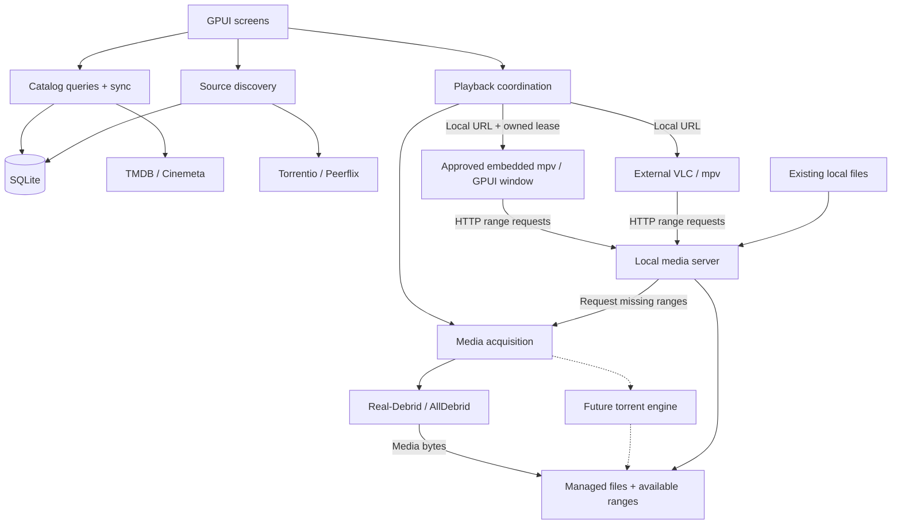

# Architecture

## What we are building

**Current state:** MVP source flows are composed in the Rust workspace,
using direct GPUI (`gpui-pre =0.3.9`) and `gpui_platform`. V3 is the sole/default
UI, with in-house widgets and no version switch or Kit dependency. It wires Cinemeta/TMDB browse/search/details
and episodes, source selection, settings/keyring actions, preparation/file choice,
managed-media sessions, local-file playback, manual cleanup, and quit confirmation.
The reported v4 source uses normalized canonical metadata and indexer rows, with
saved provider-specific search/page membership;
it is not arbitrary offline full-text search over all saved titles. The approved
provider-priority/enrichment revision below is in progress; automatic TTL refresh
remains undecided.

`kinema-core` holds pure validated values and policies; `kinema-desktop` owns UI,
provider/storage/process adapters, and background work. The last documented catalog baseline is
schema v6 with twelve normalized `STRICT` tables. V7 personal storage is now
source implemented: 15 `STRICT` tables, migration wiring and personal storage/query
operations, including frozen-season identity guards. Shared state/UI integration
is implemented and lead-reviewed. Root/feature checks and Linux synthetic captures
provide scoped validation, not full MVP or cross-platform acceptance; see the
[Library evidence](development.md#library-and-manual-watch-tracking-validation-pending). Its transactional retirement
migration removes the seven obsolete provider-cache tables with explicit user
authorization to discard old-only cached results; normalized catalog data remains.
Fresh databases create only the normalized schema. Metadata/indexer paths
read and write canonical rows under the
[approved catalog design](catalog-schema.md#target-catalog-schema). The rich domain
API exposes artwork, ratings, identifiers, seasons/episodes, and provenance, but
native display projections now retain optional artwork/IMDb/facts through shared
display DTOs, but do not render a full per-field provenance inspector.
The historical bounded-memory backfill and field-quality checkpoint passed root fmt,
strict locked workspace Clippy, locked tests (295 passed, 3 ignored), and diff checks. Those historical checks did not access a user database or credentials. The later
schema review inspected the development database read-only; migration tests use
synthetic databases. A user's database upgrades only when next opened with the new build. See the
[conservative backfill limits](catalog-schema.md#conservative-v3-preservation-and-backfill-limits).

**Not complete acceptance:** source wiring and reported subsystem fixtures/local
server + isolated mpv smoke checks do not establish live authenticated TMDB/debrid
playback, a successful full GUI workflow, or runtime support on all desktops.
Current post-correction root checks passed. Public Cinemeta checks used a temporary
v4 database; credential-free TMDB transport reached expected HTTP 401. Post-v4
authenticated-provider/debrid and new GUI acceptance remain unverified. Historical
user-reported successes do not establish current-version acceptance. See the
[quickstart](development.md#quickstart-and-setup) and
[validation matrix](development.md#validation-status-and-limits). The diagram
below remains a responsibility model, not a claim that every target policy is done.

Kinema Next is a local-first movie and TV-series application written in Rust with GPUI. It targets **Windows, macOS, and Linux from the first release**, without KDE dependencies.

### Agreed MVP

- Browse/search a locally cached movie and episode catalog. Both Cinemeta and TMDB are required now; TMDB is not deferred.
- Find and select sources through Torrentio and Peerflix.
- Integrate debrid services, targeting Real-Debrid and AllDebrid.
- Download media into managed local storage and serve it through Kinema's media server while downloading.
- Play local server URLs, including served existing local files. The previous external-only MVP is superseded by the approved embedded-mpv default below; retain external VLC and standalone mpv. The server is loopback-only; LAN access is excluded.
- Cache metadata and indexer results; show last-update times and provide force-refresh.
- Enforce a user-configurable media-cache limit, defaulting to 20 GiB. Warn and offer to increase it when one file exceeds the limit. See [storage policy](storage-layout.md#limits-and-cleanup) for remaining choices.

**Source implemented and reviewed; scoped validation passed:** local personal Library membership and
manual movie/episode watched state, independent of membership, with a Library-only
landing scope. See the [Library contract](design/library.md) and
[schema v7](catalog-schema.md#personal-library-and-manual-watch-state-proposed-schema-v7).
Poster membership controls are always top-right (SERIES below); movie hero actions
include membership/watch, show hero membership, and episode stills watch controls.
Detail actions do not depend on entry point. Show summaries derive conservatively
from canonical episodes and locally persisted completeness evidence, not a stored
whole-show flag. Unknown/empty listings never imply watched. AppCoordinator owns
shared snapshots; the existing catalog worker owns serialized durable mutations,
separate from replaceable metadata work. Personal rows and referenced entities
survive cache cleanup; deleting the same catalog database loses personal records.
Lead-reviewed source tests include worker durability, failed writes, identity/revision
handling and local acquisition/fallback; reviewed Linux captures cover Library,
movie and series controls, including keyboard focus. Full live-provider/playback
and Windows/macOS acceptance remain unverified.

**Later:** watch history, automatic watch tracking and tracked persistent resume,
download pause/prefetch suspension, and a built-in torrent engine. Manual inactive-only media cleanup is sufficient for the MVP; active eviction is excluded. Mobile support is only a future possibility.

Provider catalog membership is not personal Library membership. The approved
personal records extend the same database, not the provider page cache. Media
downloading and playback completion are never proof that someone watched it.

## Approved embedded-player direction

**Source implemented; scoped Linux presentation and root checks passed, full acceptance pending.**
The original backend crate import, embedded default and three ordinary settings choices
(embedded mpv, external mpv, VLC), managed-window code, close/lease release,
retry, and stale-event logic are implemented. Backend native synthetic checks
and scoped integration tests passed as reviewed by the lead. Root checks passed
(477 tests, 11 ignored), as did full desktop `ui-probe-test` checks (447 tests,
4 ignored). Native Wayland and isolated Xvfb probes establish scoped GPUI video
presentation, not full-provider, cross-platform, or performance acceptance. Final
backend review added explicit script/OSC/OSD disabling; post-change root/native
reruns passed. Native no-Lua builds are not runtime-qualified; missing-option
classification has pure-test coverage only. See the [validation evidence](design/player.md#validation-evidence-lead-reviewed).

Embedded mpv uses the GPU-surface path as its sole/default renderer, enabled by
the default Cargo feature `gpu-surface`. Playback opens an independent
Kinema-managed GPUI window, not a pane in the browser or an external mpv process.
This default-on policy is not release readiness or new platform qualification.
External mpv and VLC remain explicit alternatives with their existing lifetime
policy. See the [player design](design/player.md) for chrome, controls, states,
ownership, and acceptance requirements.

The backend was imported from `/home/tlm/Projects/Random/mpv-gpui` into
`kinema-mpv` without modifying that source experiment at import time. Keep native libmpv loading,
commands, events, decoding/render workers, and resource teardown behind that
backend boundary; the desktop owns the GPUI view, window, Cinema tokens, and
session coordination. Do not import the experiment's GPUI 0.2.2 view or introduce
a second engine: desktop presentation uses only pinned `gpui-pre =0.3.9` and
`gpui_platform`. Domain policies remain in `kinema-core`.

Embedded playback consumes the same loopback media-server lease boundary as
external playback, never upstream debrid URLs. Each embedded window owns one
lease; replay of that lease focuses its existing window rather than creating
another embedded owner. External replay can share a lease, so playback instances
and leases are not interchangeable. The implemented replay guard remembers the
original player choice per session: changed preferences apply to new sessions,
and replay retains its original backend. An externally used lease is not converted
to embedded ownership based only on a settings change. No alternate new-lease
switching is claimed.
Closing an embedded window stops its decoder
and releases its lease exactly once; acquisition cancellation occurs only when
the final lease for the asset is released. A media session is a lease; multiple
leases can share an asset. Other leases and assets survive.
User pause is decoder intent, not download pause or prefetch suspension. Buffering
is observed media starvation, not evidence that the user paused. No tracked
persistent resume/history is added in this increment.

Native libmpv must be supplied separately and dynamically loaded; an mpv executable
alone is insufficient. Library/API/dependency failures must be actionable, without
silent installation or silent external fallback. Dynamic loading does not waive
libmpv/FFmpeg licensing obligations. See [native playback prerequisites and
validation limits](development.md#embedded-mpv-prerequisites-and-validation-plan).

### GPU-surface Embedded MPV — current default, prior scoped evidence

The GPU-surface path is promoted from the former fourth experimental option to
sole/default Embedded MPV. There is no separate experimental player choice or
ordinary readback-player fallback. External mpv and VLC remain unchanged explicit
alternatives. On load, the current Rust settings key `exp-embedded-mpv` normalizes
to Embedded MPV while preserving other preferences; explicit saves always write
`embedded-mpv`. Loading does not automatically rewrite settings on disk. This is
not migration of legacy C++ settings, databases, or keyring entries.
Missing compiled support or native capabilities must fail explicitly, not silently
select another renderer or player.

The historical anchor above is retained for links. The evidence below predates
this default promotion: it records prior scoped Linux SDR tests, not fresh
qualification of the default-on build. HDR and native Windows/macOS runtime tests
remain deferred and unqualified; enabling a Cargo feature does not change that.

This is a rendering path in the existing `kinema-mpv::Player`, using the same
libmpv client, control/audio workers, session/lease rules and managed player
window—not the standalone experiment's `Producer`, a second libmpv client, or a
parallel playback subsystem. A separate bounded GPU-surface mailbox retains
native frame owners; cancellation, generation rejection and teardown remain
owned by the existing player lifecycle. Desktop presents surfaces and controls;
`kinema-core` remains pure. Native interop/unsafe code stays behind the backend
boundary, not in domain or desktop UI code. GPU-surface playback must reject
missing capabilities or decoder evidence rather than use rendered-frame CPU
readback/re-upload or an automatic alternate player.

Source implementation includes three native paths:
- Linux: port of the qualified standalone GL/external-memory Vulkan-buffer bridge
  into the real player, using GPUI's actual WGPU device/queue.
- Windows: ANGLE GL through D3D11On12 on GPUI's actual D3D12 device/queue, with GPU
  copying into the presentation texture; native DLL/extension/device checks are
  required, not an invented libmpv D3D12 render API.
- macOS: legacy CGL rendering into IOSurface-backed CVPixelBuffer ownership,
  presented through GPUI's Apple BGRA surface path, not a WGPU/Vulkan assumption.

The root workspace uses durable vendored patches for `gpui-pre`, `gpui-pre-wgpu`,
`gpui-pre-apple`, `wgpu-hal`, and `gpui-pre-windows`; root Cargo patch configuration
and the lockfile own their resolution. Run `cargo run -p kinema-desktop --locked`
from the repository root without generating an isolated wrapper workspace.
The former real-app wrapper is retired; its [historical qualification record](validation/gpu-surface-qualification.md)
is evidence, not a default-build prerequisite. [Patch API and synchronization notes](../vendor/patches/README.md)
describe the durable patches. Registry sources are not
edited. The patches cover surface presentation, multiwindow/shared-queue gating,
and Windows' WGPU HWND/D3D12 adapter. Windows GPUI's prior native D3D11 renderer
was not already WGPU; native D3D11 remains for glyph rasterization, not video CPU
pixel mapping. See [current build instructions](development.md#run-and-validate).

**Prior scoped evidence boundaries (not a new default-build test run):** the [archived standalone qualification](validation/gpu-surface-qualification.md)
combines ten-second Linux Intel Mesa resize-stress runs and separate native pixel
tests for H.264 8-bit, HEVC 8/10-bit, and AV1 8/10-bit, each at 1080p and 4K,
24-fps limited-range BT.709 SDR. It does not validate the real-app port,
multiwindow/session behavior, sustained playback, physical presentation, HDR, or
Windows/macOS. The lead's later eight ignored native real-Player backend tests
all passed in 47.89 seconds: five 1080p codecs and controls, H.264 source switching
between 1080p/4K, three retained-frame backpressure/release, retained-frame lifetime
past Player teardown, concurrent experimental players on one supplied WGPU
device/queue, and coexistence with the ordinary EGL GPU-readback player including
close-survivor behavior. These are backend tests, not actual GPUI-window tests.
Playback had zero uncaptured WGPU errors; the lead's raw scan found zero VUID,
validation-error or UNASSIGNED-threading diagnostics. The corrected tests set the
required nonzero viewport before loading; the first all-eight failure was test
API misuse (zero viewport means suspended), not a claimed capability pass.

The latest native backend rerun at `203640b` with the five-patch GPUI snapshot
passed **all 8 in 48.43 seconds**, with zero raw VUID, validation-error or threading
matches. Backend feature tests passed 69 with 16 ignored. Final root fmt/strict
locked Clippy/tests passed **575 tests, 12 ignored**; the experimental workspace
passed fmt/strict locked Clippy/tests with **598 passed, 20 ignored** (lead).

Separately, the actual five-patch PlayerWindow passed three offline Linux probes:
H.264 8-bit 1080p (167 GPU surfaces / 165 UI acceptances), HEVC 10-bit 4K
(166/164), and AV1 10-bit 4K (165/163), with exact source/render dimensions. Each
had an 8-second total budget (7 playback + 1 cleanup), verified pause/seek/resume/
speed/volume phase 5, zero readback bytes/upload estimate, two requested/observed
player resizes, and two painted auxiliary GPUI windows including resize and
close/reopen while playing. Three-window behavior is therefore scoped-tested,
not a remaining multiwindow blocker. Presentation owners released, background
Player join was observed, no late frames arrived, and GPU errors/panics/raw VUID,
validation and threading matches were zero through window teardown.
See `target/kinema-gpu-app/gui-smoke-report.json` and the
[development evidence](development.md#experimental-gpu-player-integration--validation-pending)
for artifacts and attribution. No DB/settings/accounts/providers were opened.
These probes do not verify managed-download/provider workflows, audible audio
(fixtures have none), physical presentation or long-soak performance.

Windows/macOS backend and GPUI Windows HWND/macOS BGRA/Metal source cross-checks
passed, including owner-reported feature-on/off checks. These are compile-only,
not cross-OS qualification: native linking/runtime tests, native Metal shader
execution and HDR remain explicitly user-deferred. Device-loss recovery is
unsupported; cooperative audio pause is best-effort and uncertain completion
uses quarantine, not GPU-hang recovery. These historical probes used the isolated
wrapper's offline `run --probe`, not ordinary app/accounts. Current user launch is
`cargo run -p kinema-desktop --locked`; it is not an isolated validation fixture.
Use the root offline `ui-probe` PlayerWindow path described in the
[current scoped validation](development.md#gpu-surface-default-promotion--current-scoped-validation)
for fixture checks, not the retired wrapper.

## UI direction and historical implementation evidence

**Current authority:** [Desktop v3](design/desktop-v3.md) is the sole/default
Cinema dark/warm UI, using direct pinned GPUI and in-house widgets. The Graphite
and Kit records below are historical evidence, not current dependencies or
instructions; their checks do not validate the embedded-player increment.

The user approved the six-area UI feature scope and decided on a **permanent
left icon-only rail**, with no expanded-sidebar or top-navigation mode. The new
direction is a professional neutral Graphite theme with blue accents, not amber;
compact desktop spacing and a native font stack; polished primitive controls and
composable GPUI components; visible IMDb card ratings and hover/focus states;
purposeful motion; and lazy-loading/performance requirements.

The user **approved native Graphite implementation** and lead-owned commits.
The [design system](design/design-system.md) is the visual/state contract; the
[native implementation record](design/native-implementation.md) describes actual
shared themes/cards/buttons/grid sizing, fixed-rail shell/provider-view composition,
bounded artwork, safe gallery commands and remaining gaps. That historical implementation used pinned Kit reexports/components/assets/init/open_window;
current v3 must not restore Kit or introduce a second UI engine.

The **Graphite v2** [HTML artifact](design/desktop-wireframes.html) remains frozen
as a design-only reference, with its historical browser checks and simulated
performance preview. See the [review guide](design/README.md) for limits. Earlier
three-layout comparisons are superseded exploration, not supported modes. Native
approval is no longer pending. Final offline gallery captures were visually
inspected by the lead; serialized root checks passed **331 tests / 3 ignored**,
with **20** explicit feature passes (17 overlap + 3 GPUI tests) and **5** Node
passes. See [final evidence](design/native-implementation.md#final-validation-evidence).
Neither these fixtures nor HTML counters prove GPU/RAM bounds, OS support or
complete workflow acceptance.

Search/detail/sources cancellation and shared display facts are implemented, not
full rich/provenance UI acceptance. Preserve prior backend evidence as historical.
The approved Library extension above supersedes the historical library deferral;
history and other deferred work remain outside its scope.

## Agreed metadata-provider contract

**Decided 2026-10-21; implementation in progress in this change.** This supersedes
the selected-provider-only policy; it is not live-provider or UI verification.

- Cinemeta and TMDB implement one common provider interface with declared search,
  browse/discover, title-detail, season/episode, and external-ID lookup capabilities.
  Future providers (e.g. TVmaze/OMDb) use the same boundary. Adapters normalize output
  into `kinema-core::catalog_normalized::{TitleObservation, FieldValue,
  RatingObservation, ExternalIdentifier}` for local storage with per-field provenance.
- Settings replace the single `MetadataProvider` choice with an ordered provider
  priority list, reset to Cinemeta, TMDB without migration. The first enabled,
  active provider is PRIMARY for grid search/browse; the rest are ENRICHMENT.
  Providers missing required credentials are shown inactive and skipped, not errors.
  TMDB's bearer token stays in OS secure storage, not ordinary settings.
- Per field, the highest-priority provider with a value wins; lower-priority
  providers fill gaps. Within one provider newer wins, but summary does not replace
  detail. Unknowns stay nullable. Ratings retain separate source/metric/supplier
  rows; TMDB scores are never labelled IMDb.
- Details show the primary result first, then enrich fully from all enabled,
  active enrichment providers asynchronously. Work is owned, cancellable, and
  generation-checked; enrichment failures are quiet and non-fatal. Grid enrichment
  covers only visible cards and missing poster, year, rating, runtime, or genres,
  with bounded concurrency, catalog-based skipping of already enriched titles,
  and cancellation on scroll/query changes.
- Identity matching uses explicit external IDs only (IMDb mappings, TMDB
  find-by-IMDb / `external_ids`), never name/year guesses. Source lookup remains
  unavailable without IMDb mapping. The current TMDB locale is `en-US`;
  multi-locale storage remains open.
- Details use a footer such as “Data from TMDB and Cinemeta”, listing only actual
  contributors (“Data from Cinemeta” for one). No per-field provenance UI is
  planned. TMDB's required About attribution notice stays.

The [target specification](catalog-schema.md#target-catalog-schema) remains the
authority for identity, rating, and merge rules.

The user also approved narrow automatic transactional identity reconciliation when
explicit provider-supplied IMDb mapping proves duplicates without contradictory
external IDs or season/episode coordinates. Preserve metadata and references;
abort contradictions. This is not name/year matching or cache cleanup. The
[authoritative reconciliation policy](catalog-schema.md#approved-narrow-identity-reconciliation)
is approved, with backend-reported graph reconciliation and rollback coverage;
current root checks passed, while integrated UI acceptance remains pending.

The local catalog is the target primary read model. Owned, bounded background
work fetches missing/new details and enrichment on demand under the priority
policy above, rather than crawling the full catalog or adopting an automatic TTL. Current source paths use canonical rows; legacy
rows remain preserved with deliberately limited backfill, not guaranteed offline
reuse of every old query/detail/source snapshot.

This records the decision and implementation contract, not verified adapter/UI
behavior. [TMDB access and attribution](development.md#tmdb-access-and-attribution)
documents token/terms requirements and the official bundled logo; asset inclusion
does not establish verified adapter or About/Credits integration.

## How it fits together

This target-architecture diagram shows responsibilities and data flow, not separate processes or a list of implemented subsystems.

Players receive local server URLs, not upstream debrid URLs. The player decodes the video; the server delivers bytes. LAN sharing is excluded. Transcoding and a standalone daemon are not assumed requirements.

TMDB and Cinemeta supply metadata. IMDb IDs identify titles in much of the source workflow; there is no direct IMDb catalog integration. A title, a particular release/file, and an expiring playback link are different identities.

## Keep the implementation small

Use one application with these boundaries:

| Part | Responsibility |
| --- | --- |
| Presentation | GPUI views, navigation, loading/error states, and user actions |
| Application | Catalog sync, source lookup, acquisition, and playback coordination |
| Domain | Typed identities and pure rules such as episode/file selection |
| Adapters | Provider APIs, SQLite, filesystem, secure credentials, and OS integration |

Construct dependencies in one place. Keep GPUI, SQL, and provider response formats out of domain rules. Provider adapters should be easy to add or replace; runtime plugin loading is not needed to achieve that.

For the fuller sync design, start with a small in-memory queue, one SQLite worker, and bounded background work. No persisted job system, global event bus, or general plugin framework is needed. These are design directions, not additional subsystems required for the first catalog increment.

## Implemented worker lifetime limits

The catalog worker opens the backend lazily on its first request, not at startup;
a failed open is retried on the next explicit request. `kinema-catalog` is the sole
SQLite connection owner: it reads caches and validates identities before dispatch,
then persists validated fetch results and emits events. Four `kinema-fetch-N`
threads perform blocking HTTP and response parsing concurrently. Completed fetches
are served before new preparation. At most four jobs, including completions
awaiting persistence, are admitted; there is no unbounded fetch queue.

There are two search slots and sixteen metadata operation/kind/indexer slots,
served round-robin. Each holds at most one queued request; equivalent queued
requests coalesce and newer requests cancel obsolete work in the same slot.
Different slots can fetch concurrently. A replacement may start while its obsolete
fetch is still in flight when pool capacity is available. If all four threads are
busy, requests still wait for capacity (potentially the HTTP timeout). Cancellation
is exact-generation; cancelled results are discarded without persistence. Existing
transaction cancellation checks also guard entry/commit. The bounded event mailbox
holds at most two events per slot; screen generations additionally reject late
results. Cache-hit-then-refresh and successful empty results remain distinct from
service, credential, and storage failures.

Cinemeta and indexer HTTP clients are reused. TMDB retains one HTTP transport and
connection pool for the backend lifetime, independently of credential changes. Its
credential-bearing wrapper is shared across requests and retains a zeroizing secret.
Successful credential set/delete increments a process-wide generation; the next
preparation drops a stale cached credential/client and re-reads secure storage.
Authentication rejection also invalidates the cached client, including when an
obsolete fetch's result is discarded. Missing, denied, and unavailable credential
lookups remain distinct errors, not successful cached credentials. Redirects never
receive the TMDB bearer token (TMDB redirects are disabled).

An in-flight blocking HTTP call is **not cancelled**; only its result is discarded.
Cinemeta and TMDB have 10-second connect and 15-second total request timeouts;
responses are capped at 2 MiB and 500 page titles. Dropping the worker closes its
mailbox and cancels active work without joining either the SQLite thread or fetch
threads. The SQLite owner can exit without waiting for in-flight HTTP; fetch
threads exit after their current calls finish. A disconnected worker closes
requests and marks busy screens failed. This remains bounded blocking work, not
fully cancellable networking or an orderly joined shutdown.

## Target responsiveness and lifetime rules

- Read the local catalog first. Fetch missing/new details through owned, bounded, demand-driven work under the provider-priority/enrichment policy; keep usable data visible during explicit refresh. Automatic refresh timing remains open. See the [target catalog](catalog-schema.md#target-catalog-schema) and [cache policies](cache-policy.md).
- Keep SQL, network waits, image decoding, and blocking file operations outside UI rendering.
- Give background tasks an owner. Cancel obsolete work and reject late results using request/session generations; these solve different problems.
- Screen state belongs to its navigation entry. Closing a page must not stop an external player or remove files it is using.
- Prioritize interactive work, especially seek requests, over prefetch. Bound queues and buffers.
- On shutdown, stop accepting work, cancel requests, checkpoint media availability, and close resources in order. Follow the agreed session lifetime policy below.
- Distinguish empty results, unavailable services, missing credentials, and storage failures. Errors must not silently become “no data.”

### Agreed session lifetime policy

Navigation must not stop active sessions. Quitting or closing the main window with
active sessions requires a warning and explicit confirmation that Kinema's server
will stop. The external player remains open; it is not a child UI session that
Kinema closes. There is no daemon keeping the server alive after exit. This is an
agreed requirement. The shell now wires confirmation for tracked active sessions
and pending playback launch; live UI/OS-close acceptance is still required.

The approved embedded window has a separate lifetime: closing it tears down its
player and releases its owned lease, not the application. Confirmed application
quit must tear down embedded players before their server resources disappear.
This does not change external-player close policy; Kinema does not infer external
closure from silence or kill external players. Cancelling quit retains windows,
leases, and sessions. Embedded source integration is implemented; actual GPUI
presentation has scoped Linux probe evidence; full OS-close acceptance remains pending.

External launch success and HTTP traffic do not establish playing/paused/completed
state. Any future automatic watch tracking would require real player telemetry;
the approved manual tracking increment does not use it or infer completion.

## Desktop support and security

Use native adapters or maintained cross-platform libraries for application directories, secure credential storage, player discovery/launch, and optional desktop features. Store secrets in the OS secure store, never settings, SQLite, manifests, or logs. Launch players with argument lists, not constructed shell commands.

Test on all three desktops throughout development. Pay particular attention to Unicode paths, file locks/deletion, secure-store errors, player reconnects, and GPUI window/rendering behavior; test Wayland/X11 on Linux. Minimum OS versions, architectures, packaging, and optional integrations remain open. The desktop pins direct GPUI 0.3.9; native compilation alone does not establish runtime desktop support.

## What we learned from the old application

Keep explicit composition, stable content identity, player/source boundaries, pure policies, and stale-response tests. Avoid shared detail state being overwritten by navigation, blocking work on the UI path, detached tasks without lifecycle rules, and database failures disguised as empty collections.

The [feature inventory](features.md) links to the reference implementation. These are source-level findings, not measured performance claims.

## Remaining end-to-end MVP slice

Select a movie, find a source, resolve it through one debrid provider, download into managed storage, and play the local URL in the approved embedded
window, with external VLC/mpv alternatives retained. Test seeking to missing bytes, repeated local metadata reads, interrupted downloads, refresh failures, and cache exhaustion on all desktop targets. Then cover episodes and both indexers before calling the MVP complete.

Measure UI stalls, result latency, seek recovery, startup, memory, and disk usage. Use those results to justify complexity—not assumptions that rewriting in Rust automatically makes the application faster.
