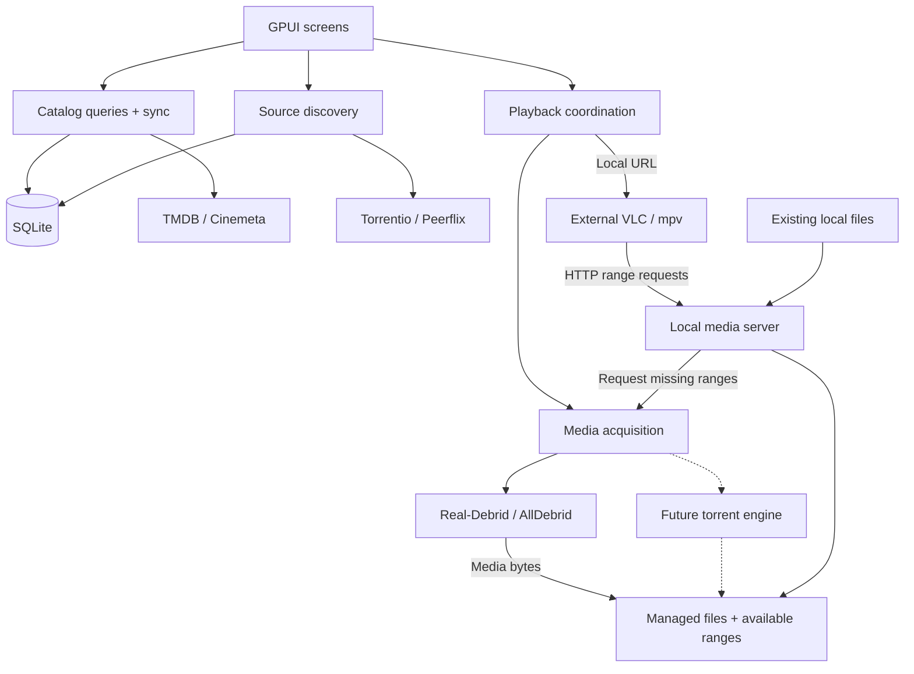

# Architecture

## What we are building

**Current state:** the first bounded catalog increment is implemented in the
two-crate Rust workspace, using official GPUI Kit 0.7.3. Movies and Series have
explicit Cinemeta search with SQLite saved exact-query membership, fetch-on-miss,
and manual Refresh. This is a query-result cache, not offline text search over all
saved titles, discovery/catalog browsing, or detail/episode sync. The UI distinguishes loading, saved/fetched results, empty results,
and errors, and displays last-success timestamps as UTC Unix seconds. This is
source-level status, not test or GUI-runtime verification. See
[development](development.md) for setup and validation.

`kinema-core` holds validated catalog values and pure rules. `kinema-desktop`
contains the UI and blocking Cinemeta/SQLite adapter, executed on an owned worker
thread outside rendering. Each media kind retains independent search state.
The [actual cache subset](catalog-schema.md#implemented-first-increment) is not the
full proposed catalog schema. [Current refresh behavior](cache-policy.md#implemented-first-increment)
does not adopt automatic TTLs or a global provider preference/fallback.

Source discovery, debrid, managed media acquisition/storage, the media server,
and external VLC/mpv playback remain unimplemented. The flows below describe the
target architecture, not completed end-to-end behavior.

Kinema Next is a local-first movie and TV-series application written in Rust with GPUI. It targets **Windows, macOS, and Linux from the first release**, without KDE dependencies.

### Agreed MVP

- Browse/search a locally cached movie and episode catalog, using TMDB/Cinemeta metadata.
- Find and select sources through Torrentio and Peerflix.
- Integrate debrid services, targeting Real-Debrid and AllDebrid.
- Download media into managed local storage and serve it through Kinema's media server while downloading.
- Open local server URLs in external VLC or standalone mpv. Also serve existing local files.
- Cache metadata and indexer results; show last-update times and provide force-refresh.
- Enforce a user-configurable media-cache limit. Warn and offer to increase it when one file exceeds the limit.

**Later:** personalized library membership, watch history/progress and tracked resume, embedded playback, and a built-in torrent engine. Rolling cache eviction is optional, not required for the MVP. Mobile support is only a future possibility.

The catalog is not a personalized library. Media downloading is not proof that someone watched it.

## How it fits together

This target-architecture diagram shows responsibilities and data flow, not separate processes or a list of implemented subsystems.

Players receive local server URLs, not upstream debrid URLs. The player decodes the video; the server delivers bytes. Transcoding, LAN sharing, and a standalone daemon are not assumed requirements.

TMDB and Cinemeta supply metadata. IMDb IDs identify titles in much of the source workflow; there is no direct IMDb catalog integration. A title, a particular release/file, and an expiring playback link are different identities.

## Keep the implementation small

Use one application with these boundaries:

| Part | Responsibility |
| --- | --- |
| Presentation | GPUI views, navigation, loading/error states, and user actions |
| Application | Catalog sync, source lookup, acquisition, and playback coordination |
| Domain | Typed identities and pure rules such as episode/file selection |
| Adapters | Provider APIs, SQLite, filesystem, secure credentials, and OS integration |

Construct dependencies in one place. Keep GPUI, SQL, and provider response formats out of domain rules. Provider adapters should be easy to add or replace; runtime plugin loading is not needed to achieve that.

For the fuller sync design, start with a small in-memory queue, one SQLite worker, and bounded background work. No persisted job system, global event bus, or general plugin framework is needed. These are design directions, not additional subsystems required for the first catalog increment.

## Implemented worker lifetime limits

The catalog worker opens the backend lazily on its first request, not at startup;
a failed open is retried on the next explicit request. It accepts at most one
queued request per media kind, served round-robin; newer work replaces obsolete
queued work, and equivalent queued requests coalesce. The event mailbox is bounded
to two events per kind. Screen generations reject late results. A disconnected
worker closes requests and marks busy screens failed. A blocking HTTP call already in flight is **not
cancelled**: the client has a 5-second connect timeout and 15-second total request
timeout. Responses are capped at 2 MiB and 500 titles; the UI draws at most 200 rows.
Dropping the worker closes its mailbox without joining the thread, so the UI does
not wait for that HTTP timeout; the worker exits after its current call completes.
This is bounded blocking work, not fully cancellable networking or an orderly
joined shutdown. Obsolete in-flight work can still finish and save a cache result.

## Target responsiveness and lifetime rules

- Read local data first. Fetch missing data; proposed background refresh keeps stale-but-usable results visible. See [catalog sync](catalog-schema.md) and [cache policies](cache-policy.md).
- Keep SQL, network waits, image decoding, and blocking file operations outside UI rendering.
- Give background tasks an owner. Cancel obsolete work and reject late results using request/session generations; these solve different problems.
- Screen state belongs to its navigation entry. Closing a page must not stop an external player or remove files it is using.
- Prioritize interactive work, especially seek requests, over prefetch. Bound queues and buffers.
- On shutdown, stop accepting work, cancel requests, checkpoint media availability, and close resources in order. External-player/server lifetime needs an explicit policy.
- Distinguish empty results, unavailable services, missing credentials, and storage failures. Errors must not silently become “no data.”

External launch success and HTTP traffic do not establish playing/paused/completed state. Real player telemetry will be needed when watch tracking is introduced.

## Desktop support and security

Use native adapters or maintained cross-platform libraries for application directories, secure credential storage, player discovery/launch, and optional desktop features. Store secrets in the OS secure store, never settings, SQLite, manifests, or logs. Launch players with argument lists, not constructed shell commands.

Test on all three desktops throughout development. Pay particular attention to Unicode paths, file locks/deletion, secure-store errors, player reconnects, and GPUI window/rendering behavior; test Wayland/X11 on Linux. Minimum OS versions, architectures, packaging, and optional integrations remain open. The shell pins GPUI Kit 0.7.3 and uses its GPUI reexports; native compilation alone does not establish runtime desktop support.

## What we learned from the old application

Keep explicit composition, stable content identity, player/source boundaries, pure policies, and stale-response tests. Avoid shared detail state being overwritten by navigation, blocking work on the UI path, detached tasks without lifecycle rules, and database failures disguised as empty collections.

The [feature inventory](features.md) links to the reference implementation. These are source-level findings, not measured performance claims.

## Remaining end-to-end MVP slice

Select a movie, find a source, resolve it through one debrid provider, download into managed storage, and launch VLC/mpv with the local URL. Test seeking to missing bytes, repeated local metadata reads, interrupted downloads, refresh failures, and cache exhaustion on all desktop targets. Then cover episodes and both indexers before calling the MVP complete.

Measure UI stalls, result latency, seek recovery, startup, memory, and disk usage. Use those results to justify complexity—not assumptions that rewriting in Rust automatically makes the application faster.
