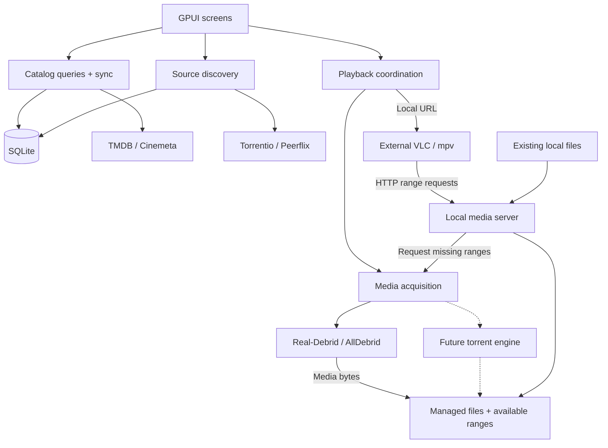

# Architecture

## What we are building

**Current state:** MVP source flows are composed in the two-crate Rust workspace,
using direct GPUI (`gpui-pre =0.3.9`) and `gpui_platform`. V3 is the sole/default
UI, with in-house widgets and no version switch or Kit dependency. It wires Cinemeta/TMDB browse/search/details
and episodes, source selection, settings/keyring actions, preparation/file choice,
managed-media sessions, local-file playback, manual cleanup, and quit confirmation.
The reported v4 source uses normalized canonical metadata and indexer rows, with
saved provider-specific search/page membership;
it is not arbitrary offline full-text search over all saved titles. The approved
provider-priority/enrichment revision below is in progress; automatic TTL refresh
remains undecided.

`kinema-core` holds pure validated values and policies; `kinema-desktop` owns UI,
provider/storage/process adapters, and background work. Backend-owner evidence
reports `SCHEMA_VERSION = 4`: twelve normalized `STRICT` tables plus seven retained
legacy tables, with atomic schema/backfill/version upgrade. Metadata/indexer paths
now read and write canonical rows under the
[approved catalog design](catalog-schema.md#target-catalog-schema). The rich domain
API exposes artwork, ratings, identifiers, seasons/episodes, and provenance, but
native display projections now retain optional artwork/IMDb/facts through shared
display DTOs, but do not render a full per-field provenance inspector.
The historical bounded-memory backfill and field-quality checkpoint passed root fmt,
strict locked workspace Clippy, locked tests (295 passed, 3 ignored), and diff checks. No user database or credentials were accessed.
A user's v3 database upgrades only when next opened with the new build. See the
[conservative backfill limits](catalog-schema.md#conservative-v3-preservation-and-backfill-limits).

**Not complete acceptance:** source wiring and reported subsystem fixtures/local
server + isolated mpv smoke checks do not establish live authenticated TMDB/debrid
playback, a successful full GUI workflow, or runtime support on all desktops.
Current post-correction root checks passed. Public Cinemeta checks used a temporary
v4 database; credential-free TMDB transport reached expected HTTP 401. Post-v4
authenticated-provider/debrid and new GUI acceptance remain unverified. Historical
user-reported successes do not establish current-version acceptance. See the
[quickstart](development.md#quickstart-and-setup) and
[validation matrix](development.md#validation-status-and-limits). The diagram
below remains a responsibility model, not a claim that every target policy is done.

Kinema Next is a local-first movie and TV-series application written in Rust with GPUI. It targets **Windows, macOS, and Linux from the first release**, without KDE dependencies.

### Agreed MVP

- Browse/search a locally cached movie and episode catalog. Both Cinemeta and TMDB are required now; TMDB is not deferred.
- Find and select sources through Torrentio and Peerflix.
- Integrate debrid services, targeting Real-Debrid and AllDebrid.
- Download media into managed local storage and serve it through Kinema's media server while downloading.
- Open local server URLs in external VLC or standalone mpv. Also serve existing local files. The server is loopback-only; LAN access is excluded.
- Cache metadata and indexer results; show last-update times and provide force-refresh.
- Enforce a user-configurable media-cache limit, defaulting to 20 GiB. Warn and offer to increase it when one file exceeds the limit. See [storage policy](storage-layout.md#limits-and-cleanup) for remaining choices.

**Later:** personalized library membership, watch history/progress and tracked resume, embedded playback, and a built-in torrent engine. Manual inactive-only media cleanup is sufficient for the MVP; active eviction is excluded. Mobile support is only a future possibility.

The catalog is not a personalized library. Media downloading is not proof that someone watched it.

## Approved UI direction and current work

The user approved the six-area UI feature scope and decided on a **permanent
left icon-only rail**, with no expanded-sidebar or top-navigation mode. The new
direction is a professional neutral Graphite theme with blue accents, not amber;
compact desktop spacing and a native font stack; polished primitive controls and
composable GPUI components; visible IMDb card ratings and hover/focus states;
purposeful motion; and lazy-loading/performance requirements.

The user **approved native Graphite implementation** and lead-owned commits.
The [design system](design/design-system.md) is the visual/state contract; the
[native implementation record](design/native-implementation.md) describes actual
shared themes/cards/buttons/grid sizing, fixed-rail shell/provider-view composition,
bounded artwork, safe gallery commands and remaining gaps. Use only pinned
Kit reexports/components/assets/init/open_window, not a second UI engine.

The **Graphite v2** [HTML artifact](design/desktop-wireframes.html) remains frozen
as a design-only reference, with its historical browser checks and simulated
performance preview. See the [review guide](design/README.md) for limits. Earlier
three-layout comparisons are superseded exploration, not supported modes. Native
approval is no longer pending. Final offline gallery captures were visually
inspected by the lead; serialized root checks passed **331 tests / 3 ignored**,
with **20** explicit feature passes (17 overlap + 3 GPUI tests) and **5** Node
passes. See [final evidence](design/native-implementation.md#final-validation-evidence).
Neither these fixtures nor HTML counters prove GPU/RAM bounds, OS support or
complete workflow acceptance.

Search/detail/sources cancellation and shared display facts are implemented, not
full rich/provenance UI acceptance. Preserve prior backend evidence as historical.
Do not expand the six-area scope into later library/history or other deferred work.

## Agreed metadata-provider contract

**Decided 2026-10-21; implementation in progress in this change.** This supersedes
the selected-provider-only policy; it is not live-provider or UI verification.

- Cinemeta and TMDB implement one common provider interface with declared search,
  browse/discover, title-detail, season/episode, and external-ID lookup capabilities.
  Future providers (e.g. TVmaze/OMDb) use the same boundary. Adapters normalize output
  into `kinema-core::catalog_normalized::{TitleObservation, FieldValue,
  RatingObservation, ExternalIdentifier}` for local storage with per-field provenance.
- Settings replace the single `MetadataProvider` choice with an ordered provider
  priority list, reset to Cinemeta, TMDB without migration. The first enabled,
  active provider is PRIMARY for grid search/browse; the rest are ENRICHMENT.
  Providers missing required credentials are shown inactive and skipped, not errors.
  TMDB's bearer token stays in OS secure storage, not ordinary settings.
- Per field, the highest-priority provider with a value wins; lower-priority
  providers fill gaps. Within one provider newer wins, but summary does not replace
  detail. Unknowns stay nullable. Ratings retain separate source/metric/supplier
  rows; TMDB scores are never labelled IMDb.
- Details show the primary result first, then enrich fully from all enabled,
  active enrichment providers asynchronously. Work is owned, cancellable, and
  generation-checked; enrichment failures are quiet and non-fatal. Grid enrichment
  covers only visible cards and missing poster, year, rating, runtime, or genres,
  with bounded concurrency, catalog-based skipping of already enriched titles,
  and cancellation on scroll/query changes.
- Identity matching uses explicit external IDs only (IMDb mappings, TMDB
  find-by-IMDb / `external_ids`), never name/year guesses. Source lookup remains
  unavailable without IMDb mapping. The current TMDB locale is `en-US`;
  multi-locale storage remains open.
- Details use a footer such as “Data from TMDB and Cinemeta”, listing only actual
  contributors (“Data from Cinemeta” for one). No per-field provenance UI is
  planned. TMDB's required About attribution notice stays.

The [target specification](catalog-schema.md#target-catalog-schema) remains the
authority for identity, rating, and merge rules.

The user also approved narrow automatic transactional identity reconciliation when
explicit provider-supplied IMDb mapping proves duplicates without contradictory
external IDs or season/episode coordinates. Preserve metadata and references;
abort contradictions. This is not name/year matching or cache cleanup. The
[authoritative reconciliation policy](catalog-schema.md#approved-narrow-identity-reconciliation)
is approved, with backend-reported graph reconciliation and rollback coverage;
current root checks passed, while integrated UI acceptance remains pending.

The local catalog is the target primary read model. Owned, bounded background
work fetches missing/new details and enrichment on demand under the priority
policy above, rather than crawling the full catalog or adopting an automatic TTL. Current source paths use canonical rows; legacy
rows remain preserved with deliberately limited backfill, not guaranteed offline
reuse of every old query/detail/source snapshot.

This records the decision and implementation contract, not verified adapter/UI
behavior. [TMDB access and attribution](development.md#tmdb-access-and-attribution)
documents token/terms requirements and the official bundled logo; asset inclusion
does not establish verified adapter or About/Credits integration.

## How it fits together

This target-architecture diagram shows responsibilities and data flow, not separate processes or a list of implemented subsystems.

Players receive local server URLs, not upstream debrid URLs. The player decodes the video; the server delivers bytes. LAN sharing is excluded. Transcoding and a standalone daemon are not assumed requirements.

TMDB and Cinemeta supply metadata. IMDb IDs identify titles in much of the source workflow; there is no direct IMDb catalog integration. A title, a particular release/file, and an expiring playback link are different identities.

## Keep the implementation small

Use one application with these boundaries:

| Part | Responsibility |
| --- | --- |
| Presentation | GPUI views, navigation, loading/error states, and user actions |
| Application | Catalog sync, source lookup, acquisition, and playback coordination |
| Domain | Typed identities and pure rules such as episode/file selection |
| Adapters | Provider APIs, SQLite, filesystem, secure credentials, and OS integration |

Construct dependencies in one place. Keep GPUI, SQL, and provider response formats out of domain rules. Provider adapters should be easy to add or replace; runtime plugin loading is not needed to achieve that.

For the fuller sync design, start with a small in-memory queue, one SQLite worker, and bounded background work. No persisted job system, global event bus, or general plugin framework is needed. These are design directions, not additional subsystems required for the first catalog increment.

## Implemented worker lifetime limits

The catalog worker opens the backend lazily on its first request, not at startup;
a failed open is retried on the next explicit request. `kinema-catalog` is the sole
SQLite connection owner: it reads caches and validates identities before dispatch,
then persists validated fetch results and emits events. Four `kinema-fetch-N`
threads perform blocking HTTP and response parsing concurrently. Completed fetches
are served before new preparation. At most four jobs, including completions
awaiting persistence, are admitted; there is no unbounded fetch queue.

There are two search slots and sixteen metadata operation/kind/indexer slots,
served round-robin. Each holds at most one queued request; equivalent queued
requests coalesce and newer requests cancel obsolete work in the same slot.
Different slots can fetch concurrently. A replacement may start while its obsolete
fetch is still in flight when pool capacity is available. If all four threads are
busy, requests still wait for capacity (potentially the HTTP timeout). Cancellation
is exact-generation; cancelled results are discarded without persistence. Existing
transaction cancellation checks also guard entry/commit. The bounded event mailbox
holds at most two events per slot; screen generations additionally reject late
results. Cache-hit-then-refresh and successful empty results remain distinct from
service, credential, and storage failures.

Cinemeta and indexer HTTP clients are reused. TMDB retains one HTTP transport and
connection pool for the backend lifetime, independently of credential changes. Its
credential-bearing wrapper is shared across requests and retains a zeroizing secret.
Successful credential set/delete increments a process-wide generation; the next
preparation drops a stale cached credential/client and re-reads secure storage.
Authentication rejection also invalidates the cached client, including when an
obsolete fetch's result is discarded. Missing, denied, and unavailable credential
lookups remain distinct errors, not successful cached credentials. Redirects never
receive the TMDB bearer token (TMDB redirects are disabled).

An in-flight blocking HTTP call is **not cancelled**; only its result is discarded.
Cinemeta and TMDB have 10-second connect and 15-second total request timeouts;
responses are capped at 2 MiB and 500 page titles. Dropping the worker closes its
mailbox and cancels active work without joining either the SQLite thread or fetch
threads. The SQLite owner can exit without waiting for in-flight HTTP; fetch
threads exit after their current calls finish. A disconnected worker closes
requests and marks busy screens failed. This remains bounded blocking work, not
fully cancellable networking or an orderly joined shutdown.

## Target responsiveness and lifetime rules

- Read the local catalog first. Fetch missing/new details through owned, bounded, demand-driven work under the provider-priority/enrichment policy; keep usable data visible during explicit refresh. Automatic refresh timing remains open. See the [target catalog](catalog-schema.md#target-catalog-schema) and [cache policies](cache-policy.md).
- Keep SQL, network waits, image decoding, and blocking file operations outside UI rendering.
- Give background tasks an owner. Cancel obsolete work and reject late results using request/session generations; these solve different problems.
- Screen state belongs to its navigation entry. Closing a page must not stop an external player or remove files it is using.
- Prioritize interactive work, especially seek requests, over prefetch. Bound queues and buffers.
- On shutdown, stop accepting work, cancel requests, checkpoint media availability, and close resources in order. Follow the agreed session lifetime policy below.
- Distinguish empty results, unavailable services, missing credentials, and storage failures. Errors must not silently become “no data.”

### Agreed session lifetime policy

Navigation must not stop active sessions. Quitting or closing the window with
active sessions requires a warning and explicit confirmation that Kinema's server
will stop. The external player remains open; it is not a child UI session that
Kinema closes. There is no daemon keeping the server alive after exit. This is an
agreed requirement. The shell now wires confirmation for tracked active sessions
and pending playback launch; live UI/OS-close acceptance is still required.

External launch success and HTTP traffic do not establish playing/paused/completed state. Real player telemetry will be needed when watch tracking is introduced.

## Desktop support and security

Use native adapters or maintained cross-platform libraries for application directories, secure credential storage, player discovery/launch, and optional desktop features. Store secrets in the OS secure store, never settings, SQLite, manifests, or logs. Launch players with argument lists, not constructed shell commands.

Test on all three desktops throughout development. Pay particular attention to Unicode paths, file locks/deletion, secure-store errors, player reconnects, and GPUI window/rendering behavior; test Wayland/X11 on Linux. Minimum OS versions, architectures, packaging, and optional integrations remain open. The desktop pins direct GPUI 0.3.9; native compilation alone does not establish runtime desktop support.

## What we learned from the old application

Keep explicit composition, stable content identity, player/source boundaries, pure policies, and stale-response tests. Avoid shared detail state being overwritten by navigation, blocking work on the UI path, detached tasks without lifecycle rules, and database failures disguised as empty collections.

The [feature inventory](features.md) links to the reference implementation. These are source-level findings, not measured performance claims.

## Remaining end-to-end MVP slice

Select a movie, find a source, resolve it through one debrid provider, download into managed storage, and launch VLC/mpv with the local URL. Test seeking to missing bytes, repeated local metadata reads, interrupted downloads, refresh failures, and cache exhaustion on all desktop targets. Then cover episodes and both indexers before calling the MVP complete.

Measure UI stalls, result latency, seek recovery, startup, memory, and disk usage. Use those results to justify complexity—not assumptions that rewriting in Rust automatically makes the application faster.
