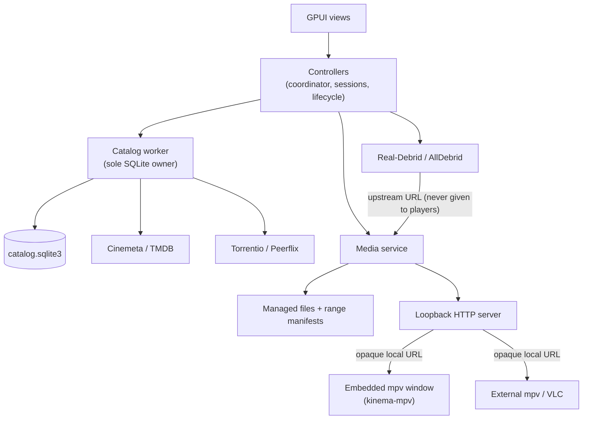

# Architecture

This section explains how Kinema is built and why. It records the principles and
decisions that should shape new work. Read it before you add a subsystem, a
dependency, a table or a component. It is not a code walkthrough: the source and
its doc comments own the details.

| Page | Read it when you are… |
| --- | --- |
| [Principles](#principles) and [change risk](#change-risk) (below) | Making any design decision |
| [Glossary](glossary.md) | Meeting a project term (lease, presence, enrichment, generation…) |
| [Runtime and concurrency](runtime.md) | Adding background work, a worker, a window or a lifetime rule |
| [Data and caching](data.md) | Touching SQLite, migrations, personal records, artwork or file locations |
| [Providers and credentials](providers.md) | Adding or changing metadata, indexer or debrid integrations, secrets or logging |
| [Media storage and serving](media.md) | Changing downloads, quota, cleanup or the loopback server |
| [Playback](playback.md) | Working on embedded mpv, external players, progress/resume or OS integration |
| [UI](ui.md) | Changing screens, navigation, interaction or accessibility behavior |
| [Design system](design-system.md) | Writing any UI code: tokens, layers, components, motion (strict rules) |
| [Brand](brand.md) | Editing the logo, app icons or tray icons |
| [Development](development.md) | Building, running, testing, CI, vendored patches, packaging |

New ideas that are not built or decided yet go in [proposals](../proposals/README.md).

## What Kinema is

Kinema is a local-first desktop app for movies and TV series, written in Rust with
GPUI. It targets Windows, macOS and Linux and has no KDE dependencies. You browse a
locally cached catalog (Cinemeta and TMDB), find sources (Torrentio or Peerflix),
resolve them through a debrid service (Real-Debrid or AllDebrid), download into
managed storage, and play from a loopback server. Playback uses the embedded mpv
window by default, or external mpv/VLC. A personal Library tracks membership,
watched state and resume progress.

The project is pre-1.0. Linux is the only platform with hands-on testing. Windows
and macOS compile and pass unit tests in CI, but their runtime behavior is not
qualified.

## Workspace

| Crate | Owns | Must not contain |
| --- | --- | --- |
| `kinema-core` | Pure, validated domain values and policies: identities, catalog observations and merge rules, source and file selection, byte ranges, library and watch-progress rules | GPUI, SQL, HTTP, filesystem, threads |
| `kinema-desktop` | GPUI presentation (`ui/`), orchestration (`controllers/`), adapters (catalog/SQLite, providers, media server, credentials, settings, desktop integration) | Domain rules that can be pure |
| `kinema-mpv` | Native libmpv loading, commands, events, decode/render workers, GPU-surface interop. This is the **only** crate allowed to use `unsafe` | Library, SQL or UI knowledge |

The root workspace owns shared dependency versions, the toolchain (Rust 1.97.1,
edition 2024, resolver 3) and the [vendored GPUI/HAL patches](development.md#vendored-patches).

## Principles

These principles are in rough priority order. When they conflict, the earlier one
wins. Each one is short so you can apply it quickly.

1. **Honest state over convenient state.** Unknown is not zero, failure is not
   empty, and "launch requested" is not "playing". Never let a service, storage
   or credential failure render as "no results". Never show a value you don't
   have, for example `IMDb —`, or a TMDB score labelled as IMDb. *Why:* the old
   app hid database failures behind empty lists, and users trusted false data.
2. **The UI thread never waits.** No SQL, network I/O, file I/O, image decode or
   worker joins during render or in event handlers. *Why:* stalls are the most
   visible defect in a media browser.
3. **Every background task has an owner, a bound and a generation.** Cancel
   obsolete work, and reject late results by generation. These are two different
   tools and you need both. Queues and buffers are bounded. *Why:* stale-response
   races and runaway work were the old app's main bug classes. See
   [runtime](runtime.md).
4. **Secrets live only in OS secure storage.** Never put them in settings,
   SQLite, manifests, logs, cache keys, command lines or screenshots. Logs are
   allowlisted. *Why:* logs and databases get shared.
5. **Fail explicitly; never fall back silently.** A missing libmpv, a missing GPU
   capability or an ambiguous file produces an actionable error. Never switch to
   another renderer or player, guess the largest file, or fill in identity by
   name/year. *Why:* silent fallbacks hide bugs and surprise users.
6. **Identity comes from explicit IDs.** A title, a release/file and an expiring
   playback link are different identities with different lifetimes. Titles merge
   only on explicit external IDs. *Why:* false merges corrupt personal data.
7. **Personal data is not cache.** Library membership, watched state and resume
   progress survive every cache cleanup. Downloading or launching media is never
   proof of watching. *Why:* the user cannot recreate it.
8. **Domain rules are pure and tested.** If a rule can be written without GPUI,
   SQL or I/O, it belongs in `kinema-core` with focused tests, including failure
   paths. *Why:* fast, deterministic tests and a portable core.
9. **Small, direct design.** Use one app, construct dependencies in one place, and
   use a few long-lived workers. There is no plugin framework, event bus,
   persisted job system or daemon. Add a subsystem only when a shipped feature
   needs it. *Why:* every layer has a maintenance cost, and the MVP does not need
   one.
10. **Clean breaks over compatibility shims.** There is no migration from the
    legacy C++ app (`~/.config/kinemarc`, `kinema.db`, keyring entries). There is
    no UI-version switch and no second GPUI engine. Remove superseded code instead
    of keeping it behind flags. *Why:* shims accumulate faster than they retire.
11. **Cross-platform by construction.** Launch processes with argument lists, not
    shell strings. Resolve directories through native conventions. Do not assume
    POSIX file semantics (delete-while-open, atomic replace, directory fsync).
    *Why:* Windows and macOS are first-release targets even before they are
    qualified.
12. **Claims need evidence.** A compiling scaffold, a fixture or a Linux capture
    does not prove provider, playback or OS support. Docs state rules, and they
    do not promote work to "supported" without native evidence. *Why:* GPU,
    keyring and provider behavior differs per OS and account, and a false
    support claim ships broken features.

## Rule strength

- **MUST** marks an invariant. Breaking it needs a proposal and a user decision.
- **Default** marks the current convention. Deviate when you have a reason, and
  record that reason.
- Everything else describes how things work today, and you are free to improve
  it. These docs guide engineering; they are not meant to stop new ideas.
- **Known debt** notes mark implemented decisions that are bad or outgrown. Do
  not extend those patterns. Each one links the proposal that fixes it.

## Change risk

How much care a change needs depends on what it can break.

| Area | Risk | Why | Required care |
| --- | --- | --- | --- |
| SQLite schema, migrations, personal records ([data](data.md)) | **High** | Existing users' databases upgrade in place; personal data can't be recreated | Forward-only transactional migration, tests from every older version on synthetic DBs, user sign-off for any lossy change |
| Credential storage names and formats ([providers](providers.md#credentials)) | **High** | Renaming orphans every user's stored tokens | Treat as a persisted contract; plan the transition in a proposal |
| On-disk media layout and manifests ([media](media.md#storage)) | **High** | Existing caches must recover or be discarded safely | Version the manifest; never trust unvalidated ranges |
| Settings file keys and values ([data](data.md#locations)) | **Medium** | Silent reset of user preferences | Normalize on load; no rewriting on load |
| Secrets, logging, loopback server exposure | **High** | Leaks are irreversible | Follow the [logging allowlist](providers.md#logging-and-privacy); review every new log field |
| GPU-surface interop, vendored patches, `unsafe` ([playback](playback.md#gpu-surface-rendering)) | **High** | Crashes, GPU hangs, platform breakage that is hard to test | Read the patch notes; native tests on real hardware; keep FFI in `kinema-mpv` |
| Concurrency model: owners, generations, bounded queues ([runtime](runtime.md)) | **Medium** | Stale-result races and leaks across the whole app | Keep the rules; add generation tests |
| Provider adapters ([providers](providers.md)) | **Medium** | External APIs, terms, rate limits | Loopback fixtures; keep failures distinct from empty results |
| Design tokens and primitives ([design system](design-system.md)) | **Medium** | Visual changes spread to every screen | Update the pinned tests and lab scenes |
| View layout, screen composition, pure `kinema-core` policies with tests | **Low** | Local and well tested | Normal review; change freely |

## Decision checklist

Before you merge a design, check these questions:

- Does any new background work have an owner, cancellation, a generation check
  and bounded queues?
- Can every new state be told apart: loading, empty, stale, failed and
  unavailable?
- Does it touch secrets, URLs or tokens? If so, keep them out of logs, the
  database and settings.
- Is the pure part in `kinema-core` with tests?
- Does UI code use only design-system tokens and presets, and does
  `cargo test -p kinema-desktop --test design_tokens --locked` pass?
- Does it assume one OS (paths, shells, file locking, window behavior)?
- Does it reintroduce something superseded (see below)?
- If it is a new direction, does it have a [proposal](../proposals/README.md)?

## Settled directions that should not be reopened casually

To reopen any of these, write a [proposal](../proposals/README.md) that names
the direction and explains what changed.

- **UI:** Desktop v3 is the only UI. Do not reintroduce gpui-kit, Graphite v2,
  the left rail, the Save/Revert settings bar, the modal Play sheet or HTML
  players.
- **One GPUI:** `gpui-pre =0.3.9` with `gpui_platform`, patched through
  `vendor/`. Do not use crates.io `gpui` 0.2.x or a second engine.
- **Embedded playback** uses the GPU-surface renderer only. There is no
  CPU-readback fallback and no experimental player option.
- **The media server** binds to loopback only. There is no LAN sharing,
  transcoding or daemon.
- **Indexers are selected one at a time.** There is no federated search.
- **Refresh is explicit.** There is no automatic TTL refresh and no
  full-catalog crawl. The open questions live in
  [refresh and retention](../proposals/refresh-and-retention.md).
