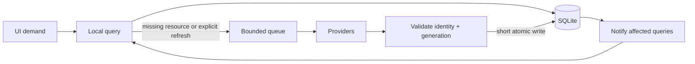

# Data and caching

All durable app data lives in one SQLite database, `catalog.sqlite3`. It holds a
normalized, provider-independent catalog, saved provider page membership, indexer
snapshots and personal records. Artwork and media live in separate bounded file
caches.

## Locations

`AppPaths::resolve` (`paths.rs`) is the only place that chooses directories.

| Build | `data`, `config`, `cache` |
| --- | --- |
| Debug (`debug_assertions`) | All of them are `./data/` relative to the working directory, which is gitignored. Run from the repo root |
| Release | `directories::ProjectDirs::from("", "", "kinema")`: `data_local_dir`, `config_dir`, `cache_dir` |

Debug and release use **separate databases**, and nothing is copied between
them. Settings live in `config/settings.toml`. Logs go to `cache/logs`, artwork to
`cache/artwork`, downloaded subtitles to `cache/subtitles` and media to `cache/media`. Credentials are not stored in any of
these places. **Deleting the database deletes the Library, watched state and
resume progress.**

> **Known debt:** personal records exist only in `catalog.sqlite3`, with no
> backup or export, so one corrupted or deleted file loses them. Do not add more
> irreplaceable data to the database without a recovery path. Fix:
> [watch history and portability](../proposals/watch-history-and-portability.md).

> Never reset or migrate the developer's `data/catalog.sqlite3` by hand. It
> contains real personal records. Tests use synthetic databases.

## Schema principles

The current schema version is `SCHEMA_VERSION` in `catalog.rs`, and the DDL is in
`catalog_schema.rs`. The code is the authority for table shape. These rules
govern changes to it:

- **MUST: every table is `STRICT`.** Use composite foreign keys such as
  `(title_id, kind)` so that a movie cannot own seasons. Foreign keys are
  `ON DELETE RESTRICT`, with one exception: `catalog_page_items.page_id`
  cascades, because page membership is rebuildable cache that belongs to its
  page. Integrity lives in the database, not only in Rust.
- **MUST: NULL means unknown.** Never store `0`, `""` or `[]` to mean "don't know". A
  reported zero is a known value.
- **MUST: migrations are transactional, forward-only and in place.** The database is
  upgraded when the new build opens it. A newer-than-supported version is
  refused, not downgraded. Every migration is tested on synthetic databases built
  at each older version. When a migration cannot keep data faithfully, the user
  must agree explicitly. For example, retiring the legacy provider-cache tables
  discarded some old cached results.
- **Do not add a table for a feature that doesn't exist yet.** Do not add generic
  entity tables, archives or job tables "for later".

### Table groups

| Group | Tables | Notes |
| --- | --- | --- |
| Canonical catalog | `titles`, `seasons`, `episodes` | Provider-independent current values |
| Identity | `title_identifiers`, `season_identifiers`, `episode_identifiers` | These stay separate tables because their collision domains, owner foreign keys and namespace constraints differ |
| Facts | `ratings`, `field_provenance` | One provenance row per current non-NULL field. Ratings are kept per source, metric and supplier |
| Provider state | `metadata_fetches`, `catalog_pages`, `catalog_page_items`, `indexer_snapshots` | Fetch state per provider, resource and locale. Saved query and page membership |
| Personal | `library_entries`, `movie_watch_state`, `episode_watch_state`, `movie_playback_progress`, `episode_playback_progress`, `season_release_memory`, `episode_stream_memory` | Never cache. See [personal records](#personal-records) |

The legacy `cinemeta_v3_*`, `indexer_sources_v1` and `tmdb_v1_cache` DDL exists
only so that old databases can be migrated. New code must not read from or write
to these tables.

## Catalog: local-first read model

- **Read locally first.** Return usable local data immediately, then fetch only
  what is missing or what the user asked to refresh. There is no automatic TTL,
  polling or crawling.
- **Saved queries are not offline search.** A saved search or page can be
  reopened, but arbitrary full-text search over every stored title is not
  supported.
- **Fetch state is honest.** `updated_at` means the content changed. `fetched_at`
  means the last successful fetch. A successful fetch that changes nothing only
  advances `fetched_at`. "Never fetched", "failed", "successful but empty" and
  "partial" are all distinct states.
- **A failure keeps the last good data.** An import validates the whole response
  first, then commits entities, provenance, ratings, page membership and fetch
  state in one transaction. If anything fails, everything rolls back and the
  failure is reported separately. An empty page replaces only that page's
  membership.

### Merge rules

These rules are implemented as pure policy in `kinema-core::catalog_normalized`
and applied in `catalog_normalized_merge.rs`.

1. **Per field, the highest-priority provider that has a value wins**, and
   lower-priority providers fill gaps. Within one provider, a newer observation
   wins, but a summary never replaces a detail value. Each value and its
   provenance are written together.
2. A missing, NULL or blank incoming field never clears a known value. Clearing
   requires an explicit operation.
3. **Ratings never blend.** Each `(source, metric, supplier)` is its own
   observation. A TMDB score never fills an IMDb slot.
4. A detail response that omits children never deletes those children.
5. The model stores current values only. There is no history store. When a value
   is replaced, its old provenance is replaced too.

### Identity and reconciliation

- Entities resolve by **validated external identifiers**. Children resolve
  through a verified parent and explicit season and episode numbers. Never match
  on name, year, artwork URL or coincident numeric IDs. A contradiction aborts
  the import.
- **Narrow automatic reconciliation:** when an explicit provider-supplied IMDb
  mapping proves that two local rows are the same entity, and nothing in the
  affected graph contradicts that, one transaction merges them. It retargets
  every reference (pages, identifiers, ratings, provenance, fetch state and
  personal rows) and then retires the redundant row. Any conflict rolls back the
  whole merge.
- Personal rows move with the merge. Library membership takes the union with the
  earliest `added_at`. For watched state, the newest mutation wins, and a tie
  prefers unwatched.

### Locale

Metadata is fetched in fixed `en-US`. Supporting several locales needs a design
for localized fields. See [proposal](../proposals/metadata-coverage.md).

## Personal records

Personal records are Library membership, watched state and playback progress.

- **They are independent.** Membership, watched and resume progress are three
  separate facts. Saving progress never adds a title to the Library. Removing a
  title from the Library never clears watched state or progress. Downloading or
  launching media never marks anything watched.
- **MUST: they are excluded from every cleanup:** cache, media, artwork and refresh.
- **Show and season status is derived, never stored.** None, some or all
  watched is computed from canonical episodes. It is conservative: it is known
  only when complete, reconcilable listings exist. An unknown or empty listing
  never means "watched".
- **Writes are serialized and acknowledged.** They go through the catalog
  worker's FIFO local queue. The UI changes only after the commit succeeds, and
  a full queue leaves the UI unchanged. Watch timestamps are monotonic, using
  `max(now, last + 1)`. Bulk season writes check a frozen snapshot of the episode
  IDs first.
- **Progress writes are fenced.** Starting a playback run increments a durable
  per-item epoch. Each checkpoint compares the epoch inside its transaction, so
  deleted progress can never come back from a late write. See
  [playback](playback.md#progress-and-resume).

### Stream memory

`catalog_stream_memory.rs` (schema v9) remembers what the user last played, so
the next episode can start from the same release. Two overwrite-only
(upsert) records:

- `season_release_memory`, keyed by `seasons.id`: the last played release.
- `episode_stream_memory`, keyed by `episodes.id`: the last played stream,
  which adds the resolved provider file basename and size.

- **Keys follow `episode_playback_progress`:** canonical row IDs with
  `ON DELETE RESTRICT`, so identity merges move the record to the winner (newest
  `updated_at` wins) before deleting the loser. Callers address them by
  `(series, season, episode)`; a write for a season or episode missing from the
  catalog fails with `MissingIdentityMapping` rather than inventing rows.
- **Raw strings, not traits:** info hash (40 lowercase hex, `CHECK`ed), release
  name, quality, size, indexer file index and file name hint, plus the provider
  file basename and size. `kinema-core` derives traits when reading. Unknown is
  NULL; empty strings and path separators in the basename are refused.
- **One write, both records**, in one `IMMEDIATE` transaction. Validation
  happens before any row changes. Reads return `None` for missing rows.
  `ReadPreviousSeason` finds the nearest earlier season (number ≥ 1, so
  specials never count) that has a record.
- **MUST: personal record.** Excluded from cache, media, artwork and refresh
  cleanup. Independent of watched state and progress: **Clear saved progress**
  and Library removal leave it alone. Never store URLs, debrid file IDs or
  provider file IDs. Never log hashes, names or file names, only counts and
  outcome categories.
- **Worker:** `LibraryOperation::StreamMemory(StreamMemoryOperation)` goes
  through the FIFO local queue; `Remember` counts as a mutation (acknowledged,
  revisioned, `Full` when the queue is saturated), the reads do not.

## Artwork cache

`artwork.rs` loads posters, backdrops, stills and profile images.

- Fetch, decode, downsample and blur all happen off the render path, in a
  bounded pool. The pool has 8 active jobs and 128 queued, with 2 slots reserved
  for interactive work.
- **Caps:** the encoded fetch is limited to 4 MiB, decoded images to about 8 MP,
  and any edge to 8192 px. Decoded memory budgets are separate for posters and
  backdrops.
- **Disk:** files are stored as `cache/artwork/<sha256(url)>.img`, with a
  256 MiB budget and LRU eviction by mtime.
- **Definitive misses** (404/410/undecodable) are remembered for 24 h. Timeouts
  and offline errors are never remembered.
- Redirects are limited, HTTPS-only and validated on every hop. A pending image
  stays in Loading and is never shown as a fallback.

## Settings file

`config/settings.toml` is versioned (`version = 1`) and nonsecret. A malformed or
unsupported file is never rewritten on load or reset; explicit saves refuse to
replace it. `subtitle_languages` is an ordered list of ISO 639-1 codes
(`kinema_core::subtitle_languages`). A missing key means `["en"]`. Aliases
(`eng`), case and duplicates are normalized on load without rewriting the file;
an unknown code or an empty list is `Invalid` and preserves the file, like other
keys. **Medium risk:** it is a persisted contract.

## Subtitle cache

`subtitle_cache.rs` stores downloaded online subtitles. Pure blocking API, called
from a background executor.

- **Disk:** `cache/subtitles/<sha256("opensubtitles:" + file_id)>.<ext>`, with
  `<ext>` from `kinema_core::subtitles::SubtitleFormat`. Debug builds use
  `./data/subtitles`, like artwork.
- **Writes** go to a temp file in the same directory and are renamed into
  place. Empty content and files over the 64 MiB subtitle cap or the cache budget
  are refused.
- **Budget:** its own 64 MiB, separate from the media quota. Each write evicts
  the oldest entries by mtime until it fits, never the file just written. A
  lookup hit touches mtime. Stale interrupted temp files (over 1 h) are removed.
- **Lookups** treat missing, empty, oversized, symlinked or non-file entries as
  misses; a hit avoids spending download allowance.
- **MUST: only delete owned names** (64 lowercase hex digits plus a known
  subtitle extension, or the temp prefix). Errors and logs carry categories
  only, never ids, paths or contents.

## Response caches

The cache rules boil down to: cache provider responses as normalized catalog
rows, not raw JSON. The one exception is the bounded detail `facts_json`
projection. Credentials, temporary authorized URLs and account tokens never go
into cache keys or rows. Proposals cover cache lifetimes, retention and caching
of debrid validity ([refresh and retention](../proposals/refresh-and-retention.md),
[debrid availability](../proposals/debrid-availability.md)).

## Change risk

- **High: schema and migrations.** Every user's database upgrades in place on
  next launch, and a bad migration can't be rolled back. Write migrations as one
  transaction, test them from every older version on synthetic databases, and get
  user sign-off for anything that discards data.
- **High: personal tables and merge rules.** Bugs silently lose or corrupt data
  users can't recreate. Add failure-path tests for every new write.
- **Medium: merge priority and identity rules.** Changes alter what every user
  sees, but the data can be refetched.
- **Low: artwork cache limits, queries and read models.** These are rebuildable.
