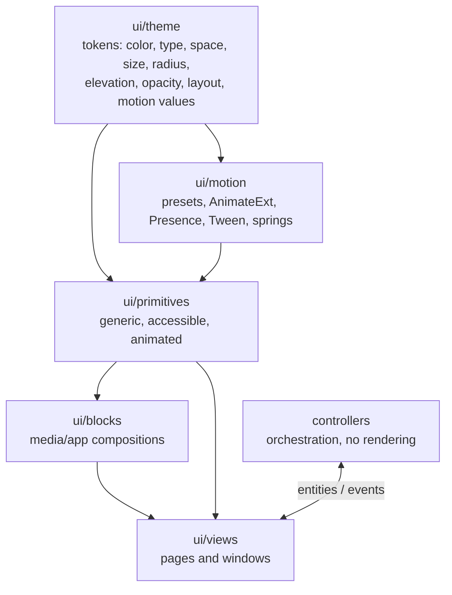
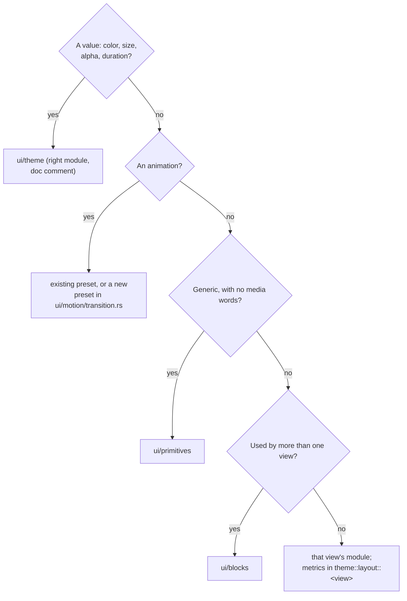

# Design system

The desktop UI uses one design system. It defines tokens, layers, components and
motion, and every pixel in the app goes through it. [UI](ui.md) covers product
rules (what screens do). This page covers **how to build them**.

Values in the code are authoritative: `crates/kinema-desktop/src/ui/theme/` and
`ui/motion/` contain tests that pin the tables below. If you change a value,
update the test and this page in the same change.

Naming follows shadcn/ui, adapted for a desktop media app. **`primary`** is the
brand orange, **`accent`** is the neutral hover/highlight fill, and
**`selection`** is the brand-tinted selected fill. All sizes are logical px.

## Hard rules

Every hard rule is a **MUST**. The `tests/design_tokens.rs` source scan enforces
most of them.

1. **No raw style literals outside `ui/theme`.** Do not write `px(..)`, `rgb(`,
   `rgba(`, `hsla(`, `Hsla {`, `.opacity(<number>)`, literal `.text_size(` or
   `.font_weight(`, or `Duration::from_*` used as UI timing anywhere in
   `ui/{primitives,blocks,views,motion}`.
2. **No GPUI shorthand sizing or color helpers** (`.p_2()`, `.gap_4()`,
   `.text_xs()`, `.rounded_md()`, `white()`, `black()`, …). Use
   `.p(space::S8)`, `.rounded(radius::MD)`, `.text(TextSize::Sm)` and so on.
3. **Animate only through `ui::motion` presets.** Only `ui/motion` may call
   `Animation::new`, `with_animation`, `with_spring` or `SpringConfig`.
4. **Respect the layer order** (below). Primitives and blocks never import
   `crate::controllers` or `ui::views`. Primitive type names never use domain
   words (poster, stream, episode, watched, library).
5. **Use semantic tokens, not lookalike values.** Pick the token for its
   *meaning* (`muted_foreground` for metadata, `input` for an essential control
   edge), even when another token has the same value today.
6. **Never hand-pick interaction colors.** Derive hover and pressed states with
   `Palette::hover/pressed/primary_hover/primary_pressed` or
   `motion::interaction`.
7. **Every interactive primitive meets the [accessibility checklist](#accessibility-checklist).**
8. **Text over artwork always sits on a `scrim` or `chip_on_art` backing.**

The single escape hatch is a same-line comment that gives the reason:

```rust
.w(px(0.5)) // token-exempt: sub-pixel seam between GPU surface and chrome
```

The scan reports the number of exemptions. Keep it near zero, and prefer adding
a token. Test code (`#[cfg(test)]` modules, `*tests.rs`, `fixtures.rs`) is exempt.

## Layers



A layer may depend only on the layers above it.

| Layer | May use | Must not |
| --- | --- | --- |
| `theme` | Pure values and functions | Build GPUI elements |
| `motion` | `theme` | Contain literals (it is scanned too) |
| `primitives` | `theme`, `motion` | Use domain vocabulary or types; touch controllers or views |
| `blocks` | primitives, `theme`, `motion`, `crate::artwork`, `kinema-core` types | Touch controllers or view types |
| `views` | Everything above; `theme::layout::<view>` for metrics | Own domain policy (that belongs in `kinema-core`) |
| `controllers` | `ui::theme` preference types only | Render anything |

### Where a new thing goes



## Tokens

### Color: `theme::color::Palette`

`Palette` is a flat struct of semantic tokens, read with `theme::palette(cx)`.
It has two modes: `Palette::dark()` and `Palette::light()`. `Palette::cinema()`
is used by the player window and is always dark.

| Group | Token | Dark | Light | Use for |
| --- | --- | --- | --- | --- |
| Surfaces | `background` | `#0B0C0E` | `#F3F3F5` | Window canvas, grid, detail body |
| | `surface` | `#131418` | `#FFFFFF` | Toolbar, sidebar, action column |
| | `card` | `#1B1D22` | `#FFFFFF` | Raised cards and posters |
| | `popover` | `#202228` | `#FFFFFF` | Opaque menu, popover and sheet surface |
| | `muted` | `#1B1D22` | `#E4E5EA` | Placeholder and skeleton fill |
| Text | `foreground` | `#F2F3F5` | `#111215` | Titles, body |
| | `muted_foreground` | `#B3B8C1` | `#4B505A` | Facts, metadata |
| | `subtle_foreground` | `#8C929D` | `#5E646F` | Hints, captions, disabled ink |
| | `primary_text` | `#FF9B72` | `#A83B12` | Links, selected labels |
| Actions | `primary` | `#FF7A45` | `#B54118` | Brand action fill (scarce: one primary action per context) |
| | `primary_foreground` | `#21130D` | `#FFFFFF` | Ink on `primary` and its states |
| | `secondary` | `#24272D` | `#EAEAEE` | Neutral control fill at rest |
| | `accent` | `#2D3037` | `#E1E2E7` | Neutral hover/highlight fill |
| | `selection` | `#FF7A45` @ 16 % | `#B54118` @ 10 % | Brand-tinted selected fill |
| Lines | `border` | white @ 8 % | `#111215` @ 10 % | Decorative structural edge |
| | `input` | `#646A75` | `#868C97` | Essential control boundary (≥ 3:1) |
| | `ring` | `#FF9B72` | `#B54118` | Focus ring; never derived from artwork |
| Status | `success` | `#46C98A` | `#1B7045` | Ready, cached, serving |
| | `warning` | `#F2A33A` | `#9A5400` | Quota, stale, partial |
| | `destructive` | `#FF6B6B` | `#B32626` | Failures, danger |
| Effects | `shadow` | black @ 32 % | `#111215` @ 14 % | Soft shadows (through `elevation` only) |
| | `overlay` | black @ 60 % | `#0B0C0E` @ 40 % | Modal and backdrop dimming; does not guarantee text contrast |
| Media | `scrim` | `#0B0C0E` @ 92 % | same | Text-bearing scrim over artwork |
| | `chip_on_art` | `#0B0C0E` @ 80 % | same | Chip backing over artwork |
| | `poster_edge` | white @ 6 % | black @ 8 % | 1 px inner poster edge |
| | `rating` | `#F5C451` | `#8A5D00` | Star glyph and score |
| | `rating_on_art` | `#F5C451` | `#F5C451` | Rating ink on a dark chip over artwork |
| Brand | `brand_wash` | violet h 274° s 40 % l 46 % | same | Second hue of the Browse brand wash (the first is `primary`) |

`theme::transparent(color)` returns the same hue at zero alpha. Use it for
gradient endpoints so fades do not pass through grey.

**Derived states.** Hover and pressed colors are not stored. They are mixed in
sRGB with levels from `theme::opacity`:

| Method | Mix | Level |
| --- | --- | --- |
| `palette.hover(base)` | `base` → `foreground` | `HOVER_MIX` 0.05 |
| `palette.pressed(base)` | `base` → `foreground` | `PRESSED_MIX` 0.10 |
| `palette.primary_hover()` | `primary` → `foreground` | `PRIMARY_HOVER_MIX` 0.15 |
| `palette.primary_pressed()` | `primary` → black | `PRIMARY_PRESSED_MIX` 0.20 |

`palette.glass()` returns the translucent header material as `(fill, hover fill,
edge)`.

**Contrast guarantees.** Unit tests in `color.rs` enforce these in both modes.
New text-bearing tokens must be added to the tests.

- `foreground`, `muted_foreground` and `primary_text` reach 4.5:1 on
  `background`, `surface`, `card`, `popover` and `muted`.
- `success`, `warning` and `destructive` reach 4.5:1 on those surfaces. This
  holds for artwork-tinted palettes and on a 10 % status wash.
- `primary_foreground` reaches 4.5:1 on `primary` and on its hover and pressed
  states.
- `input` is the essential control boundary (≥ 3:1). `border` is decorative only
  and must never be the only thing that shows a control's edge.
- Every hex value is pinned by `dark_hex_values_match_the_token_table` and its
  Light counterpart.

**Artwork tinting.** `palette.tinted(Option<ArtworkPalette>, Mode)` washes the
four surfaces with the artwork's primary color, using clamped lightness. It sets
`selection` from the artwork's secondary color. **Brand stays brand:**
`primary*`, `primary_text` and `ring` are never recolored from artwork. `None`
returns the palette unchanged.

### Typography: `theme::typography`

Families: `UI_FAMILY` Inter and `MONO_FAMILY` JetBrains Mono (both bundled).

| `TextSize` | px / line | Typical use |
| --- | --- | --- |
| `Xs` | 11 / 14 | Captions, chips, counters |
| `Sm` | 12 / 16 | Facts, metadata, shortcuts; mono file names |
| `Base` | 13 / 18 | Body, button labels; `Semibold` for row titles |
| `Md` | 14 / 21 | Prose, synopsis |
| `Lg` | 15 / 20 | Headings, card hover title |
| `Xl` | 18 / 24 | Titles, sheet titles |
| `Xxl` | 30 / 36 | Display, detail title (`Bold`) |

`Weight`: `Regular` 400, `Medium` 500, `Semibold` 600, `Bold` 700.

`TypeExt` is implemented for any `Styled` element. `.text(TextSize)` sets the
size, line height and family, and **resets the weight to Regular**, so call
`.weight(..)`, `.mono()` and `.tabular()` **after** it.

- Use `.tabular()` for every numeric fact (sizes, durations, counts).
- `.clamp_lines(n)` wraps and ends with an ellipsis.
- Use uppercase only for `SERIES` and quality chips.
- Never shrink text to fit. Wrap it, truncate it with a tooltip, or scroll.

### Space, size, radius

- `theme::space`: `NONE`, `S2`, `S4`, `S6`, `S8`, `S12`, `S16`, `S20`, `S24`,
  `S32`, `S48`. The number is the px value. Use only this scale for padding and
  gaps.
- `theme::size`: component dimensions.

| Group | Constants |
| --- | --- |
| Controls | `CONTROL_SM` 28, `CONTROL` 32, `TOOLBAR_CONTROL` 32 |
| Icons | `ICON` 16, `ICON_SM` 14, `ICON_TARGET` 28 |
| Rows, chips | `ROW` 32, `ROW_TALL` 56, `CHIP` 20 |
| Lines | `HAIRLINE` 1, `FOCUS_RING` 2, `SUBPIXEL` 0.5 |
| Page | `PAGE_INSET` 20, `TOOLBAR_TOP` (= `PAGE_INSET`), `TOOLBAR_HEIGHT` 52, `PAGE_TOP` 72 |
| Panels | `SHEET_WIDTH` 560, `POPOVER_WIDTH` 380, `ACTION_COLUMN` 400 |

- `theme::radius`: the base `RADIUS` is 8.

| Constant | px | Use |
| --- | --- | --- |
| `SM` | 4 | Chips, badges |
| `MD` | 6 | Controls, inputs, menu items, list-row hover |
| `LG` | 8 | Cards, posters |
| `XL` | 12 | Sheets, popovers, menus |
| `FULL` | 9999 | Pills and circles (instead of `rounded_full()`) |

Focus rings follow their host's radius.

### Elevation: `theme::elevation`

`sm`, `md`, `lg` and `xl` are functions of `&Palette` that return `Vec<BoxShadow>`.
They all have zero spread and use `palette.shadow`. **Separate layers by tone
first, and add a shadow only to raised things.**

| Fn | Offset / blur | Use |
| --- | --- | --- |
| `sm` | 0/2 · 8 | Raised surface at rest |
| `md` | 0/4 · 14 | Card hover |
| `lg` | 0/6 · 20 | Menus, popovers |
| `xl` | 0/12 · 36 | Sheets |

### Opacity: `theme::opacity`

These are named alpha and mix levels in `0..=1`. Each one is documented in
`opacity.rs`. **Snap to an existing level** if the value you need is within a
step of it, and add a new one only for a new meaning. The groups are:

- **State mixes:** `HOVER_MIX`, `PRESSED_MIX`, `PRIMARY_HOVER_MIX`, `PRIMARY_PRESSED_MIX`.
- **Surfaces:** `GLASS`, `OVERLAY_HOVER`, `CARD_TRANSLUCENT`, `SELECTED_HOVER`, `BADGE_WASH`.
- **Edges:** `ALERT_EDGE`, `SELECTED_EDGE(_STRONG)`, `EDGE_HOVER_GAIN`,
  `SELECTION_HOVER_GAIN`, `DESTRUCTIVE_EDGE`, `TRACK`.
- **Ink:** `INK_SOFT`, `INK_THUMB`, `INK_FAINT`, `INK_REFRESH`,
  `DISABLED_OVER_ART`, `SCROLLBAR_IDLE`.
- **Imagery and scrims:** `DIM_*`, `STATIC_PULSE`, `PULSE_MIN`, `SKELETON_*`,
  `POSTER_SCRIM_PEAK`, `PLAYER_SCRIM`, `HEADER_SCRIM`, `HERO_*`, `AMBIENT_*`,
  `ART_WASH_*`, `BRAND_WASH_*`, `CONTENT_FADE_MIN`.

### Layout: `theme::layout`

View-specific metrics are grouped by owner. Module-local `const` sizes in views
are not allowed. Write derived values as arithmetic of other tokens, for example
`layout::browse::COMPACT_BELOW = breakpoints::WIDE`.

| Group | Contents |
| --- | --- |
| `layout::GRID_GAP` | Poster grid and carousel gap |
| `layout::breakpoints` | `COMPACT` 900, `INSPECTOR` 1040, `WIDE` 1100 |
| `layout::detail` | Page max width, hero, facts, episodes, seasons, similar, cast, Streams and stream-row metrics |
| `layout::browse` | Search widths, scrim ramp, compact breakpoint |
| `layout::settings`, `layout::transfers` | Window and popover sizes |
| `layout::player` | Window, dock, top bar, timeline, volume, help and diagnostics metrics |
| `layout::controls` | Primitive metrics that are not component sizes (choice tile, carousel slop, scrollbar, menu min width, indicator) |

### Motion values: `theme::motion`

| Group | Values |
| --- | --- |
| `duration` | `FAST` 90 ms, `NORMAL` 180 ms, `SLOW` 280 ms |
| `Ease` | `Linear`; `Out` (cubic, no overshoot); `InOut` (cubic, emphasized) |
| `delay` | `STAGGER` 30 ms (per successive row), `INTENT` 60 ms (hover intent) |
| `distance` | `SM` 4, `MD` 8, `LG` 12 px |

`theme::motion::timing` holds **interaction timings**. These are not animations,
and reduced motion does not affect them. They include `TOOLTIP_DELAY` 500 ms,
`SEARCH_DEBOUNCE` 300 ms, `SCROLLBAR_IDLE` 600 ms, `TYPEAHEAD_RESET` 700 ms,
`SKELETON_DELAY` 150 ms, `PULSE_PERIOD` 1600 ms, `COPIED_FEEDBACK` 1500 ms,
`SPIN_PERIOD` 1000 ms, `CHROME_IDLE` 2500 ms, `NOTICE_TIMEOUT` 10 s, and the
player and transfer sampling intervals. Any `Duration` that drives UI behavior
belongs here.

## Motion

### Presets: `ui::motion::transition`

A preset is `Transition { duration, ease, delay, effect }`, where `Effect` is one
of `None` (the caller drives the visual), `Fade`, `Rise(d)`, `Slide(axis, d)` or
`Lift(d)`. **Every animation uses one of these presets.**

| Preset | Duration · ease · delay | Effect | Use |
| --- | --- | --- | --- |
| `FEEDBACK` | FAST · Linear | None | Hover/pressed fills, toggles |
| `HOVER` | NORMAL · Out | Lift(SM) | State layers, card lift |
| `DISCLOSE` | NORMAL · Out | Fade | Disclosure panels, artwork fade-in |
| `POPUP_IN` / `POPUP_OUT` | NORMAL / FAST · Out | Rise(SM) | Popover, menu, tooltip |
| `CONTENT` | NORMAL · Out · STAGGER | Rise(MD) | Detail content landing after navigation |
| `COLUMN` | NORMAL · Out | Slide(X, LG) | Episodes ⇄ Streams, carousel paging |
| `CROSSFADE` | SLOW · Out | Fade | Backdrop changes, placeholder → content |
| `SHEET` | SLOW · Out | Rise(LG) | Modal sheet and scrim |
| `FLIGHT` | SLOW · InOut | None | Shared poster flight (geometry driven by the caller) |
| `CARD_OVERLAY` / `_OUT` | SLOW · Out · INTENT / NORMAL · Out | Rise(MD) | Poster-card scrim and rows |
| `WHEEL` | NORMAL · Out | None | One mouse-wheel notch gliding to its destination |

Under reduced motion, `motion::resolve(preset, cx)` returns zero duration and
zero delay. A test enumerates every preset to check this, so **add every new
preset to the test's `ALL` list.**

### Runtime: `ui::motion`

- `motion::reduced(cx)`, `motion::resolve(preset, cx)` and
  `motion::duration(preset, cx)` are the queries.
- **`AnimateExt`** on elements: `.animate_enter`, `.animate_exit`,
  `.animate_with(id, preset, cx, |el, t| ..)` for custom properties,
  `.animate_stable` (keeps element identity across states) and `.animate_loop`
  (pulses and sweeps; static under reduced motion). The result can no longer be
  styled, so apply styles first.
- **`Presence`** is the one open → closing → closed lifecycle for Popover, Menu,
  Sheet and Tooltip. Its exit timer is keyed by generation, so reopening during
  an exit cancels the stale close. Hosts keep the overlay mounted while
  `is_visible()`.
- **`interaction`**: `state_fill` (an interruptible keyed spring for rest → hover),
  `StateStyle` (rest/hover/pressed/focus-visible/disabled), `focus_ring(palette)`
  and `lerp_shadows`.
- **`Tween`** is one interruptible eased value for frame-driven animation.
  **`CardHover`** is the poster-card choreography.
- **`SmoothWheel`** smooths notched mouse wheels (`ScrollDelta::Lines`). GPUI
  applies each wheel event as one jump. A scroller keeps one `SmoothWheel` per
  handle, attaches `listener(handle, axis, ..)` with `on_scroll_wheel` on the
  element that tracks the handle, and paints `probe(handle)` in the same frame.
  The probe records the offset before GPUI scrolls. The listener runs right
  after GPUI's handler, undoes the jump and glides with `WHEEL`. Each reported
  line travels `layout::controls::WHEEL_LINE` (100 px per usual three-line
  notch, like Chrome on Windows) in every view; GPUI's own jump depends on the
  painting element's line height. Notches in one direction stack onto the
  destination, a reversal starts from the current offset, and destinations
  clamp to the scroll range. Touchpad (pixel) deltas, keyboard, scrollbar and
  programmatic scrolling stay direct; any of them moving the offset mid-glide
  makes the glide yield. Reduced motion applies the same distance at once.
  `ScrollArea`, `Carousel`, `Menu`, the Browse grid and Settings use it; new
  scrollers should too.
- Reduced motion comes from Settings (`theme::apply_preferences`). GPUI does not
  expose the OS preference, so `System` currently means "not reduced". Do not
  claim OS-level support.

## Component conventions

- Builders are `#[derive(IntoElement)]` `RenderOnce` structs. Use an `Entity`
  only when the component owns state (TextInput, Menu, Popover, ScrollArea,
  Presence hosts). Element IDs are stable. Inputs are explicit. Callbacks are
  `Rc<dyn Fn(..)>` and slots are `AnyElement`.
- Variants follow shadcn naming:

| Component | Variants |
| --- | --- |
| `Button` | `Primary`, `Secondary`, `Ghost`, `Outline`, `Destructive`; sizes `Sm` (28), `Md` (32), `Icon`; `.square(true)` gives the icon form; `.selected(bool)` gives the toggled state (`selection`); busy keeps its width and label and blocks repeats |
| `Badge` | `Neutral`, `Primary`, `Success`, `Warning`, `Destructive`, `OnArt`; `.strong(true)` gives the info look |
| `Alert` | `Info`, `Success`, `Warning`, `Error`, `Empty`; each tone is paired with a distinct icon; at most one action |

- Every component implements all of its states: rest, hover, pressed,
  focus-visible and disabled, plus busy where relevant.
- **Disabled** means `subtle_foreground` ink on an unchanged fill. Never fade the
  whole control. The only exception is over artwork, which uses
  `opacity::DISABLED_OVER_ART`.
- **Selection is never shown by color alone.** Add a marker or check. Keep
  keyboard focus and semantic selection independent.
- **Status is never shown by color alone.** Pair the tone with an icon or label.

## Accessibility checklist

This applies to every interactive primitive. Record deviations in the component's
module doc, and test behavior where GPUI test support allows.

- **Role** is set with `.role(..)`.
- **Name** comes from a label, or from `aria_label` or a tooltip for icon-only
  controls.
- **State** (`aria_selected`, `aria_expanded`, `aria_toggled` and values) stays
  in sync.
- **Keyboard:** the control is reachable by Tab, and Enter/Space activate it.
  Segmented, Menu and Select support arrows and Home/End. Menu and Select support
  type-ahead.
- **Focus ring** is visible on `focus_visible` and never removed. It follows the
  host radius and never shifts layout.
- **Overlays:** Esc closes the overlay and returns focus to the trigger. An
  outside click dismisses non-modal panels. A Sheet traps focus.
- **Contrast** uses only the palette pairs listed above.
- **Motion** goes through a preset.

Known GPUI limits are documented, not worked around:

- There is no `disabled` attribute and no `aria-modal`. Disabled controls drop
  their tab stop and click action instead.
- Tests cannot read the accessibility tree.
- There is no OS reduced-motion signal.

This checklist is not a screen-reader certification.

## Extending the system

**Adding a token**

1. Put it in the right `ui/theme` module, with a doc comment that says what it is
   for. Reuse an existing value if it is within a step.
2. For a color, add the `Palette` field, set it in `dark()` and `light()`, add it
   to the hex-pinning tests, and add contrast assertions if it carries text.
3. Update this page. If the token is visual, add it to the `tokens` scene in the
   [design lab](development.md#ui-probe-and-design-lab).

**Adding a motion preset**

Build it from `theme::motion` values in `ui/motion/transition.rs`, add it to the
test's `ALL` list, and add a row to the presets table.

**Adding a component**

1. Choose the layer with the decision chart above.
2. Build it from tokens only. Put layout constants in `theme::layout::<owner>`.
3. Implement all states and the accessibility checklist.
4. Animate through presets. Overlays use `Presence`.
5. Add a focused test for its pure decisions, add a design-lab scene, and run
   `cargo test -p kinema-desktop --test design_tokens --locked`.

## Change risk

- **Medium: token values and primitives.** Changes spread to every screen.
  Update the pinned tests, this page and the lab scenes together.
- **Low: new tokens, presets and components** that follow the extension rules.
