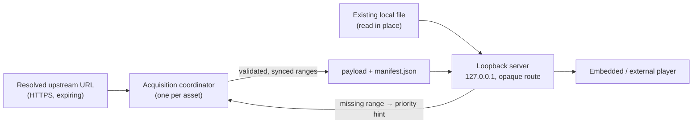

# Media storage and serving

Players never talk to providers. The media service (`kinema-desktop/src/media/`)
downloads bytes into managed storage and serves them over a loopback HTTP
server. Players receive an opaque local URL. The precise API, limits and
recovery protocol are in [`media/README.md`](../../crates/kinema-desktop/src/media/README.md).

## Rules

- **MUST: loopback only.** The server binds to `127.0.0.1` on an ephemeral port, with
  one random capability route per lease. It serves no LAN clients, does no
  transcoding and runs no daemon. It delivers bytes, and the player decodes
  them.
- **MUST: serve by opaque ID only.** Never put filesystem paths, upstream URLs or
  credentials in the route. Never log or persist them. *Why:* any local process
  can reach the loopback port, so the route must reveal nothing.
- **A session is a lease.** `register_remote` and `register_local` return a
  `PlaybackSession { id, url }`. Several leases can share one asset. `release`
  is idempotent. Acquisition is cancelled only when the last lease on an asset
  is released.
- **Existing local files are read in place.** They are never copied, never
  counted against the quota and never deleted.
- **MUST: never claim bytes you don't have.** Downloaded ranges are tracked
  explicitly. The size of a sparse file says nothing about its holes. A reader
  waits for the ranges to become durable, and a failure aborts the read.
- **Exact HTTP semantics.** GET and HEAD support single closed, open-ended and
  suffix ranges (206/416). Multi-range requests are deliberately rejected with
  416. The upstream must answer with an exact 206. Full-download HTTP 200
  responses are not supported.

## Acquisition

- **One coordinator per asset** owns writing, syncing, checkpointing and URL
  renewal. Parallel range fetches only return bodies to it. Ranges are published
  only after they are durable, so completing out of order can never expose a hole.
- **Adaptive ranges:** parallel range requests and range size adapt to reader
  pressure, under a per-asset and a process-wide cap. Concurrency halves only on
  throttling (429/503 with `Retry-After`), not on an isolated failure.
- **Readers drive priority.** A seek to missing bytes sends a priority hint, and
  the first interactive range is kept small. A distant seek advances a
  generation, so obsolete results are never published as live.
- **Identity is pinned.** The first strong ETag binds the acquisition. Renewed
  URLs must return the same ETag and the same hash, path and size, or the
  acquisition fails with `IdentityMismatch`. Never mix bytes from two versions.
- **Renewal** happens on expiry, on link age, or on a 401/403, and only the
  coordinator renews. It is bounded: repeated renewals without validated
  progress fail. **Renewal callbacks must bound their own I/O.** The service
  cannot interrupt them.
- **Every wait is bounded:** upstream connect and request deadlines, missing-chunk
  waits and idle sockets all time out.

The exact caps, range sizes, renewal triggers and timeouts are in
[`media/README.md`](../../crates/kinema-desktop/src/media/README.md#http-and-acquisition).
The adaptive policy came from a proof of concept. Under high demand, a few
adaptive ranges beat a single fixed range. Blind multiplicative decrease on every
error did not help. Real-provider throughput is still unmeasured.

## Storage

- Each asset lives in its own directory,
  `cache/media/<sha256 identity>/{payload, manifest.json}`. The manifest holds a
  format version, the stable upstream identity (hash, path, size) and the durable
  ranges. It never holds URLs or secrets. There are no chunk files, no duplicate
  "complete" copy and no asset database.
- **Checkpoint order:** sync the payload, write and sync `manifest.next`, replace
  the manifest atomically, then sync the directory (Unix only). On restart, only
  validated, checkpointed ranges are trusted. Anything else is downloaded again.
- **Staging and tombstones:** new assets are published from `.create-<hash>`, and
  cleanup renames assets to `.delete-<hash>` before deleting them. Startup
  finishes or discards these. Unknown entries are left alone. Never recurse
  outside the root, and never follow symlinks or junctions.
- A **lock on the media root** stops a second instance from corrupting it.

## Quota and cleanup

- The default managed-media limit is **20 GiB**, and the user can change it. It
  is separate from the artwork, database and log budgets.
- Admission **reserves the full known size** and also checks physical free
  space. A file of unknown size is not admitted until its size is verified.
- **No automatic eviction.** Cleanup is manual and removes only inactive assets,
  including abandoned partial downloads. An asset is active while any session,
  acquisition or HTTP reader pins it. Space still waiting to be deleted counts
  as used.
- Lowering the limit below what is already reserved is **refused, with an
  explanation**. Kinema never silently deletes files to fit. When one file is
  bigger than the limit, explain why and offer to raise the limit.
- **MUST:** never delete original user files.
- Losing the cache is recoverable: media is fetched again, and the catalog and
  settings are untouched. The cache is not guaranteed offline storage.

## Portability

Do not assume POSIX semantics such as delete-while-open, atomic replace or
directory fsync. Serialize writes and cleanup per media root. Storage has only
been exercised on Linux. Crash and power-loss behavior on Windows and macOS is
unqualified (see [cross-platform qualification](../proposals/cross-platform-qualification.md)).

## Change risk

- **High: manifest format and storage layout.** Existing caches must either
  recover or be discarded safely, so version the manifest.
- **High: server exposure and route design.** Anything beyond loopback with
  opaque routes is a security change.
- **Medium: acquisition policy.** It affects playback for everyone, but it is
  tunable. Measure before and after.
- **Low: limits and timeouts.** Tune them with evidence.
