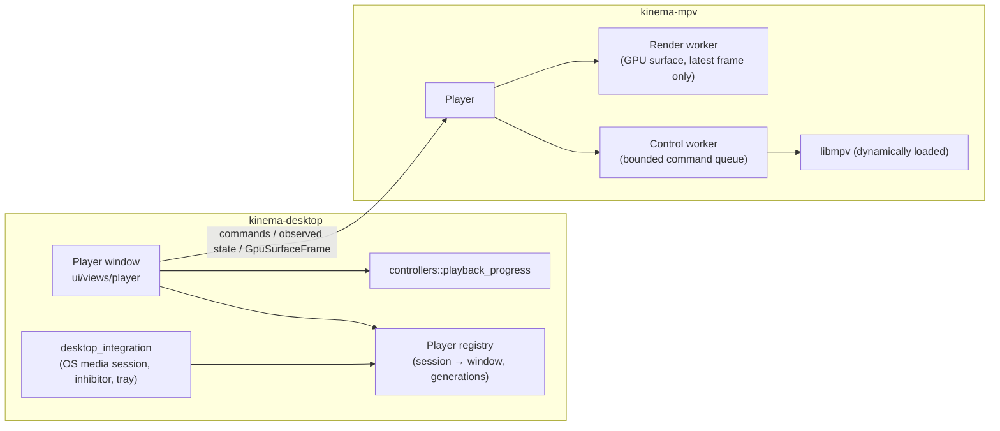

# Playback

There are three player choices in Settings: **Embedded MPV** (the default),
**external mpv** and **VLC**. Every player receives the same thing, which is a
loopback URL for one lease (see [media](media.md)). This page covers the
embedded player, external launching, progress and resume, and OS integration.

## Embedded player architecture

- **Split of responsibility.** `kinema-mpv` owns libmpv loading, commands,
  events, decode and render workers, GPU interop and teardown. It knows nothing
  about the Library, SQL or GPUI views. `kinema-desktop` owns the window,
  chrome, focus, sessions and progress. **All `unsafe` and FFI code lives in
  `kinema-mpv`.**
- **The player is an independent window** with one window per lease. It is not
  a pane in the browser and not a separate mpv process.
- **Commands return acceptance, not success.** Only observed mpv state is truth.
  A requested seek, speed, volume or track is not proof that it happened.
  Unknown metadata is different from known-empty metadata (`*_available`
  flags).
- **Rendering never blocks** on I/O, decoder commands or worker shutdown. Frame
  handoff is bounded and keeps only the latest frame. Retired images use a
  bounded two-slot pipeline.
- **Every async result carries a window, session and generation tag.** A frame
  or event from a closed or replaced session must never update another player.
- **mpv is locked down.** Kinema sets `config=no`, `load-scripts=no`, `osc=no`
  and `osd-level=0`, and turns off the default input bindings, so it never
  inherits the user's mpv config, scripts or OSC. External mpv, by contrast,
  keeps the user's configuration, and Kinema never copies or edits it.
- Player init and worker joins block, so `Player::new` runs off the UI thread.
  Native cleanup that might hang is *quarantined*: its owners are retained
  rather than torn down unsafely.

> **Known debt:** libmpv, codecs and GPU drivers run inside the Kinema process,
> so a native crash takes down the whole app, including downloads and the
> Library. Fix: [player process isolation](../proposals/player-process-isolation.md).

### GPU-surface rendering

The only embedded renderer is the **GPU-surface** path, enabled by the default
Cargo feature `gpu-surface`. Each OS path hands mpv's output to GPUI's own GPU
device without a CPU copy:

| OS | Path |
| --- | --- |
| Linux | OpenGL render into Vulkan buffers shared through external memory, on GPUI's WGPU (Vulkan) device and queue. It uses explicit `GL_EXT_semaphore_fd` ↔ `VK_KHR_external_semaphore_fd` sync. `glFinish` or CPU waits are not enough |
| Windows | ANGLE GL through D3D11On12 on GPUI's D3D12 device and queue. WGPU is DX12-only here. It needs the ANGLE `libEGL.dll`/`libGLESv2.dll` next to the executable, with the device-creation and D3D-texture extensions |
| macOS | Legacy CGL rendering into IOSurface-backed `CVPixelBuffer`s, presented through GPUI's Apple BGRA surface path |

Rules:

- **MUST: fail closed.** A missing compiled feature, GPU capability or hardware-decode
  proof, or an HDR/PQ/HLG transfer, produces an explicit failure
  (`hdr-unsupported`, `gpu-device-unsupported`, …). Never fall back to CPU
  readback, and never switch to another player automatically.
- **Use only GPUI's device.** Never create a private second device to work
  around a missing adapter. With multiple windows, the GPU context accessors
  return `None` when live renderers use different devices.
- **Gate the queue.** Every raw producer submit and every normal WGPU submit
  holds the same queue gate. A poisoned gate is fatal.
- Device-loss recovery is not supported. **Only SDR** is accepted (bt.1886,
  bt.709, sRGB, gamma 2.2 and 2.8). See the [HDR proposal](../proposals/hdr-playback.md).

GPUI 0.3.9 has no API for externally produced GPU textures, and its Windows
backend constructs its own DirectX renderer. So the root workspace patches
`gpui-pre`, `gpui-pre-wgpu`, `gpui-pre-apple`, `gpui-pre-windows` and `wgpu-hal`
through [vendored sources](development.md#vendored-patches). This is a durable
fork with reproducible patches, not edited registry sources.

### Native libmpv

libmpv is **not bundled**. Embedded playback needs a trusted libmpv with client
API major version 2. Lookup order is `Config.library_path`, then
`MPV_LIBRARY_PATH`, then the OS loader (`libmpv.so.2`, `libmpv.2.dylib`,
`mpv-2.dll`/`libmpv-2.dll`). An installed `mpv` executable alone is not enough.
Loading a library runs native code, so never discover one from media folders or
an untrusted working directory. Dynamic loading does not waive the GPL/LGPL
obligations of libmpv or FFmpeg. Distribution is an open question (see the
[desktop releases proposal](../proposals/desktop-releases.md)).

## Window, lease and session ownership

- **One embedded window per lease, one lease per window at a time.** Replaying a
  lease focuses its existing window instead of creating a second owner.
  Different leases can have their own windows at the same time. A window can
  swap its source to another episode (below); it then briefly holds two leases
  and ends up with one.
- **MUST: closing a player** stops its decoder, flushes progress and releases its
  lease **exactly once**. It is not "delete cache" and not "stop download".
- **Replay keeps the original backend.** A changed player preference applies to
  new sessions only. A lease that was used externally is never converted to
  embedded ownership.
- **Pause is decoder intent**, not a download pause. **Buffering** is observed
  starvation, not a user pause. Recovery resumes only if the user still intends
  to play.
- **Startup readiness:** the initial load has a 60 s budget, and seek
  confirmation has 10 s. A launch with no checkpoint that fails says "Playback
  could not start". It never says "Saved position cannot be resumed".

### Episode swap (same window)

An embedded window playing a tracked episode can move to another episode
without closing. Only embedded windows swap; external players never do.
`AppCoordinator::swap_embedded_source` takes an open window and an
already-launched lease, and runs this sequence exactly:

1. **Flush** the old run. The final observation is submitted and the swap waits
   until the save is acknowledged (no save in flight or waiting). If that takes
   more than 3 s the swap is abandoned and the user keeps the episode.
2. **Hold** the new lease next to the old one.
3. **Re-key** the registry entry to the new session with a **new generation**,
   and tombstone the old session. Late events, samples and window addressing
   for the old session or generation find nothing.
4. **Begin a run** for the new `Episode` subject (the old run is sealed and takes
   no samples) and give the window its new `PlaybackTarget`, title and
   `Progress`. The OS media session follows because it reads the window.
5. **`Player::load`**, paused when tracked, then the normal resume sequence (a
   saved position resumes; a duration mismatch still asks).
6. When the window reports the new media **ready**, release the old lease,
   exactly once.

If anything fails before step 6 (no backend, load error, the new media failing,
progress not saved in time), the **new** lease is released and the window goes
back to the old session and resumes it from the position saved in step 1.
A failure of the incoming media is masked in the window so it cannot close it
while that happens. Closing the window mid-swap releases both leases, once each.

After the new file's tracks are observed, the previous audio and subtitle choice
is restored by **language and flags** (forced, SDH), never by track ID
(`ui/views/player/track_carryover.rs`; it may move to `kinema-core::tracks`). With
no match mpv's default stays. Sidecar subtitles are not carried.

**The kept preparation.** A debrid preparation started for an episode in the
embedded player is *kept* by its window instead of being dropped when playback
starts: the worker keeps the preparation (file list, provider and client, at most
8) and the coordinator keeps the file list (`KeptPreparation`). Another file of
the pack is unlocked with `AppAction::PlayKeptFile`, which always starts an
embedded lease. The pack moves with the window across swaps, is cancelled when
the window closes, when the account changes (the worker drops every
preparation), and when a swap leaves the pack. Resolution (which file or stream)
is policy and stays outside the player: the player only exposes the swap, the
kept pack and the neighbour state below.

### External players

External mpv and VLC are explicit choices, launched with **argument lists**
(custom paths must be absolute executables, never shell commands). Kinema never
kills them and never infers their state from traffic. Launching one counts as
"launch requested", never as "playing". On quit, Kinema's server stops and the
external player loses its stream.

## Player chrome and input

The chrome is a **Cinema Dock** built from design-system tokens on
`Palette::cinema()` (always dark):

- The video is aspect-fit with near-black letterboxing and is never stretched or
  cropped. A compact title sits at the top.
- An edge-attached bottom scrim (`scrim`, with a fade above it, not a card)
  holds the time and chapter row, a 12 px seek rail inside a 32 px target, ghost
  transport buttons on the left (play/pause, ±10 s), and chapter, subtitle,
  audio, speed and fullscreen controls on the right. Volume (0–150) is a
  vertical panel at middle-right.
- The chrome auto-hides after `CHROME_IDLE` while playing. It never hides while
  a control has focus or hover, during a drag, while a menu is open, while the
  **Up next** card is showing, or when paused, buffering, loading, ended or
  failed. The subtitle safe zone moves
  `sub-pos` only while the chrome is visible.
- **Show only observed capabilities.** Don't invent chapters, tracks, buffer
  ranges or HDR badges. An unknown duration shows `—`. Seek previews are
  text-only (time and chapter); thumbnails are a
  [proposal](../proposals/player-enhancements.md).

### Next, Previous and Up next

For tracked episodes the dock has **Previous episode** and **Next episode**
ghost buttons beside ±10 s, with shortcuts **Shift+N** and **Shift+P**. They are
shifted because leaving an episode costs more than a seek, so a stray tap must
not do it; bare N/P stay free, and `<`/`>` would sit on the frame-step keys and
depend on the layout. Each direction is one of four states, given by the
coordinator (`Neighbours`):

| State | When | Dock |
| --- | --- | --- |
| Hidden | movie, untracked file, external player, or nothing published | no button |
| Disabled | an episode with no neighbour that way | button disabled, "No next episode" |
| Enabled | a neighbour exists | usable |
| Busy | a request is resolving | busy bar, input ignored |

The window never resolves anything. It emits a request through the injectable
`NeighbourRequests` (the coordinator in production) and receives
`set_neighbours` / `neighbour_failed`. The coordinator publishes
`NeighbourEvent::{SubjectChanged, Requested, Closed}`; neighbour resolution
listens to those and answers with `set_neighbours`, `neighbour_failed`,
`play_kept_file` or `swap_embedded_source`. A failure shows a dock notice
("Couldn't open the next episode") and leaves the current episode playing.

At end of file, if Next is enabled, an **Up next** card appears with a 5 s
countdown, **Play now** and **Cancel**. It is owned by the window (its timer
task is dropped on cancel, input, swap or close) and enters with the `POPUP_IN`
preset. Any key, click or wheel input cancels it, as does Escape (before
leaving fullscreen); pointer movement alone only reveals the chrome. It is
shown once per ending: replaying or seeking away re-arms it.

### External subtitles

The embedded player can add subtitle files the user already has, and search
OpenSubtitles.com for more ([provider rules](providers.md); the proposal keeps
the unbuilt remainder). The player window holds the session's
`Option<PlaybackTarget>` (`subtitle_target`, in memory only; `PlayLocal` files
have `None` and identity is never inferred from file names),
`Player::add_subtitles` takes `SubtitleFile { path, title, lang }` so a download
carries its release name and language (local files pass neither), and downloads
are cached by `subtitle_cache` (see [data](data.md#subtitle-cache)).
`MediaService::hash_window(session)` is the read-only source for a movie hash:
a local file's path, or a managed asset's payload path only when its first and
last 64 KiB are in the durable range set. It never starts or prioritizes
acquisition.

- **Two entry points:** **Add file** in the subtitle menu (native dialog,
  several files allowed) and dropping files anywhere on the player window. The
  subtitle menu opens whenever track metadata is known, even with no tracks,
  so **Add file** is always reachable once the media is loaded.
- **Admission** (`kinema_core::subtitles`) runs off the UI thread: a supported
  extension (SRT, ASS, SSA, VTT, SUB, SUP), a regular non-empty file up to
  64 MiB, and an absolute UTF-8 path. At most `MAX_SUBTITLE_FILES` (8) per
  request; the rest are counted as skipped. The dialog has no type filter on
  any platform, so admission is the filter.
- **MUST: files are read in place.** Kinema never copies, moves or deletes a
  user's subtitle file, and never logs its path or name; logs carry counts and
  outcome categories only.
- **Loading** is one generation-tagged `Player::add_subtitles` operation
  (`sub-add … auto` for each file, `select` for the last). A racing load makes
  it stale. mpv may load the files concurrently, so track order need not follow
  request order; the last requested file is still the one selected. External tracks belong to one load: mpv drops them on reload or
  replay, and they are not remembered across sessions.
- **Outcome is observed, not assumed.** Success is a new track with
  `Track::external`; an mpv error, or no new track within
  `SUBTITLE_LOAD_TIMEOUT`, reports "Subtitle failed". Each outcome is a short
  dock status for `PLAYER_NOTICE` ("Subtitle added", "Not a subtitle",
  "Player not ready" …), with the full wording in the status tooltip.
- While files are dragged over the window a full-window hint names what a drop
  will do: "Drop to add", "Not a subtitle" (judged by name only) or "Player not
  ready". Drop support is code-read for X11, Wayland, Windows and macOS and
  tested through GPUI dispatch, not yet by hand on each platform.

#### Online search

- **Entry:** **Search online** in the subtitle menu, below **Add file**. It is
  shown but disabled with a reason when no API key is saved ("Add an
  OpenSubtitles API key in Settings") or the media is not loaded. Whether a key
  exists is read off the UI thread (re-read when the credential generation
  changes) and is "unknown", hence enabled, until the first read finishes; the
  sheet itself reports a missing key.
- **Sheet over the video** (`ui::primitives::sheet::Sheet`, Esc closes it).
  Playback keeps running; shortcuts do not fire while the field has focus (the
  text field's Esc arrives as an action, so the window closes the sheet from the
  field's `Cancelled` event). It holds a language filter (shown for two or more
  settings languages; default **All**, which searches every configured language),
  a title field and **Search** only for media without a usable catalog id, the
  remaining allowance once known (login, or the last download), and the results:
  release name, language, download count and badges **Hash match**, **HI/SDH**,
  **Forced**, **AI translated**. The service ranks results; at most 50 are shown.
- **Searches run only on request.** A catalog id searches on open; otherwise on
  **Search**/Enter. Changing the language filter searches again. One search or
  download is in flight; nothing starts while another runs.
- **Identity** is the catalog target (movie, or series + season + episode); typed
  text is used only when there is none, trimmed, collapsed and capped at 120
  characters. File names never feed the query.
- **Work off the UI thread.** Keyring reads, login, search, download, cache and
  hashing run on the background executor with a cancel flag and a generation;
  closing the sheet or the window cancels, and a stale result is dropped. The
  signed-in session lives in memory per window and is reused until the saved
  credentials change (`opensubtitles_generation`) or the service expires it
  (replaced once, then repeated). A rejected login is remembered for that
  credential generation and never retried.
- **Moviehash is optional.** If a hash source is installed
  (`set_hash_window_source`, backed by `MediaService::hash_window`), the worker
  reads the first and last 64 KiB of the returned file and hashes them. Any
  failure omits the hash; it never blocks, waits or triggers acquisition.
- **Distinct states**, each with short copy: searching, empty ("No subtitles
  found"), service failure and offline and rate limited (**Retry**), download limit
  reached (with the reset time as "Resets at HH:MM UTC"), and API key needed or
  rejected, sign-in required, sign-in rejected (**Open Settings**, pointing to
  Settings → Accounts). An empty result is never shown for a failure.
- **Choosing a result** uses the cache (`SubtitleCache::lookup`, no allowance, no
  sign-in), else downloads, stores, then goes through the same load path as **Add
  file** with the release name as title and the language as `lang`. The row shows
  "Adding…" and the sheet stays open until the new external track is observed,
  then closes with the dock status "Subtitle added". A failure keeps the sheet
  open with the reason; a reload under an add abandons it.
- **Track source:** tracks the window added from a download are remembered by
  mpv track id for that media load and read "OpenSubtitles · SRT" in the dimmed
  column; others read "File · SRT". mpv's `external-filename` (a cache path) is
  never shown or logged.
- **Logs** carry categories and counts only (opened, outcome, result count):
  never queries, titles, file names, keys, tokens or download links.
- **Unverified:** the live OpenSubtitles API, a real download into mpv, and the
  moviehash path against a real service have not been exercised; the adapter is
  covered by loopback fixtures and the sheet by pure state tests, lab scenes
  (`player-search*`) and GPUI dispatch. The sheet uses the global theme
  palette like the player's menus.
- **Hash source:** each embedded start carries a weak `HashWindows` handle from
  the media service, which the coordinator installs as the player's hash
  source. It answers only for live sessions and never keeps storage alive.
- **Not planned for now:** a second provider (SubDL is the candidate; every user
  would need their own key), unofficial proxies or scraping (Stremio v3 proxy,
  Addic7ed, Podnapisi), and automatic sync with `alass` (GPL-3.0-or-later,
  incompatible with linking into Apache-2.0 Kinema; manual delay exists).

### Track labels

Audio and subtitle menus use `kinema_core::tracks`, never raw metadata:

- **Language first**, as a name: `en-IN` → "English (India)", `eng` →
  "English". Unknown codes fall back to the code in capitals; `und`/`mul` mean
  no language.
- **Titles only when meaningful.** Web addresses and watermarks
  ("www.…", "site.org"), and titles that repeat the language, are dropped.
  Real titles stay ("English · Commentary").
- **Added files drop what is playing from their name.** A leading title
  (catalog name, or the playing file's stem), then any year, episode tag
  (`S01E04`, `1x04`) and episode name are removed, as is a trailing language
  tag: "Immortal.2026.1080p.WEB-DL.en.srt" reads "English · 1080p WEB-DL".
  Matching ignores case and punctuation and stops at word boundaries; if
  nothing matches or nothing is left, the whole name is kept. This is display
  only and never identity. Dots become spaces except in "5.1" and "H.264";
  names longer than 40 characters end at a word with "…".
- **Tags** from observed track flags: Forced, SDH; audio adds the layout
  (Mono, Stereo, 5.1, 7.1).
- **Source in the dimmed right column:** "Built-in", "File · SRT" or (downloaded)
  "OpenSubtitles · SRT" for subtitles, the codec (AAC, E-AC-3 …) for audio.
- Rows that would read the same are numbered in order ("English 1",
  "English 2"). Identity is still the mpv track ID; labels never select.

**Shortcuts** come from one catalog, `player_shortcuts.rs`. The player's `?`
help, Settings → Keyboard & Mouse, and the tooltips all read from it, so add or
change a binding there; it is the authority for the binding list.
**Default: Escape never closes playback.** It closes help or a menu, then
cancels a drag, then exits fullscreen. *Why:* a stray key must not end a film. Shortcuts are scoped to the focused player and never take
keys away from a text input or an open menu. Key repeat uses GPUI's
`KeystrokeEvent::is_held` (vendored patch 0012), not latches keyed on the key
name.

## Progress and resume

Progress is a separate personal fact, distinct from watched and from Library
membership (see [data](data.md#personal-records)).

| Action | Watched | Saved progress |
| --- | --- | --- |
| Mark watched | Set | Kept |
| Mark unwatched | Cleared | Kept. Auto-marking is suppressed for the rest of this run |
| Clear saved progress | Unchanged | Deleted (epoch bumped) |
| Play from beginning | Unchanged | Reset only once the new playback is ready |
| Seek backward | Unchanged | Saves the smaller position |
| Confirmed position ≥ 90% of a finite duration | Set (one-way) | Kept |

- **The identity is typed:** `PlaybackSubject::Movie | Episode | Untracked`.
  Local files with no catalog identity play normally, but do not save progress.
  Never derive identity from file names.
- **Run fencing:** each run increments a durable per-item epoch. Writes carry
  `(subject, epoch, run, sequence)`, and stale writes are rejected inside the
  transaction. The latest run owns writes. Never merge positions by taking the
  `max`.
- **Resume sequence:** load paused, wait for seekability, seek precisely, wait
  for the observed position, then apply the user's play/pause intent. A position
  of zero during loading never overwrites a checkpoint. If the new source's
  duration differs by more than max(30 s, 2%), ask the user instead of remapping.
- **Cadence:** checkpoints are coalesced to at most one every 5 s, and flushed
  on pause, seek, close, source replacement and quit. A crash can lose the last
  interval.
- **UI:** an unwatched item with progress shows **Resume · mm:ss** (offered only
  for the embedded player, which performs the seek) and **Play from beginning**.
  Watched items hide catalog progress bars.
- The pure policies live in `kinema-core::watch_progress`: eligibility, the 90%
  rule and next-up.

## OS integration

`desktop_integration/` is owned by the app, not by Main.

- **OS media controls** (souvlaki, vendored) route to **one selected player**:
  the focused or explicitly chosen player, otherwise the most recently started
  one. They send the same commands as the Cinema Dock, not commands to a second
  controller. Only supported actions are advertised: Next and Previous are
  advertised exactly while the dock's button for that direction is enabled
  (not hidden, disabled or busy), and arrive as the same request as the button. Only a safe title and description, the position and artwork are
  published, never URLs or paths. Untrusted OpenUri requests are ignored.
- **The sleep and idle inhibitor** (keepawake) is process-wide. It is held while
  *any* embedded video is actively playing, with a 30 s buffering grace. A
  denied inhibitor is a nonfatal capability failure, and Kinema never overrides
  an explicit lock or suspend.
- **The tray** (tray-icon, KSNI on Linux, with no GTK or AppIndicator) has only
  Show/Hide, Settings and Quit. Its behavior is described in
  [runtime](runtime.md#main-window-tray-and-quit). Hiding the main window uses
  the vendored `Window::{hide_window, show_window}` patches. Wayland has no safe
  hide, so it falls back to minimize.

## Change risk

- **High: GPU-surface interop, vendored patches and `unsafe` FFI.** Mistakes
  cause crashes or GPU hangs that are hard to test. Read the
  [patch notes](../../vendor/patches/README.md) first, and test on real hardware.
- **High: progress fencing.** It protects personal data.
- **Medium: lease and window ownership.**
- **Low: chrome layout and shortcut bindings** (keep the single catalog).
