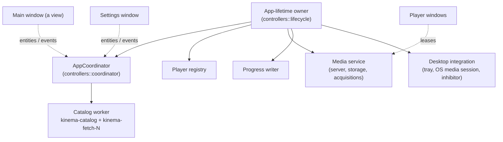

# Runtime and concurrency

Kinema is one process. It has a few long-lived, owned workers and GPUI's
foreground executor. This page describes who owns what, how work is bounded and
cancelled, and how lifetimes end.

## Ownership model

- **The app owns the process. Windows are views.** Closing the main window does
  not stop players, leases, progress writes or the tray. Every window talks to
  the same coordinator, so reopening a window never duplicates workers.
- **Controllers orchestrate and never render.** `controllers/` holds the
  coordinator (shared snapshots, generations, personal-state mutations),
  `play_session` (prepare → choose file → launch), `enrichment` (pure merge
  policy plus bounded scheduling), `playback_progress`, and `lifecycle` (tray,
  close-to-background, quit gate).
- **Views own only view state.** That means scroll, focus, hover and local
  form state. Screen state belongs to its navigation entry. Back restores it,
  and closing a page never stops a session.

## Background work rules

1. **MUST: give every task an owner.** Store the task handle on the entity or worker
   that owns it. Dropping the owner cancels the task. Never detach tasks without
   a lifetime rule.
2. **MUST: cancel obsolete work and reject stale results.** Every request carries a
   monotonic generation for its slot or screen, such as detail, sources,
   collection, card enrichment or player session. Apply a result only when its
   generation still matches. Cancellation saves work, and generations guarantee
   correctness. Use both.
3. **MUST: bound everything.** Queues, mailboxes, buffers, decoded-image caches and
   concurrent fetches all have fixed caps. When a queue is full, fail with an
   explicit error. Never grow without limit.
4. **Interactive work comes before speculative work.** Seeks beat prefetch,
   visible cards beat off-screen cards, and two artwork workers are reserved for
   interactive requests.
5. **Coalesce equivalent requests, but never coalesce writes.** Search and
   metadata requests in the same slot coalesce, and a newer request replaces
   the older one. Durable personal mutations are FIFO, and a write is reported
   as successful only after it commits.
6. **Blocking calls are bounded, not cancelled.** An in-flight blocking HTTP
   call cannot be interrupted. Use connect and total timeouts, and discard the
   result. Never let a renewal or callback do unbounded I/O.

   > **Known debt:** blocking HTTP can't be interrupted, so a cancelled fetch
   > keeps a worker busy until its timeout, and shutdown can't join fetch
   > threads. Don't add new blocking network clients. Fix:
   > [cancellable networking](../proposals/cancellable-networking.md).

## Catalog worker

The catalog worker (`catalog_worker.rs`) is the template for I/O-heavy
subsystems:

- **One SQLite owner thread** (`kinema-catalog`) holds the only connection. It
  reads caches, validates identity before dispatch, persists validated results
  and emits events. It opens lazily on the first request. If the open fails, the
  next explicit request retries it.
- **A small fetch pool** (`kinema-fetch-N`, 4 threads) does blocking HTTP and
  parsing. At most 4 jobs are admitted, counting completions that are waiting to
  be persisted. Completions are served before new preparation work.
- **Slots:** 2 search slots and 22 metadata slots (one per
  operation/kind/indexer, with separate Detail and episode-continuity source
  lanes) are served round-robin. Each slot holds at most one
  queued request.
- **Local (personal) work** uses a separate bounded FIFO queue. It is never
  coalesced and never cancelled by navigation.
- The event mailbox is bounded (two events per slot). Screens still check
  generations.
- Dropping the worker closes its mailbox and cancels queued work without joining
  threads. Fetch threads exit after their current call.

Clients are reused: HTTP connection pools live for the whole backend lifetime.
Credential changes bump a process-wide generation. On the next request, the
stale client is dropped and secure storage is read again.

## Lifetimes

### Sessions and leases

A **media session is a lease** on a managed or local asset. Several leases can
share one asset. Releasing a lease is idempotent. Acquisition is cancelled only
when the last lease on an asset is released. See [media](media.md) and
[playback](playback.md#window-lease-and-session-ownership).

Navigation never stops sessions. The transfers popover in the toolbar shows
them.

### Main window, tray and quit

| Event | Behavior |
| --- | --- |
| Close Main with active playback, serving or a pending launch, when a tray is usable | Hide Main and keep everything running. Show a one-time "still running" notice |
| Close Main with active work and no usable tray (common on Wayland, or GNOME without an extension) | Keep Main open and offer Minimize / Quit / Cancel |
| Close Main while idle | Quit |
| Close a player window | Stop that player, flush its progress and release its lease |
| Tray **Show/Hide**, **Settings**, **Quit** | These are the only tray items. Show restores or recreates Main against the same coordinator |
| Quit with active sessions | Show a confirmation sheet with Cancel focused first. It explains that Kinema's server stops and that external players stay open but lose their stream. There is no daemon |
| Cancel quit | Keep all windows, leases and sessions |

Kinema never kills an external player, and never decides that one has exited
because network traffic stopped.

### Shutdown order

1. Stop accepting new work.
2. Cancel requests and acquisitions.
3. Tear down embedded players. Their final progress writes are drained with a
   bounded deadline (about 2 s). Never hang OS logout.
4. Checkpoint media range manifests.
5. Stop the server, then release the workers.

A crash or power loss can lose the last progress interval and any unflushed
ranges. Both are recoverable: progress falls back to an older checkpoint, and
the missing ranges are downloaded again.

## Threading with GPUI

- Foreign-thread callbacks (OS media keys, tray, mpv events) enqueue **typed,
  bounded, generation-tagged** commands onto a GPUI-owned task. They never touch
  GPUI entities directly.
- Respect thread affinity in platform APIs: macOS main-thread requirements, the
  lifetime of the Windows HWND for media sessions, and the threads that acquire
  and release the inhibitor.
- Native libmpv runs in-process. Worker error handling is **not** crash
  isolation: a libmpv, codec or driver crash takes Kinema down with it. See the
  [debt note in playback](playback.md#embedded-player-architecture).

## Change risk

- **Medium: the concurrency rules.** A missed generation check or an unbounded
  queue causes races and leaks across the app. Keep the rules and add
  generation tests.
- **Medium: lifetime and quit behavior.** Mistakes here lose progress or
  playback when windows close. Test close, quit and tray paths.
- **Low: worker sizes and slot counts.** Tune them freely, with a measurement.
