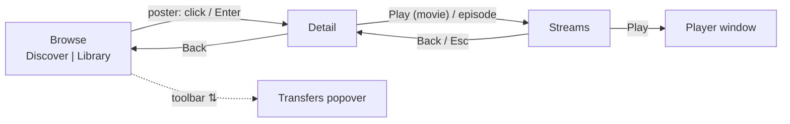

# UI

Desktop v3 is Kinema's only UI. It is built directly on GPUI with in-house
components. This page covers product rules: what screens do and how they behave.
How to build them (tokens, layers, components, motion) is in the
[design system](design-system.md), and those rules are strict.

## Product character

Kinema is a **media browser, not a dashboard.** These principles are in priority
order:

1. **Artwork first.** The chrome is near-black and quiet so posters carry the
   color. Dark is the default theme regardless of the OS setting, and Light is
   available.
2. **One screen, one job.** Browse grid → Detail → Streams → play. There are no
   dashboards, no tab bars and no left rail. Back restores the exact previous
   context.
3. **Strong defaults, few knobs.** Every setting has to earn its place.
   Settings apply immediately, with no Save/Revert bar and with errors shown per
   field.
4. **Desktop native.** Compact density, 1 px hairlines and restrained radii.
   Hover, right-click, Menu or Shift+F10, and the keyboard work everywhere.
   Settings and About share one separate window (single instance).
5. **Motion explains space.** Animations show where things come from and where
   they go. Nothing animates decoratively, and reduced motion is instant.

Fonts are bundled (Inter, JetBrains Mono) so rendering is the same on every OS.

## Navigation and screens

### Toolbar

There is one floating 52 px header language for every main-window view, and only
the contents of its slots change. Every header control uses the **glass**
material (`Palette::glass`), is `CONTROL` high and uses `radius::MD`. The
toolbar owns pointer hits across its height, and the wheel still scrolls the
page. Once content scrolls under the toolbar, a canvas-colored top scrim fades
in.

| Slot | Browse | Detail / Streams |
| --- | --- | --- |
| Leading | Scope chip (one click switches Discover ⇄ Library), kind segmented control | Back |
| Center | Search, 180–440 px | — |
| Trailing | **Filters** chip with an active-count badge, then the global capsule | Global capsule |

The global capsule holds Open local file, Refresh, the transfers status, the
[notifications](#toasts) bell, Settings and the overflow menu (Open local file,
Refresh, About, Quit). **Filters** is the only home for
advanced options, so the header never grows. Facets are never faked: if the
primary provider can't filter server-side, Kinema offers only "sort loaded
results" and says why. Below 1100 px, chips become icon-only and keep their
accessible names.

### Browse grid

- **Cards are poster-only.** At rest a card shows a rating chip (top-left), a
  Library membership toggle (top-right) and `SERIES` below it on shows. Hover
  or focus lifts the card and reveals the title, facts, genres and two lines of
  synopsis over a scrim. The artwork never zooms.
- Poster width is S/M/L = 140/172/212. The gap is `GRID_GAP`, the inset is
  `PAGE_INSET` and the aspect is 2:3. Columns are
  `max(2, floor((W+g)/(P+g)))`.
- The grid is **virtualized by row** with 2 rows of overscan. Stable media keys
  own focus and selection, so a resize keeps the anchor title.
- **Infinite scroll** asks for the next page within 2 rows of the end. A failed
  page shows one retry row and keeps the cards that already loaded.
- **Keyboard:** arrows move by cell or row, Home/End go to row edges, Ctrl/Cmd
  with Home/End go to the loaded edges, PageUp/PageDown move by viewport, Enter
  opens, and Menu opens the context menu. Typing printable characters focuses
  search.
- Each scope (Discover, Library) keeps its own search, filters, sort, scroll and
  focus. Discover and Library use a fixed brand-wash backdrop, never one derived
  from artwork.

### Detail

- A single scrolling page with a 2400 px maximum frame and the shared page inset.
  The hero holds the poster, the story and actions, and an "At a glance" panel
  (rating tiles, key facts). It is followed by grouped fact cards, a cast grid
  and similar titles. Carousels are not used.
- **Series order:** hero → Episodes (wrapping season tiles with progress, a
  next-up highlight, and **Continue · SxEy** in the hero) → About → Cast →
  Similar.
- The hero has **one primary action** (Play, Resume or Continue). Library,
  watched and other actions are secondary buttons from the same 32 px family.
- Detail actions are **the same from every entry point** (Discover, Library,
  search, recommendations). Only the Back target differs.
- Enrichment arrives asynchronously, is checked by generation, and never moves
  focus.

### Streams

- A separate route reached from Detail with the `COLUMN` slide. Esc or Back
  returns to Detail with focus restored.
- It has a compact header, filter controls and a list. The list shows parsed
  quality, codec and audio tags, size, seeders, and **account presence** in the
  debrid service. Account presence is not a cache or readiness check.
- Provider, quality, sort and "in my debrid account" are remembered globally,
  while the text filter lasts for one visit.
- **Single-click selects. Double-click, Enter or the Play button prepares
  inline.** There is no modal Play sheet. A frame ≥ 1040 px gets a side
  inspector with the play controls, and narrower windows get a bottom play dock.
  Starting another stream, or leaving the page, cancels the preparation.

### Transfers, Settings, quit

- The **Transfers popover** lists sessions and the cache line. Copy is truthful:
  "Launch requested", never "Playing". Stop releases the session and does not
  kill the player. Cleanup reports freed and protected bytes.
- The **Settings window** has the sections General, Accounts, Playback,
  Keyboard & Mouse, Storage, Appearance and About. Theme, poster size and motion
  apply live.
- The **quit sheet** appears only when sessions or launches are active. Cancel is
  focused first, and Esc cancels.

## State presentation

Every collection and personal-state surface tells these states apart:

| State | Presentation |
| --- | --- |
| Loading (first) | Skeleton cards appear after `SKELETON_DELAY`. They pulse, and are static under reduced motion |
| Empty success | A centered state block that names the reason and offers a fix action (Clear search, Browse Discover) |
| Failure | ⚠ plus the service and reason, with Retry. **MUST never show as "no results"** |
| Missing credential | 🔑 plus "Open Settings" |
| Stale | Saved content stays visible, and a sticky Warning toast names the failure with Retry |
| Personal state unknown | The controls are disabled, never shown as unsaved or unwatched |

Show a rating only when it is known. Show `0.0` when the known value is zero.
Show an unknown duration as `—`.

### Toasts

Outcomes and page conditions never sit inline in the layout. They are toasts
in one region per window, at the **top-right just below the header** (never
over it), aligned with the header's right edge, newest on top.

- **Label and description.** Every toast has a short label naming what
  happened ("Added to Library", "Playback problem", "Couldn’t save change")
  and a description with the specifics (the title, the reason). Global notices
  carry a topic that supplies the label and tone; the personal-state notice
  carries its own label.
- **Derived, not pushed.** The main window builds the toasts that should exist
  now from state, every render: the global notice, the personal-state notice,
  the Transfers cleanup result and the current route's conditions. A condition
  that clears removes its toast.
- **What is a toast:** results of an action (saved, removed with Undo, a write
  failed with Retry, cleanup finished or failed), app notices (playback or file
  chooser failed), and conditions of the page (stale results, title details or
  Library status unavailable, streams not available for a title).
- **One place per failure.** A failure the screen already shows (stream
  preparation or play in the play panel, cleanup in its own toast) never also
  becomes the global notice.
- **What stays inline:** loading skeletons, empty and full-failure state blocks
  (no content to keep, so the block *is* the page), confirmations that ask
  before acting (clear progress, stop serving), the play preparation panel, and
  the player dock's status. Settings shows errors per field.
- **Lifetime:** confirmations close after `TOAST_TIMEOUT` (5 s), or
  `TOAST_ACTION_TIMEOUT` (10 s) when they offer Undo. Failures and conditions
  are sticky. Hover pauses every timer. The close button is always there.
- **Identity:** one toast per slot key; changed text is a new occurrence. A
  closed condition stays closed while it persists and shows again when it
  comes back.
- At most three are visible.
- **Notification panel.** Every toast occurrence is also logged, so it can be
  read after the toast is gone. The header **bell** opens the log (newest
  first, with tone icon, text and age) and shows an unread-count badge (`9+`
  above nine). An entry is read once the user closes its toast, uses its
  action or opens the panel; a toast that expires stays unread. Opening the
  panel marks all read, and entries that were unread keep a "New" marker while
  it is open. Entries carry no actions (Retry or Undo belong to the live
  toast). The log keeps the newest 50 entries for this session only; it is not
  persisted. **Clear all** empties it.
- A failure toast **never replaces** the honest state: unknown personal state
  still disables its controls, and a collection that failed with nothing saved
  still shows its inline failure block.

## Library

- **Discover** browses provider catalogs. **Library** lists titles the user saved
  explicitly. It does not list downloaded files, and episodes have no membership
  of their own.
- Library filters are kind (All/Movies/Series), title substring search, status
  (Any/Unwatched/In progress/Watched) and sort (Recently added/Title/Newest).
  Queries start from local membership, apply filters before pagination, and
  never fetch a whole show to answer a query.
- **Placement:** posters have an always-visible top-right bookmark. The movie
  hero has membership and watched toggles. The show hero has membership only.
  Episode stills have a top-right watched toggle. Seasons and series use a
  tri-state `WatchedToggle` that applies immediately. Tooltips and accessible
  names describe the *next* action.
- **Child controls never bubble** into card, Detail, Streams or playback
  navigation.
- One global personal-state [toast](#toasts) confirms changes. A removal offers
  **Undo**, and a failed write offers **Retry** while leaving the state unchanged.
  When a filter removes the focused card, focus moves to the next card, then
  the previous one, then the empty-state action.

## Interaction and accessibility

- **Selection and focus are independent.** Selected means the `selection` fill
  plus a marker. Focus is the ring, shown only when focus-visible.
- **Only one menu can be open at a time.** A menu opened with the pointer starts
  with nothing highlighted. A menu opened with the keyboard highlights the first
  enabled row. If any row has a leading icon, every row gets one.
- **Action labels never end in "…".** Status text such as "Loading…" keeps it.
- **Context menus** exist on cards, episodes, streams, transfer rows and text
  inputs. Copied values never include credentials or debrid links.
- **Never shrink text to fit.** Wrap it, clamp it with `clamp_lines`, or
  scroll.
- Every component meets the
  [accessibility checklist](design-system.md#accessibility-checklist).

## Imagery

- Fetch, decode and blur artwork off the render path, as described in
  [data](data.md#artwork-cache).
- `Thumb` has four states: Ready, Loading{fallback}, Fallback and Missing.
- **Fallback chains:** episode still → season backdrop → series backdrop →
  season poster. Season poster → series poster.
- Detail uses artwork-derived tints (`palette.tinted(..)`). Brand, focus and primary
  actions are never recolored.
- Images get rounded corners with `img().rounded(radius::LG)`. GPUI clips
  containers only as rectangles.

## Rendering performance

- **No I/O or decode during render**, and no work proportional to the whole
  catalog per frame.
- Derive view models **once per coordinator revision** and reuse them while
  scrolling. Never cache GPUI elements themselves. Keep invalidation
  conservative, because a stale UI is worse than an extra render.
- Virtualize long collections. Do not trade away keyboard focus or tab stops for
  virtualization.
- Target budgets (p95 frame ≤ 16.7 ms, input ≤ 100 ms) are goals. They have not
  been measured. See [performance budgets](../proposals/performance-budgets.md).

## Change risk

- **Low: layouts, screen composition and copy.** Change them freely.
- **Medium: navigation and focus restoration, and state presentation.** Users
  rely on Back and on errors being honest.
