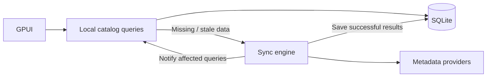
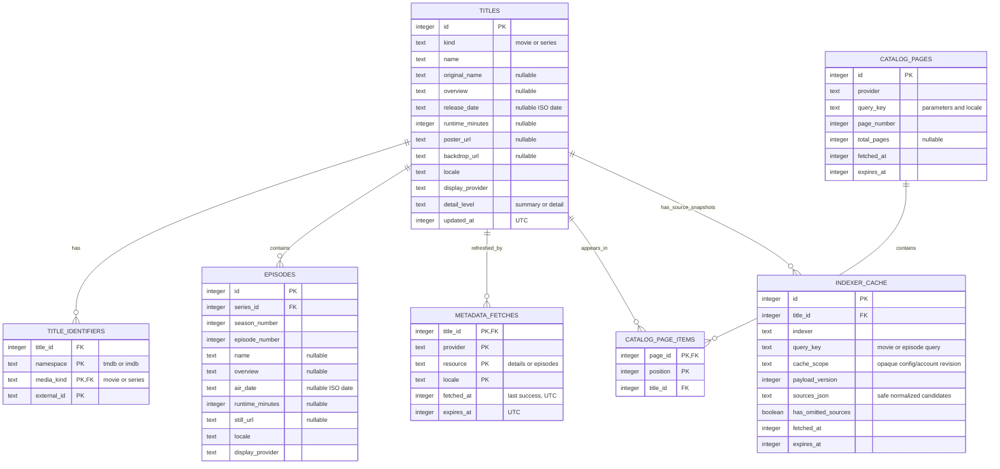

# Catalog and database

**Agreed target:** SQLite holds the local catalog and cached indexer results.
**Implemented:** the smaller Cinemeta search cache below. **Proposed:** the fuller
seven-table schema and sync model later in this document; those tables are not
created by the current adapter.

## Implemented first increment

The desktop adapter stores `catalog.sqlite3` under the build-mode location
specified in [storage layout](storage-layout.md#implemented-catalog-location):
development working-directory `./data/` or production native application data.
Schema version 1 uses SQLite `user_version` and three tables:

| Actual table | Stored data and key |
| --- | --- |
| `cinemeta_v3_searches` | `(kind, query)` primary key, last successful `fetched_at` in UTC Unix seconds, and `result_count` (including zero) |
| `cinemeta_v3_titles` | `(kind, imdb_id)` primary key, title name, optional overview |
| `cinemeta_v3_members` | Ordered membership keyed by `(kind, query, position)`, unique `(kind, query, imdb_id)`, foreign keys to searches and titles |

The table namespace fixes the provider to Cinemeta v3. Query text is trimmed at
the edges, otherwise unchanged and case-sensitive; movie and series queries are
separate. Titles are shared across saved queries of the same kind, so refreshing
one query can update a title's display fields in another saved query. Fetch times
belong to query membership, not independent detail snapshots.

The adapter enables foreign keys, sets a 2-second SQLite busy timeout, and replaces
membership and upserts titles in one transaction after validating the whole remote
response. Network work occurs outside that transaction. Reads validate saved count,
ordered membership, and title values; corrupt data is an error, not an empty result.
Unknown newer versions and nonempty unversioned databases are rejected, not deleted
or silently reset. WAL is not explicitly enabled, and no pruning/reset UI or legacy
migration is implemented.

This is an exact-query result cache, not arbitrary offline text search over all
cached titles or discovery/catalog browsing. There are no episodes, detail-fetch
tracking, pagination, locale variants, indexer snapshots, or seven-table sync engine yet.
[Current refresh policy](cache-policy.md#implemented-first-increment) defines cache
hits, misses, manual refresh, and error preservation.

## Proposed fuller catalog sync

Return locally usable data immediately. Fetch missing details and, as a proposed policy, refresh stale data in the background. After a successful write, notify the relevant query to read the updated result. SQL runs outside rendering; network calls run outside database transactions.

Start with a bounded in-memory queue that combines duplicate requests. Rebuild needed work from user demand and freshness after restart—no persisted job system or full-catalog crawler.

## Proposed seven-table schema

## Proposed table responsibilities

| Table | Purpose and key rules |
| --- | --- |
| `titles` | A movie/series and its current display metadata. Local ID is independent of release, URL, or language. |
| `title_identifiers` | Maps external IDs to local titles. Key: `(namespace, media_kind, external_id)`. Cinemeta can supply an IMDb ID without becoming a separate ID scheme. |
| `episodes` | Episode metadata. Unique `(series_id, season_number, episode_number)`; only series may own episodes. No seasons table until season-specific data is needed. |
| `metadata_fetches` | Last successful fetch per `(title_id, provider, resource, locale)`. A successful empty response is different from never fetched. |
| `catalog_pages` | Search/browse/discovery membership and freshness. Unique `(provider, query_key, page_number)`; query key includes operation, filters, sort, and locale. |
| `catalog_page_items` | Ordered titles in a page. Key `(page_id, position)`; unique `(page_id, title_id)`. |
| `indexer_cache` | Versioned, sanitized source snapshots. Unique `(indexer, query_key, cache_scope)`; episode/configuration/account differences must not collide. See [cache policy](cache-policy.md). |

Caching details alone is insufficient: saved page membership lets the application reopen a collection without waiting for a remote list. Indexer snapshots use typed JSON because the MVP does not need SQL queries over individual candidate fields.

## Proposed integrity rules

- Constrain kind to movie/series, episode coordinates and positions to nonnegative values, and page numbers/payload versions to positive values. Validate typed snapshot JSON.
- Give `titles` a unique `(id, kind)` key. The identifiers' composite foreign key `(title_id, media_kind)` references it, preventing a TMDB movie ID from being mistaken for a TV ID. Never merge titles solely by name.
- Enforce series-only episode ownership in transactional writes. Check conflicting provider IDs/episode numbering rather than silently merging them.
- Enable foreign keys. Page deletion removes its items; title deletion removes its disposable identifiers, episodes, fetch state, page references, and indexer snapshots. Revisit deletion before adding personal records.
- Index child title references and indexer expiry. Replace page membership atomically; partial imports must not mark a resource fresh or downgrade full details to summaries.

## Proposed provider and language policy

Propose one preferred metadata provider with fallback and one display locale per title/episode row. Record the display provider and completeness instead of building field-by-field merging or multilingual snapshots now.

In this proposed model, a fetch timestamp is usable only when the stored snapshot also matches the requested provider, locale, and completeness. Switching English → French → English requires fetching English again if its snapshot was overwritten, even if an old English timestamp is still fresh.

## Fuller database operating model

Start with one SQLite worker, foreign keys enabled, WAL where supported, short transactions, and versioned migrations using `user_version`. Store it in app data; see [storage layout](storage-layout.md).

Ordinary cleanup prunes cached records, not the database file. Full reset is a separate user action, never a fallback for an arbitrary SQL error. Future personal library/progress must survive cache cleanup, but needs no tables yet.

Keep old data on failed refresh and distinguish failure from an empty result. Test ID collisions, episode ownership, locale changes, atomic refresh, cleanup, and migration rollback. The target freshness policy is described in [caching](cache-policy.md); automatic TTLs remain open.
