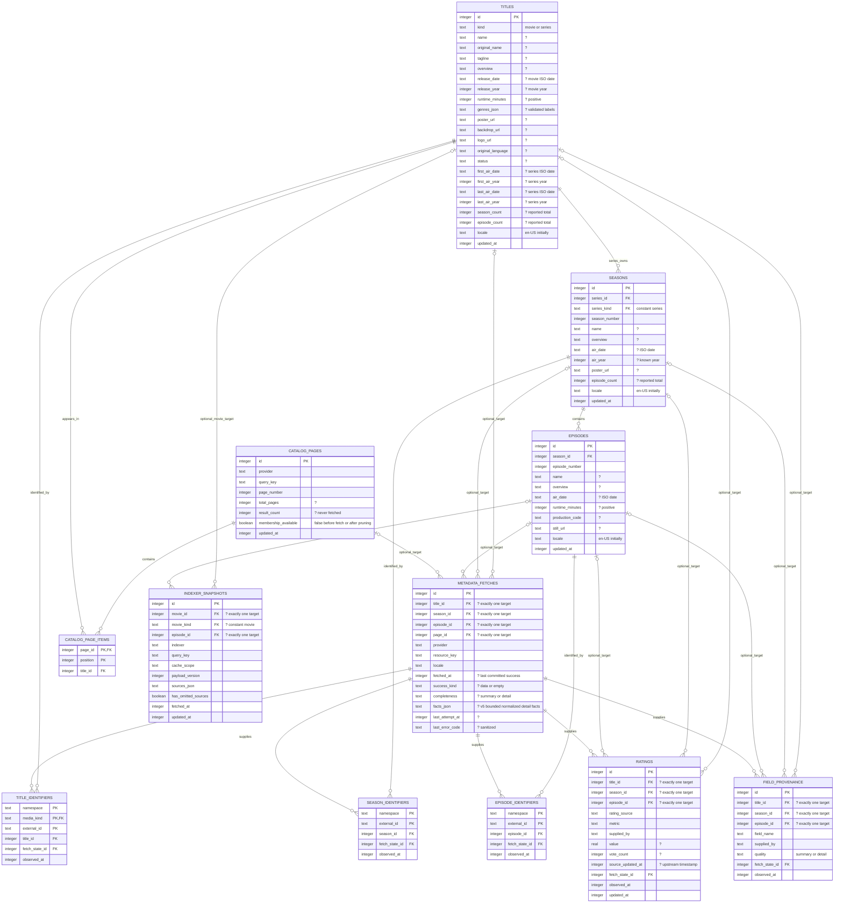

# Catalog and database

**Approved specification: normalized catalog, v6 cache retirement and v7 personal records (source implemented; scoped validation passed).**
The user approved the reviewed provider-agnostic catalog design and authorized
implementation: shared movies/series, rich optional metadata, seasons and episodes,
and bounded background fetching of missing/new details. The tables, fields,
constraints, and merge rules below describe that approved target, not observed
runtime behavior. This replaces the former seven-table proposal; it does not
supplement it with a second competing target.

**Historical v6 baseline (v7 source is now implemented):** schema v6 includes the v4
normalized foundation, the [v5 detail facts payload](#detail-facts-payload-schema-v5),
and [v6 legacy-cache retirement](#legacy-cache-retirement-schema-v6). At that baseline,
fresh databases create only the twelve normalized `STRICT` tables. Older supported databases pass
through the conservative backfill where applicable before the seven legacy cache
tables are retired. Live metadata/indexer paths use canonical rows. Legacy backfill
uses bounded single-row keyset batches. Migration validation uses synthetic temporary
or in-memory databases, not a writable user database. A user's database upgrades
when next opened with the new build. This is not full runtime or UI acceptance.

## Personal Library and manual watch state (schema v7)

**Storage source implemented and reviewed; scoped validation passed.** Inspection of `catalog.rs`,
`catalog_schema.rs`, `catalog_library.rs` and `catalog_library_query.rs` shows
`SCHEMA_VERSION = 7`, migration wiring and personal storage/query operations.
V7 contains **15 STRICT tables**: the twelve normalized catalog tables plus the
three personal tables below. The v6 evidence remains historical baseline evidence,
not validation of v7. The final Library increment has separate lead-reviewed
root/feature tests and Linux synthetic UI captures documented in development;
these establish scoped evidence, not deployed-database or full MVP acceptance.
See the [Library UI contract](design/library.md).

V7 adds three `STRICT` tables to the existing `catalog.sqlite3`, not a second database:

| Table | Columns and integrity |
| --- | --- |
| `library_entries` | `title_id` primary key references `titles(id)` ON DELETE RESTRICT; `added_at` NOT NULL. Row existence means membership. |
| `movie_watch_state` | `title_id` primary key; `title_kind` NOT NULL DEFAULT 'movie' CHECK equals 'movie'; composite FK `(title_id, title_kind)` to `titles(id, kind)` ON DELETE RESTRICT; `watched` NOT NULL integer CHECK IN (0,1); `updated_at` NOT NULL. |
| `episode_watch_state` | `episode_id` primary key references `episodes(id)` ON DELETE RESTRICT; `watched` NOT NULL integer CHECK IN (0,1); `updated_at` NOT NULL. |

All timestamps are nonnegative UTC Unix **milliseconds** (distinct from existing
fetch-time seconds). `updated_at` is mutation order/time, not a viewing date.
The source DDL adds these indexes:

| Index | Table and ordered columns | Purpose |
| --- | --- | --- |
| `library_entries_added` | `library_entries(added_at DESC, title_id)` | Stable Library pagination. |
| `movie_watch_state_updated` | `movie_watch_state(updated_at DESC)` | Persisted maximum watch timestamp lookup. |
| `episode_watch_state_updated` | `episode_watch_state(updated_at DESC)` | Persisted maximum watch timestamp lookup. |

The watch indexes support initializing monotonic mutation timestamps from both
watch tables without a full table scan. After a successful read,
absent watch rows mean unwatched; explicit unwatched rows persist after actions.
Read failure/unknown identity is not absence or a successful empty result.
Membership and watch state are independent; removal preserves watch rows/files.
No history, resume, automatic marking, credentials or show-level watched column.

V6 upgrades transactionally without changing canonical/provider data. Fresh and
older supported creation paths include v7 exactly once; retain unsupported-newer
version refusal. No database reset or historical C++ migration. Personal rows and
the catalog entities they reference are excluded from cache cleanup. Deleting
`catalog.sqlite3` loses these records; backup/export is outside this increment.

### Canonical identity and personal-record reconciliation

Resolve provider external IDs through verified identifier mappings at the SQLite
boundary. Store canonical integer refs, not provider keys or guessed name/artwork
matches. Unresolved identity disables writes with a recoverable error. Canonical-only
saved entries must remain locally openable without credentials or a remote route.

In the existing verified graph-merge transaction, before deleting title/episode
losers (including recursively merged episodes):

- Union membership, retaining the earliest `added_at`.
- Move watch rows; greater `updated_at` wins. Equal-time conflicting values prefer
  unwatched deterministically. Absence never overrides an explicit row.
- Invalidate/return canonical remappings so UI refs refresh. Contradictory identity
  rolls catalog and personal data back together.

Serialize writes in the sole catalog owner. Watch timestamps use
`max(wall_clock_ms, last_persisted_watch_timestamp + 1)`, initialized from stored
watch state; overflow is an error. Use explicit desired state, not blind toggles.
Accepted durable mutations are FIFO and acknowledged only after commit, separate
from coalescible metadata/search work; queue saturation is explicit failure.

### Local Library projections and conservative completeness

Start queries at `library_entries` joined to `titles`, never provider page
membership. Apply kind, bound-parameter literal case-insensitive title substring
search and status before stable pagination with ID tie breakers. Batch personal
reads and episode-summary SQL/adapter work; no per-card queries or network crawl.
Mutations affecting membership/status/sort invalidate the Library query generation;
read revisions must not overwrite newer committed personal state.

Derive show summaries from canonical episodes, including specials and announced
future episodes present locally. Future/new episodes are not automatically marked.
Only successfully acquired listings with reconcilable advertised season/episode
totals establish completeness. Missing counts, failed/missing season acquisition,
contradictions and partial fetches mean unknown. Complete nonempty sets classify
none/some/all watched. Unknown sets remain in Any only, with “N watched · total
unknown” or status unavailable; empty/unknown never means watched. Use persisted
acquisition evidence, not a new independent stored whole-show watch flag.
Season bulk writes require a complete loaded season, confirmed exact count, and
an atomic displayed episode snapshot excluding later arrivals.

The source freezes title/season IDs, season number, verified title external-ID
anchors, and paired episode IDs/original episode numbers at confirmation. Snapshot
creation requires successful season acquisition, a nonempty episode set and a
matching advertised count. Before writing, the transaction re-resolves every title
anchor to the original canonical title, checks season ownership/number and retained
successful acquisition evidence, and verifies each unique episode ID still has its
original season and episode number. Missing/remapped identities or reused IDs
fail rather than silently targeting different rows after a merge. The displayed
set never expands: later arrivals or changed advertised totals alone do not
invalidate it. All guards precede the atomic write. These guards are observed
source behavior with scoped test coverage, not a claim of universal runtime safety.

Migration, merge, query, queue and native evidence has been lead-reviewed within
the scopes recorded in [development](development.md#library-and-manual-watch-tracking-validation-pending).
Live-provider/playback and Windows/macOS acceptance remain unverified.

## Implemented normalized catalog (source evidence)

The twelve normalized tables retained by v6 correspond to the approved entities in the ERD:
`titles`, `title_identifiers`, `seasons`, `season_identifiers`, `episodes`,
`episode_identifiers`, `ratings`, `field_provenance`, `metadata_fetches`,
`catalog_pages`, `catalog_page_items`, and `indexer_snapshots`. The diagram remains
the authoritative target contract, not an inspection of a deployed user database.
The lead compared all twelve ERD entity field sets against actual DDL in fresh
in-memory SQLite and found **zero column mismatches**. This structural check does
not establish every runtime policy or full UI acceptance.
The rich domain API exposes artwork, distinct ratings, external IDs, seasons,
episodes, and provenance. The backend reports verified-ID graph reconciliation
and contradiction rollback coverage. Existing GPUI projections remain narrower:
per-field origins and the full rich model are not rendered. The HTML prototype is
frozen for user review; no GPUI redesign has been implemented.

### Legacy-cache retirement (schema v6)

The user explicitly approved discarding obsolete provider-cache records, including
records that cannot be faithfully transferred. V6 drops `cinemeta_v3_searches`,
`cinemeta_v3_titles`, `cinemeta_v3_members`, `cinemeta_v3_browse`,
`cinemeta_v3_details`, `tmdb_v1_cache`, and `indexer_sources_v1`. The retirement
and its version advance are transactional. Normalized titles, seasons, episodes,
identifiers, ratings, provenance, fetch state, saved pages, and indexer snapshots
are preserved. A v5 upgrade does not replay stale legacy metadata over canonical
values. Old-only saved results may no longer be available offline and may require
refetching; rollback or an automatic reconstruction of discarded cache data is
not promised. No separate archive subsystem is introduced.

Identifier consolidation was reviewed and rejected for this increment. The three
identifier tables preserve distinct registry collision domains and concrete owner
FKs. A unified table would replace those simple boundaries with conditional target
and uniqueness rules; existing import code already shares identifier handling.

### Conservative v3 preservation and backfill limits

These describe the historical v4 backfill, which still runs for pre-v4 upgrades.
V6 subsequently removes the legacy tables with the user's explicit authorization.

- The v4 stage retains legacy rows while creating and backfilling normalized data;
  legacy preservation is no longer the final v6 state.
- Nonempty legacy Cinemeta exact-query searches are **not backfilled** because
  shared title fields cannot establish unambiguous query-specific provenance.
  Before v6 their old rows survive, but the first canonical query requires a
  refresh/fetch; v6 discards the old rows rather than claiming lossless transfer.
- Known legacy detail **fields retain `Detail` provenance quality**. Only the
  corresponding **fetch-resource completeness stays `Summary`**, so richer details
  are refetched on demand without downgrading known field values. Do not mistake
  resource incompleteness for summary-quality provenance on every backfilled field.
- Legacy source targets without verified canonical mappings are not imported;
  v6 discards those legacy snapshots. Never invent identities to make them reusable.

Detailed check scopes, intermediate runs, and logs are recorded in the
[development validation history](development.md#current-normalized-catalog-batch).
Post-v4 authenticated-provider/debrid and new GUI acceptance remain unverified;
earlier user-reported successes apply to earlier versions, not this acceptance.

## Implemented first increment

**Historical v1–v3 provider-cache layout, retained by v4/v5 and retired by v6.** This section preserves
the original implementation evidence; it is not the current canonical read path.
The original exact-query cache was the foundation. Version 2 added
Cinemeta browse/details and source snapshots; version 3 added TMDB resources.
These source-level migrations are not proof of final end-to-end acceptance.

The desktop adapter stores `catalog.sqlite3` under the build-mode location
specified in [storage layout](storage-layout.md#implemented-catalog-location):
development working-directory `./data/` or production native application data.
Version 1 introduced these tables, retained in version 3:

| Actual table | Stored data and key |
| --- | --- |
| `cinemeta_v3_searches` | `(kind, query)` primary key, last successful `fetched_at` in UTC Unix seconds, and `result_count` (including zero) |
| `cinemeta_v3_titles` | `(kind, imdb_id)` primary key, title name, optional overview |
| `cinemeta_v3_members` | Ordered membership keyed by `(kind, query, position)`, unique `(kind, query, imdb_id)`, foreign keys to searches and titles |

The later source migrations add:

| Actual table | Stored data and key |
| --- | --- |
| `cinemeta_v3_browse` | `(kind, offset)`, fetch time and normalized page payload |
| `cinemeta_v3_details` | `(kind, imdb_id)`, fetch time and normalized detail/episode payload |
| `indexer_sources_v1` | `(indexer, target, scope)`, fetch time and sanitized source payload |
| `tmdb_v1_cache` | `(resource, locale)`, fetch time and normalized page/detail/season payload; locale constrained to `en-US` |

TMDB resource keys bind operation, media kind, numeric ID or exact search text,
and page/season as applicable. Public cached metadata can be read without accessing
a token; remote requests require the selected provider's credentials. Source
snapshots contain stable torrent/file identities, not signed media URLs or tokens.

The original three-table namespace fixes the provider to Cinemeta v3. Query text is trimmed at
the edges, otherwise unchanged and case-sensitive; movie and series queries are
separate. Titles are shared across saved queries of the same kind, so refreshing
one query can update a title's display fields in another saved query. Fetch times
belong to query membership, not independent detail snapshots.

The adapter enables foreign keys, sets a 2-second SQLite busy timeout, and replaces
membership and upserts titles in one transaction after validating the whole remote
response. Network work occurs outside that transaction. Reads validate saved count,
ordered membership, and title values; corrupt data is an error, not an empty result.
Unknown newer versions and nonempty unversioned databases are rejected, not deleted
or silently reset. In that baseline, WAL was not explicitly enabled and no pruning/reset UI or
legacy migration was implemented. The v4 upgrade above is a Rust-schema upgrade,
not migration of historical C++ databases.

The original search cache stores exact-query membership, not arbitrary offline
text search. Browse/detail/episode/source and TMDB resource caches now supplement
it in the historical baseline; the v4 canonical implementation is described above.
[Current refresh policy](cache-policy.md#implemented-first-increment) defines cache
hits, misses, manual refresh, and error preservation.

## Target catalog schema

### Target normalized catalog ERD

This is the approved expected target, **not a user-database inspection or full UI
acceptance claim**. Current source/migration evidence is summarized above. Names are
logical table/column names, not executable SQL. The field inventory and integrity
rules following the diagram are part of the same specification. `?` in descriptions
means nullable; omitted FK edges are not implied polymorphic references.

The optional-target edges mean **one chosen parent per row**, not a row linked to
all entity types. Concrete FKs and exactly-one checks below enforce that choice.
No bare `(entity_type, entity_id)` reference is used.

## Target field inventory

All local IDs are opaque integer primary keys, unrelated to provider IDs or URLs.
Times are UTC Unix seconds. `updated_at` records a material local row change;
`fetched_at` records a successful, validated, committed remote resource fetch.
A local reread changes neither. An identical successful refresh advances fetch time
but not entity `updated_at`; provenance observation times may advance separately.

### Movies and series

`titles` shares one row model across Cinemeta/TMDB and both kinds. The diagram
lists every column; this inventory elaborates their meaning:

| Fields | Approved target meaning |
| --- | --- |
| `original_name`, `tagline`, `overview` | Nullable original title and rich description text; no fabricated placeholders |
| `release_date`, `release_year` | Nullable ISO calendar date and/or known year; a year alone never becomes January 1 |
| `runtime_minutes` | Nullable positive integer; for a series only a documented representative episode runtime, never total series runtime |
| `genres_json` | Nullable validated ordered, deduplicated list of nonempty genre labels; not a provider response blob |
| `poster_url`, `backdrop_url`, `logo_url` | Nullable public artwork locations; image bytes belong to the separate artwork cache |
| `original_language`, `status` | Nullable language tag and adapter-normalized status; unknown status remains NULL |
| `first_air_date`, `first_air_year`, `last_air_date`, `last_air_year` | Nullable series dates and/or known years; preserve year-only information without inventing a date, and do not infer completion from last air date/year |
| `season_count`, `episode_count` | Nullable nonnegative provider-reported series counts, not counts inferred from locally cached children |

Movie rows must have NULL series-only dates/years/counts; series use first/last-air
dates/years rather than overloading movie release dates/year. When both a date
and its corresponding year are known, they must agree. `name` may be NULL for an
identity-only placeholder, but must be nonempty when supplied. The UI must indicate
missing details instead of presenting a placeholder as fetched metadata.

### Seasons and episodes

`seasons`: unique `(series_id, season_number)`; `season_number >= 0`, with zero
reserved for specials. Its nullable `air_date`, `air_year`, `poster_url`, and
`episode_count`, plus non-null `locale` (`en-US` initially), are shown in the ERD.
`air_year` preserves a known year when a full date is unavailable; if both are
known they must agree. Never fabricate January 1. Counts are reported totals, not local row
counts. Names, descriptions, artwork, dates, counts, and season ratings can arrive
independently. No synthetic season-wide rating is derived from episode scores.

`episodes`: unique `(season_id, episode_number)`; `episode_number > 0` only when
explicitly supplied by the provider (never default unknown numbering to zero).
Under the approved positive-number restriction, unsupported zero/alternate
numbering must be reported, not silently remapped.
The ERD includes nullable `air_date`, positive `runtime_minutes`, `production_code`,
`still_url`, and non-null `locale` (`en-US` initially). The parent season determines series and
season number; do not duplicate those coordinates on each episode. Incomplete
provider details need not invent an episode row without stable coordinates.

Optional `season_identifiers` and `episode_identifiers` store real external IDs
only when supplied; lack of a season ID does not prevent storing season details.
Identifier namespaces denote registries with the explicit collision domains below,
not arbitrary adapter names; provider-generated episode-coordinate strings are
not IMDb IDs. Episode artwork and ratings remain independent nullable details.

### External identities

- `title_identifiers`: primary key `(namespace, media_kind, external_id)`;
  `UNIQUE(title_id, namespace)` in this initial model. A TMDB movie ID and TMDB TV
  ID with the same digits are different identities. Cinemeta-supplied `tt…` IDs use
  namespace `imdb`, not `cinemeta`.
- **TMDB:** title numeric IDs are kind-scoped (movie versus series/TV).
  Season IDs are unique within TMDB seasons; episode IDs are unique within TMDB
  episodes. The same digits in these different entity types do not imply identity.
- **IMDb:** `tt…` IDs are globally unique across movies, series, and episodes.
  In every import transaction, check both title and episode identifier tables:
  reject reuse across kinds/entity types or a conflicting owner. Add a partial
  unique index on `title_identifiers(external_id) WHERE namespace = 'imdb'` for
  within-title enforcement; the cross-table rule still requires transactional
  validation. Do not invent IMDb season IDs; season support needs a documented
  registry identity, not an episode/title ID borrowed for the season.
- Season/episode identifier primary keys are `(namespace, external_id)` in their
  respective tables; each also has `UNIQUE(parent_entity_id, namespace)` (using
  `season_id` or `episode_id`). Keys prevent duplicate IDs within their domains;
  transaction validation also rejects reuse under a different series/season,
  conflicting coordinates, or silent reparenting of an already identified entity.
  Proven-equivalent duplicate parents may be unified only by the
  [approved narrow reconciliation](#approved-narrow-identity-reconciliation), not
  by relaxing these ownership/collision checks.
- Any other registry requires an explicit collision/scope contract before support.
  Parent-scoped IDs need an explicitly scoped key/namespace design, not a guessed
  globally unique ID or an unchecked extra registry name.
- All identifier rows carry `fetch_state_id` and `observed_at` (UTC). These describe
  the supplying resource identity and observation time of the current mapping,
  not immutable historical proof. On accepted repeated confirmation, update this
  current supplier link and observation time together; do not claim to preserve
  original response evidence. Corrections/conflicts require explicit resolution.
- These IDs describe catalog entities, not torrent releases, playable files,
  debrid assets, or expiring URLs. IMDb mapping remains required for source lookup;
  its absence is explicit unavailability, not permission to guess.

### Ratings: source is not supplier

One `ratings` row represents an observation for a concrete title, season, or
episode, a rating source/metric, and a supplying adapter. `rating_source` identifies
whose score it is; `supplied_by` identifies how Kinema received it. Thus an IMDb
score supplied by Cinemeta is `imdb / score / cinemeta`, **not a Cinemeta rating**.
TMDB votes are not IMDb votes. Rotten Tomatoes critic and audience metrics are
separate; do not average or relabel them.

| `rating_source / metric` | Canonical scale and validation |
| --- | --- |
| `imdb / score` | 0–10 inclusive |
| `tmdb / score` | 0–10 inclusive |
| `rotten_tomatoes / critic_percent` | 0–100 inclusive |
| `rotten_tomatoes / audience_percent` | 0–100 inclusive |

Store nullable `value` and nullable nonnegative `vote_count`, plus nullable
`source_updated_at` only if the upstream actually supplies it, `observed_at`,
`updated_at`, and `fetch_state_id`. At least value or vote count must be known.
No row means no known observation; NULL means unknown, not zero votes/score. Zero
is a legitimate reported value. Vote counts must belong to the same metric and
observation; never attach audience votes to critic scores or carry an old vote
count forward as though it accompanied a new score.

Adapters validate documented upstream scales and convert deterministically to
these canonical ranges (e.g. percent text to numeric percent). Reject invalid,
nonfinite, or ambiguously scaled data; never infer scale from magnitude. Display
with its source and scale. A future metric requires an explicit scale/validation
contract, not a free-form rating bucket. No score averaging, invented ratings, or
direct IMDb/Rotten Tomatoes integration is implied. If the primary provider lacks
a rating, enrichment may supply it under the provider-priority policy; an absent
IMDb score stays unavailable rather than being replaced by a TMDB score.

### Fetch state, saved pages, and source snapshots

`metadata_fetches` has exactly one concrete target: title, season, episode, or
saved page. `provider`, versioned canonical `resource_key`, and `locale` identify
the request, including operation, external identity, and parameters such as season
number. A title-detail fetch and a season episode-list fetch cannot share state.
One resource may supply child metadata; provenance links those children to that
resource state, rather than falsely claiming an independent child-detail fetch
occurred. `metadata_fetches` rows are mutable current state: `fetch_state_id` is
only a resource/supplier identity link, not an immutable observation or response
archive. Resource identity/target/provider/locale stay fixed for a row; attempt and
success state change over time. Field, rating, and identifier `observed_at` values
record their own current observation times, which need not match the linked
state's newest `fetched_at`. No raw historical proof or event history is retained.

`fetched_at`, `success_kind`, and `completeness` are all NULL before first success,
and all non-NULL after success. `success_kind = empty` records a valid authoritative
empty response, not a transport/auth/parse error. Completeness describes this
resource, not every field on an entity. Here `summary` means a list/summary
representation; `detail` means the adapter's validated detail representation, not
that every optional field is populated. A NULL field with no matching successful
resource state is not yet checked; a NULL field after a matching detail success
means unavailable in that observation, not an invitation to refetch indefinitely.
A successful detail response with missing optional values can therefore satisfy
the detail request while leaving richer retained fields untouched. A summary
success does not satisfy a request for detail. `last_attempt_at` and a bounded sanitized
`last_error_code` can report failure without advancing success time or erasing
previous state. Do not store raw responses, credentials, or unsafe error text.
No expiry column or automatic TTL is adopted by this target.

`catalog_pages` saves **provider-specific** search/browse/discovery membership,
not provider-specific copies of titles. Unique `(provider, query_key, page_number)`;
`query_key` is canonical, versioned, and includes operation, exact search text,
media kind, filters, sort, locale, and paging mode. Preserve text semantics; do not
silently lowercase or normalize distinct queries. Positive local page numbers map
explicitly to provider page/offset/cursor semantics in the resource key; never
assume provider offsets are page numbers. `total_pages` is nullable/nonnegative.
`result_count` is NULL before success, otherwise nonnegative, including zero.
`membership_available` is a non-null boolean, false before fetch or after page
membership pruning, and true after a successful membership commit (even empty).
Page success time comes from its corresponding fetch-state row; page membership,
`membership_available`, and successful fetch state are committed together.
Pruning removes items and sets `membership_available = false` atomically without
changing the last successful count/time into a false empty result. Such a stub is
a local membership miss on demand, regardless of prior successful fetch state.

`catalog_page_items` is ordered by nonnegative, contiguous zero-based `position`;
unique `(page_id, title_id)`. A saved empty page has zero members, successful
fetch state, `result_count = 0`, and `membership_available = true`. Reads verify
count/positions only for available membership; a pruned page is unavailable, not
corrupt or successfully empty. These tables allow reopening saved provider results offline. **They
do not implement arbitrary offline full-text search over all catalog titles**;
that would require a separately reviewed search/index/query design.

`indexer_snapshots` stays separate from metadata and ratings. It targets either a
movie or an episode, never a bare series/season or an unchecked numeric target.
Its key includes `indexer` (including endpoint identity), canonical `query_key`
(exact IMDb/episode coordinates and server-side options), and opaque non-secret
`cache_scope` for account/configuration revisions. Local target FKs must agree
with the query identity; absence of a required mapping blocks lookup.

Store only versioned validated `sources_json` with stable torrent/file identities,
release details and explicitly temporal availability hints. `has_omitted_sources`
marks candidates omitted because they have only temporary authorized URLs; such
snapshots are not complete playable results. Never persist signed URLs, tokens,
credential-bearing configuration, raw payloads, or token hashes as account scopes.
Successful empty snapshots are valid. Failed refresh retains the previous snapshot
and time; report its error without manufacturing an empty row. `fetched_at` is
last successful commit, `updated_at` last payload/material change. See
[source-result policy](cache-policy.md#proposed-saved-source-results). Retention
limits remain open; there is no new expiry/automatic-refresh commitment here.

## Target integrity and indexes

These are the approved integrity/test requirements, not executable DDL or a
literal audit of user databases. Backend source and targeted tests are reported
above; current root checks passed, without establishing full runtime/UI acceptance:

1. Enable SQLite foreign keys on every connection. All `*_id` references in the
   diagram use real FKs. Add `UNIQUE(titles.id, titles.kind)`.
   `title_identifiers(title_id, media_kind)` references that composite key.
   `seasons(series_id, series_kind)` references it with
   `CHECK(series_kind = 'series')`; a movie cannot own a season. Episodes reference
   a real season. Index all child FK lookup columns.
2. For `ratings` and `field_provenance`, enforce
   `CHECK((title_id IS NOT NULL) + (season_id IS NOT NULL) +
   (episode_id IS NOT NULL) = 1)`. For `metadata_fetches`, include `page_id` in
   that sum. Every nullable target column still has its own FK.
3. NULL-bearing composite unique keys are insufficient in SQLite. Create separate
   partial unique indexes per non-NULL target: ratings use
   `(target_id, rating_source, metric, supplied_by)`; provenance uses
   `(target_id, field_name)`; fetch state uses
   `(target_id, provider, resource_key, locale)`. For page fetches additionally
   validate that provider/locale/parameters agree with the saved page. The
   corresponding target-specific `WHERE target_id IS NOT NULL` is mandatory.
4. `indexer_snapshots` has `CHECK((movie_id IS NOT NULL) +
   (episode_id IS NOT NULL) = 1)` and a separate FK for `episode_id`.
   Enforce `(movie_id, movie_kind)` → `titles(id, kind)` plus an explicit check:
   movie target requires non-NULL `movie_kind = 'movie'`; episode target requires
   NULL `movie_kind`. This avoids SQLite composite-FK NULL bypasses. Use separate
   partial unique indexes on `(movie_id, indexer, query_key, cache_scope)` and
   `(episode_id, indexer, query_key, cache_scope)` for the respective target cases.
5. Constrain kind, enumerated metrics/scales, numbers, dates, and snapshot versions;
   require nonempty IDs/keys. Validate real calendar dates, typed JSON, field-name
   allowlists per entity, and resource/target coherence at the adapter/write
   boundary. Database CHECKs handle ranges/enums/exactly-one constraints; SQL
   transaction validation handles cross-row semantics. Successful page writes
   verify member count and contiguous positions before advancing fetch state.
6. `fetch_state_id` references a retained mutable resource-state row, not a job
   or immutable observation ID. In the write transaction verify that supplier,
   resource scope, and observed target agree (a series resource may legitimately
   supply its children). Ratings use `supplied_by`; provenance records it for every
   non-NULL mutable descriptive field, including genre lists, counts, and artwork.
   Identifier rows link their current supplying resource. No provenance row is
   needed for NULL unknown fields; each current observation keeps its own time.
7. Default entity/fetch deletion to RESTRICT. **Cache/page/indexer/media cleanup
   must not delete canonical titles, seasons, episodes, identifiers, ratings, or
   field provenance.** Canonical catalog retention/deletion is a separate open
   decision, not cache eviction. Cleanup may prune page items and sanitized indexer
   snapshots; media/artwork payload cleanup stays separate. Referenced fetch-state
   rows and their page parents remain lightweight stubs even after item/payload
   pruning. Delete a page/fetch stub only after explicit reference checks show it
   is unreferenced; never cascade through canonical data to make deletion possible.
   A permitted page deletion may cascade only to its page items. Do not orphan
   provenance or reset the database on errors. This normalized-catalog baseline adds no personal-record tables; the approved
    v7 extension above adds them separately, with scoped validation recorded above.

## Target provenance and deterministic merge rules

This is a small current-value catalog, not a general history/event framework.
`field_provenance` has exactly one row per current non-NULL descriptive field:
its supplier, resource identity link, observation time, and summary/detail quality.
It describes only the current retained value. Replacing that value also replaces
its provenance; the previous supplier's value/provenance is discarded, not retained
as an alternate candidate. There is no historical field-value store or automatic
restoration of overwritten values on provider switching. Mixed origins across
different current fields are explicit; a row-wide `display_provider` could hide
them and is not used. JSON genre arrays are one field, not independently merged
fragments. Unlike descriptive fields, ratings can retain separate current rows
per source/metric/supplier, but not a history of observations within each tuple.

Approved target deterministic write policy (priority/enrichment revision approved
2026-10-21; implementation in progress, not live-provider verification):

1. Use the ordered provider list: the first enabled, active provider handles
   search/browse; enrichment providers may fill missing fields and supply explicit
   ID mappings. Skip providers missing required credentials as inactive, not errors.
   Details enrich after the primary result; grid work covers visible cards only,
   under the [bounded enrichment policy](architecture.md#agreed-metadata-provider-contract).
   Priority changes do not delete shared identities or older catalog values.
2. Resolve an incoming entity by validated external identifiers first, then by
   verified parent and explicit season/episode coordinates for children. Cross-ID
   mappings must be supplied explicitly by a provider. Never merge by
   name, year, artwork URL, similar runtime, or coincident numeric provider IDs.
   When explicit provider-supplied IMDb mapping proves that different local rows
   represent the same entity, apply only the approved narrow transactional
   reconciliation below. Otherwise, different-row resolution or any contradictory
   external ID, kind, parent identity, or season/episode coordinate aborts the
   resource import and reports the conflict. No guessed coalescing, arbitrary
   reparenting, or identifier overwriting is permitted.
3. Validate the entire response before a short write transaction. New non-NULL
   fields fill unknown values. Missing/NULL/blank provider fields do not clear
   known values. Treat reported zero counts/scores as known, not blank. Removal
   or correction to unknown requires an explicit reviewed clearing operation;
   absence from a page does not delete a catalog entity or its children.
4. Per descriptive field, the highest-priority provider with a value wins;
   lower-priority providers fill gaps, regardless of cross-provider observation
   time. Within the same provider, newer accepted observations win at equal
   quality; detail can replace summary, but summary cannot replace detail.
   Reject stale request generations before writes, including after priority or
   configuration changes; serialize accepted writes so completion order cannot
   overwrite newer demand. Update each value and its provenance atomically.
5. Retained fields from other suppliers remain usable gap-fill values with stored
   provenance. They do not imply success/completeness for another provider's
   resource. Details attribute actual contributors in a footer, not per-field UI.
6. Rating observations are separate per source/metric/supplier; never merge their
   values or votes across rows. For the same tuple, accept newer validated
   observations as a unit; unknown parts remain NULL, not borrowed from an older
   observation. A wholly absent rating leaves the previous dated observation
   intact. For a given source/metric, provider priority selects the display
   candidate among suppliers with a value. Keep source labels truthful: a TMDB
   score cannot fill an IMDb score slot.
7. Fetch success advances only after all entities, provenance, ratings, page
   membership (if any), and fetch state commit together. Failure rolls back the
   resource import, retains last good data/time, and reports failure separately.
   An empty page replaces that page's membership; it does not clear existing
   entity descriptions, ratings, or other pages. Detail responses must not erase
   children merely because they omit an episode/season list.

### Approved narrow identity reconciliation

**User-approved policy; backend reports graph reconciliation and rollback coverage.**
Current root checks passed; integrated UI acceptance remains pending. Automatic
reconciliation is allowed only when an explicit mapping supplied by the selected
provider to an IMDb ID proves duplicate local identities, and the complete affected
identity/ownership graph has **no contradictory external IDs or season/episode
coordinates**. Never use name/year similarity, inferred IDs, or a second-provider
lookup. Missing IDs are not contradictions; different known IDs in the same registry
collision domain are. This exception resolves duplicates of the same entity, not
reuse of an IMDb ID by genuinely different title/episode entities or kinds.

Validate before writes and recheck inside one transaction. Choose a deterministic
surviving local identity; union compatible external identifiers and retarget every
catalog reference before retiring redundant rows. For duplicate series, reconcile
matching seasons/episodes only within proven-equivalent parents and matching
explicit coordinates; preserve nonoverlapping children. A conflicting known parent,
numbering, or child external ID aborts the whole reconciliation/import, leaving
both original graphs and last-success state intact. No partial reparenting is valid.

Preserve all nonconflicting known metadata, artwork, ratings, and child records.
For overlapping descriptive fields, apply the existing per-field quality/observation
precedence, with a deterministic survivor tie-break; keep the chosen value and its
own supplier/resource link/observation time together. This remains a current-value
model, not an archive of alternate field values. Union distinct rating tuples;
resolve same-tuple observations as whole observations under the rating policy,
never blending values/votes. Provider-reported season/episode counts remain
provenanced fields: do not add them together or replace them with cached row counts.

Retarget page membership, indexer targets, resource-state targets, identifiers,
ratings, and field provenance with all FKs/unique constraints valid at commit.
If both duplicates occur in one saved page, retain the first occurrence, remove
only the duplicate membership, compact positions, and update that page's local
`result_count` to match its unique saved members. Do not alter page identity,
provider paging totals, availability state, or successful fetch time merely because
of reconciliation. Pruned pages remain pruned; do not manufacture membership or
remote count information for a stub. Consolidate colliding resource-state keys
without losing the last successful state or latest attempt/error; rewrite every
`fetch_state_id` reference to the retained matching resource/supplier identity,
keeping each observation's own time. Do not mark any unfetched resource fresh.
Indexer-key collisions must preserve compatible snapshot/reference semantics or
abort rather than silently discarding conflicting data. Notify affected local
queries only after a successful commit; failure rolls back every reference change.

This is **identity reconciliation, not cache cleanup or catalog deletion policy**.
Retiring a redundant row after complete reference transfer is permitted only by
this proven-identity transaction; cache/page/indexer/media eviction still cannot
delete canonical entities, identifiers, ratings, or provenance. Catalog retention/
deletion remains separately open. Backend-owner evidence reports implementation;
that evidence does not establish migration of actual user data or full GUI acceptance.

## Target local-first dataflow and lifetime

Local normalized rows are the primary read model, not a disposable mirror rebuilt
for every screen. Return usable local data immediately with provenance and missing
states. Demand for a saved page, detail, season, or episode enqueues missing work;
opening a partial series can fetch its newly requested season/episode details.
Explicit refresh discovers newly available provider data. Cached counts do not
prove every child has been fetched; successful empty state avoids repeated misses.
This is demand-driven, not a promise to detect new releases while idle.

Use an owned bounded in-memory queue, coalescing equivalent provider/resource/
locale requests, prioritizing visible work. Bound concurrency, response sizes,
and retries; cancel obsolete work where possible and reject stale generations
before persistence and UI delivery. SQL and decoding stay outside rendering;
network waits stay outside database transactions. Notifications cause local rereads,
not independent UI-owned provider merges. Rebuild demand after restart; no durable
job engine, full-catalog crawler, plugin framework, or global event bus is needed.

**No automatic TTL, periodic polling, or automatic stale refresh is adopted.**
Missing-resource fetch and explicit refresh are the target triggers. Retry/backoff
must respect provider limits and must not turn a successful empty result into an
endless missing-data loop. Provider/resource success state is not evidence that
all optional fields exist. Failure, never fetched, successful empty, and partial
usable data are distinct states.

## Provider and locale boundaries

The [agreed metadata contract](architecture.md#agreed-metadata-provider-contract)
uses ordered provider priority with primary search/browse and secondary
enrichment. A shared local title does not imply shared provider page membership
or fetch success. Cached public metadata does not require reading a token;
remote work uses OS secure storage. Providers missing required credentials are
inactive and skipped without erasing local rows.

The initial target keeps the current fixed `en-US` contract. Entity `locale` and
fetch/page locale must agree; nonlocalized identifiers/ratings remain independent
of translation. This design does **not** claim simultaneous translated field
storage. Multi-locale selection/fallback remains open and would need a reviewed
localized-field design; retaining an old fetch timestamp must never assert that
an overwritten language snapshot still exists.

## Approval, preservation, and implementation gates

The user approved the reviewed ERD/details and authorized implementation.
**Implementation and the HTML UI prototype now proceed in parallel**; ERD approval
is no longer the next action. Automatic refresh intervals, retention budgets,
multi-locale storage, and offline full-text search remain unresolved; approval does
not settle those open policies by implication. The prototype still requires user
review before any GPUI redesign.

The historical **Rust v3 → v4** upgrade introduced conservative backfill and
bounded-memory streaming. The separately reviewed [v6 retirement](#legacy-cache-retirement-schema-v6)
now supersedes the requirement to keep those seven legacy cache tables. The user
explicitly authorized disposal of old-only cache records, not guessed provenance
or identities. Continue to backfill only unambiguous metadata and do not mark
optional details complete without resource evidence. V6 retirement and version
advance commit together; failure rolls both back. No actual user-database upgrade
or full UI/provider acceptance is established by synthetic migration tests.

Preserve existing Rust/user worktree data, settings, managed media, and OS secure
storage. Do not migrate historical `~/.config/kinemarc`, `kinema.db`, or old keyring
entries; do not inspect tokens. The user-requested development database review was
read-only; migration development and testing use synthetic databases. Unknown
newer/nonempty unversioned databases remain errors, never deletion/reset triggers.
Ordinary cleanup prunes only disposable membership/snapshots/payloads, not the
database file or canonical catalog. Referenced page/fetch stubs survive pruning;
canonical catalog retention/deletion remains a separate open decision.

Maintain regression coverage for FK enforcement and NULL/partial-index
cases, series-only ownership, movie-vs-episode indexer targeting, registry-scoped
ID collisions (including cross-table IMDb reuse), proven duplicate reconciliation,
contradiction rollback, reference/page/count/provenance preservation, conflicting
numbering, current-
value provenance replacement and summary/detail precedence, distinct
rating scales/votes/suppliers, provider-priority changes, stale generations,
successful empty versus failure, identical refresh timestamps, atomic membership,
locale mismatch, membership-pruning versus successful-empty states, referenced
page/fetch-stub preservation, prohibition of canonical deletion by cache cleanup,
migration rollback, and preservation of existing data. Consider
one SQLite worker and WAL where supported only as implementation choices to test,
not implied claims about the current adapter's operating mode.

## Detail facts payload (schema v5)

The v5 source upgrade adds nullable `metadata_fetches.facts_json`, a bounded,
validated normalized detail projection scoped to the provider/resource/locale
fetch row, not a raw provider response. It retains distinct TMDB score/votes and
IMDb score, runtime, dates/status, US certification, language, credits, studios,
networks and tagline where supplied. Cinemeta also retains its supplied writers,
countries and release-info text. Cast is limited to ten; unknown character names
remain null. Canonical scalar fields and ratings continue using existing rich
imports/provenance; the payload supplies provider-scoped detail-only collections
and facts. The approved priority/enrichment revision is in progress; this payload
alone does not establish merged detail-facts behavior.

The atomic v4 → v5 upgrade preserves existing rows and timestamps; NULL facts
load as empty facts and remain explicitly unacquired. The non-NULL payload itself
is the acquisition marker, independent of whether it contains any known facts;
no schema bump, migration rewrite or user-data reset is needed. The detail-only
`CatalogService::metadata_needs_refresh` predicate exposes this distinction for
worker cache-hit-then-remote routing. Load consumes this only after a successful
metadata cache hit; predicate failures preserve the cache hit without refreshing. Existing reduced snapshots omit the new optional payload
and also decode empty. The next successful selected-provider remote detail fetch
replaces facts, including clearing facts now unknown. This payload introduces no TTL or credential storage; enrichment follows the
approved provider-priority policy. The adapter locale is currently fixed
to en-US, hence certification preference is US; user locale selection is not yet
implemented. Offline fixture tests do not establish real-provider/GUI acceptance.
