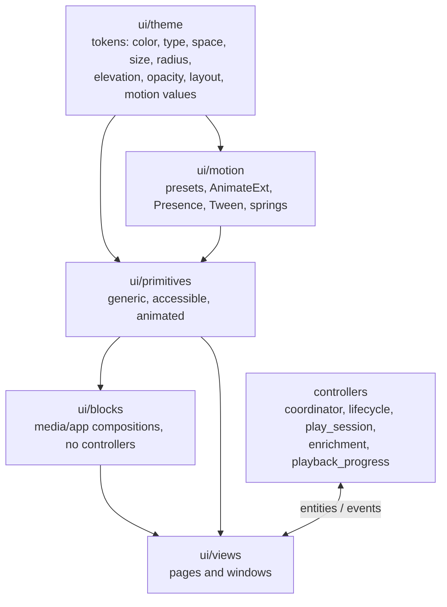

# Kinema design system

Reference for the Desktop v3 tokens, layers, component conventions, accessibility
baseline and motion runtime. Product rules (what the UI should feel like, accent
scarcity, artwork scrims, selection and disabled rules) stay in
[Desktop v3](desktop-v3.md); this document is the *how*. The code is the source of
truth for values: `crates/kinema-desktop/src/ui/theme/` carries tests that pin the
tables below.

Naming follows shadcn/ui, adapted for a desktop media app: **`primary`** is the
brand orange, **`accent`** is the neutral hover/highlight fill, and **`selection`**
is the brand-tinted selected fill. All sizes are logical px.

## 1. Layers



Source layout (`crates/kinema-desktop/src/`):

| Path | Contents |
| --- | --- |
| `ui/theme/` | `color` (Palette), `typography`, `space`, `size`, `radius`, `elevation`, `opacity`, `layout`, `motion` (values); `Theme` global, `Mode`, `init`/`set_mode`/`apply_preferences`/`observe_appearance`/`resolve_mode` in `mod.rs` |
| `ui/motion/` | `transition` (presets, `AnimateExt`), `presence`, `interaction` (`state_fill`, `StateStyle`, `lerp_shadows`, `focus_ring`, springs), `tween`, `card_hover`; `reduced()`, `resolve()`, `duration()` in `mod.rs` |
| `ui/primitives/` | `button`, `icon`, `assets`, `text_input`, `search_field`, `switch`, `segmented`, `choice_card`, `badge`, `tag_list`, `tooltip`, `popover`, `menu/`, `sheet`, `scroll_area`, `progress`, `skeleton`, `card`, `list_row`, `carousel`, `alert`, `section` |
| `ui/blocks/` | `poster_card`, `skeleton_card`, `media_card`, `thumb`, `media_hero`, `stream_row`, `quality_tile`, `stat_tile`, `watch_mark`, `watched_toggle`, `library_toggle`, `state_toggle`, `overlay`, `ambient_background`, `toolbar`, `filter_panel`, `state_view` |
| `ui/views/` | Pages and windows: main window, browse, detail, settings, player, transfers, quit |
| `controllers/` | `coordinator`, `lifecycle`, `play_session`, `enrichment`, `playback_progress`: orchestration, no rendering |

### Layer rules

A layer may depend only on layers above it in the diagram. These rules are stated
in the `ui/mod.rs` docs and partly enforced by the source-scan test (§7).

- **theme**: pure values and functions. The only place raw style literals are
  allowed. No GPUI elements.
- **motion**: depends on theme only. The only place that calls `Animation::new`,
  `with_animation`, `with_spring` and `SpringConfig`.
- **primitives**: depend on theme and motion. Generic, with no media or domain
  vocabulary (poster, stream, episode, watched, library). Explicit inputs,
  callbacks out. Each is accessible, has all its states, and animates through
  presets.
- **blocks**: depend on primitives, theme, motion, `crate::artwork` and
  `kinema-core` domain types. They never import `controllers` or view types.
- **views**: compose blocks and primitives, own view state, and talk to
  controllers only through entities and events. View-specific dimensions come from
  `theme::layout::<view>`.
- **controllers**: no rendering; may use `ui::theme` only for preference types.
  Domain policy stays in `kinema-core`.

## 2. Tokens

### 2.1 Color (`theme::color::Palette`)

A flat struct of 27 semantic tokens plus the one hue `brand_wash`. Read it with
`theme::palette(cx)`. `Palette::dark()` and `Palette::light()` are the two modes;
`Palette::cinema()` (the player window) is always dark, whatever the app theme.
Contrast figures are WCAG 2.x relative luminance, unrounded.

| Group | Token | Dark | Light | Use |
| --- | --- | --- | --- | --- |
| Surfaces | `background` | `#0B0C0E` | `#F3F3F5` | Window canvas, grid, detail body |
| | `surface` | `#131418` | `#FFFFFF` | Toolbar, sidebar, action column |
| | `card` | `#1B1D22` | `#FFFFFF` | Raised cards and posters |
| | `popover` | `#202228` | `#FFFFFF` | Opaque menu, popover and sheet surface |
| | `muted` | `#1B1D22` | `#E4E5EA` | Placeholder and skeleton fill |
| Text | `foreground` | `#F2F3F5` | `#111215` | Titles, body |
| | `muted_foreground` | `#B3B8C1` | `#4B505A` | Facts, metadata |
| | `subtle_foreground` | `#8C929D` | `#5E646F` | Hints, captions, disabled ink |
| | `primary_text` | `#FF9B72` | `#A83B12` | Links, selected labels |
| Actions | `primary` | `#FF7A45` | `#B54118` | Brand action fill |
| | `primary_foreground` | `#21130D` | `#FFFFFF` | Ink on `primary` and its states |
| | `secondary` | `#24272D` | `#EAEAEE` | Neutral control fill at rest |
| | `accent` | `#2D3037` | `#E1E2E7` | Neutral hover/highlight fill |
| | `selection` | `#FF7A45` @ 16 % | `#B54118` @ 10 % | Brand-tinted selected fill |
| Lines | `border` | white @ 8 % | `#111215` @ 10 % | Decorative structural edge (one token) |
| | `input` | `#646A75` | `#868C97` | Essential control boundary (3:1) |
| | `ring` | `#FF9B72` | `#B54118` | Focus ring, never artwork-derived |
| Status | `success` | `#46C98A` | `#1B7045` | Ready, cached, serving |
| | `warning` | `#F2A33A` | `#9A5400` | Quota, stale, partial |
| | `destructive` | `#FF6B6B` | `#B32626` | Failures, danger |
| Effects | `shadow` | black @ 32 % | `#111215` @ 14 % | Soft shadows |
| | `overlay` | black @ 60 % | `#0B0C0E` @ 40 % | Modal and backdrop dimming; not a text-contrast guarantee |
| Media | `scrim` | `#0B0C0E` @ 92 % | same | Text-bearing scrim over artwork |
| | `chip_on_art` | `#0B0C0E` @ 80 % | same | Chip backing over artwork |
| | `poster_edge` | white @ 6 % | black @ 8 % | 1 px inner poster edge |
| | `rating` | `#F5C451` | `#8A5D00` | Star glyph and score |
| | `rating_on_art` | `#F5C451` | `#F5C451` | Rating ink on a dark chip over artwork |
| (extra) | `brand_wash` | violet, h 274° s 40 % l 46 % | same | Second hue of the Browse brand wash (amber is `primary`) |

Helper: `theme::transparent(color)` returns the same hue at zero alpha, so
gradients and fades do not drift through grey.

#### Derived interaction states

Hover and pressed colors are not stored. They are mixed in sRGB (alpha kept) with
levels from `theme::opacity`:

| Method | Mix | Level |
| --- | --- | --- |
| `palette.hover(base)` | `base` → `foreground` | `HOVER_MIX` 0.05 |
| `palette.pressed(base)` | `base` → `foreground` | `PRESSED_MIX` 0.10 |
| `palette.primary_hover()` | `primary` → `foreground` | `PRIMARY_HOVER_MIX` 0.15 |
| `palette.primary_pressed()` | `primary` → black | `PRIMARY_PRESSED_MIX` 0.20 |

Resulting values: `primary` hover / pressed are `#FD8C5F` / `#CC6237` in Dark and
`#9C3A18` / `#913413` in Light. `secondary` hovers to `#2E3137` (Dark) /
`#DFDFE3` (Light); `accent` to `#373A40` / `#D7D8DC`. The primary hover lightens in
Dark and darkens in Light; pressed always deepens toward black.

`palette.glass()` returns the translucent header material `(fill, hover fill,
edge)`: `popover` and `accent` at `opacity::GLASS` (0.78) over a `border` edge.

#### Contrast rules

Enforced by unit tests in `color.rs` for both modes:

- `foreground`, `muted_foreground` and `primary_text` reach 4.5:1 on `background`,
  `surface`, `card`, `popover` and `muted`.
- `success`, `warning` and `destructive` ink reach 4.5:1 on the four surfaces,
  including artwork-tinted palettes and on a 10 % ink wash (status badge backing).
- `primary_foreground` reaches 4.5:1 on `primary`, `primary_hover()` and
  `primary_pressed()` in both modes (Dark pressed is the tightest at 4.61).
- `input` is the essential control boundary (≥ 3:1); `border` is decorative only.
- Hex values of every token are pinned by `dark_hex_values_match_the_token_table`
  and the Light twin; update the test with this table.

#### Artwork tinting

`Palette::tinted(Option<ArtworkPalette>, Mode)` washes `background`, `surface`,
`card` and `popover` with the artwork primary (`ART_WASH_DARK` 0.14 /
`ART_WASH_LIGHT` 0.07; lightness clamped to ≤ 0.13 Dark, ≥ 0.94 Light) and sets
`selection` from the artwork secondary (saturation ≤ 0.65, lightness 0.76 Dark /
0.24 Light, same alpha). `primary*`, `primary_text` and `ring` stay brand-colored.
`None` returns the palette unchanged.

### 2.2 Typography (`theme::typography`)

Families: `UI_FAMILY` = Inter, `MONO_FAMILY` = JetBrains Mono (bundled).

| `TextSize` | px / line | Typical use |
| --- | --- | --- |
| `Xs` | 11 / 14 | Captions, chips, counters (+ `Semibold`) |
| `Sm` | 12 / 16 | Facts, metadata, menu shortcuts; mono file names |
| `Base` | 13 / 18 | Body, button labels (+ `Semibold` for row titles) |
| `Md` | 14 / 21 | Prose, synopsis |
| `Lg` | 15 / 20 | Headings, card hover title (+ `Semibold`) |
| `Xl` | 18 / 24 | Titles, sheet titles, rating tile text (+ `Semibold`) |
| `Xxl` | 30 / 36 | Display, detail title (+ `Bold`) |

`Weight`: `Regular` 400, `Medium` 500, `Semibold` 600, `Bold` 700.

`TypeExt` (blanket impl on any `Styled`): `.text(TextSize)` sets size, line height,
UI family and Regular weight, so apply `.weight(..)`, `.mono()` and `.tabular()`
**after** it. `.tabular()` sets `tnum` (Inter supports it; use it for every numeric
fact). `.clamp_lines(n)` wraps to `n` lines and ends with an ellipsis. Uppercase
only for `SERIES` and quality chips. Never shrink text to fit; wrap, truncate with
tooltip, or scroll.

### 2.3 Space, size, radius

`theme::space` (`Pixels`): `NONE` 0, `S2`, `S4`, `S6`, `S8`, `S12`, `S16`, `S20`,
`S24`, `S32`, `S48` (the number is the px value).

`theme::size`:

| Group | Constants |
| --- | --- |
| Controls | `CONTROL_SM` 28, `CONTROL` 32, `TOOLBAR_CONTROL` 32 |
| Icons | `ICON` 16, `ICON_SM` 14, `ICON_TARGET` 28 |
| Rows, chips | `ROW` 32, `ROW_TALL` 56, `CHIP` 20 |
| Lines | `HAIRLINE` 1, `FOCUS_RING` 2, `SUBPIXEL` 0.5 (epsilon/half-pixel alignment) |
| Page, toolbar | `PAGE_INSET` 20, `TOOLBAR_TOP` (= `PAGE_INSET`), `TOOLBAR_HEIGHT` 52, `PAGE_TOP` 72 |
| Panels | `SHEET_WIDTH` 560, `POPOVER_WIDTH` 380, `ACTION_COLUMN` 400 |

`theme::radius` (base `RADIUS` = 8, shadcn style):

| Constant | px | Use |
| --- | --- | --- |
| `SM` | 4 | Chips, badges |
| `MD` | 6 | Controls, inputs, menu items, list-row hover |
| `LG` | 8 | Cards, posters |
| `XL` | 12 | Sheets, popovers, menus; focus rings follow their host |
| `FULL` | 9999 | Pills and circles (replaces `rounded_full()`) |

### 2.4 Elevation (`theme::elevation`)

Functions of `&Palette` returning `Vec<BoxShadow>` for `Styled::shadow`, all zero
spread and using `palette.shadow`. Separate layers by tone first; shadow only
raised things.

| Fn | Offset / blur | Use |
| --- | --- | --- |
| `sm` | 0/2 · 8 | Raised surface at rest |
| `md` | 0/4 · 14 | Card hover |
| `lg` | 0/6 · 20 | Menus and popovers |
| `xl` | 0/12 · 36 | Sheets |

### 2.5 Opacity (`theme::opacity`)

Named alpha and mix levels in `0..=1`, each documented in `opacity.rs`; nearby
literals snap to a named level. Groups:

- **State mixes**: `HOVER_MIX` 0.05, `PRESSED_MIX` 0.10, `PRIMARY_HOVER_MIX` 0.15,
  `PRIMARY_PRESSED_MIX` 0.20.
- **Surfaces**: `GLASS` 0.78, `OVERLAY_HOVER` 0.95, `CARD_TRANSLUCENT` 0.86,
  `SELECTED_HOVER` 0.5, `BADGE_WASH` 0.10.
- **Edges**: `ALERT_EDGE` 0.28, `SELECTED_EDGE` 0.35, `SELECTED_EDGE_STRONG` 0.55,
  `EDGE_HOVER_GAIN` 1.75, `SELECTION_HOVER_GAIN` 1.4, `DESTRUCTIVE_EDGE` 0.4,
  `TRACK` 0.5.
- **Ink**: `INK_SOFT` 0.75, `INK_THUMB` 0.6, `INK_FAINT` 0.45, `INK_REFRESH` 0.8,
  `DISABLED_OVER_ART` 0.6, `SCROLLBAR_IDLE` 0.35.
- **Imagery and scrims**: `DIM_FALLBACK` 0.4, `DIM_LOADING` 0.55, `DIM_MUTED` 0.3,
  `STATIC_PULSE` 0.35, `PULSE_MIN` 0.5, `SKELETON_*`, `POSTER_SCRIM_PEAK` 0.92,
  `PLAYER_SCRIM` 0.7, `HEADER_SCRIM` 0.92, `HERO_VEIL`, `HERO_SIDE_SCRIM`,
  `AMBIENT_*`, `ART_WASH_*`, `BRAND_WASH_*`, `CONTENT_FADE_MIN`.

### 2.6 Layout (`theme::layout`)

View and primitive metrics grouped by owner; values moved unchanged from the
former module-local constants. Pure arithmetic of other tokens is written as such
(for example `layout::browse::COMPACT_BELOW = breakpoints::WIDE`).

| Group | Contents |
| --- | --- |
| `layout::GRID_GAP` | Poster grid and carousel gap (`space::S12`) |
| `layout::breakpoints` | `COMPACT` 900, `INSPECTOR` 1040 (Streams inspector beside the list), `WIDE` 1100 |
| `layout::detail` | `PAGE_MAX_WIDTH` 2400; hero (`HERO_*`, `GLANCE_*`); facts; episodes, seasons, similar and cast ranges; `STREAMS_*` (poster, dock, inspector, search, banner); `STREAM_*`, `QUALITY_TILE_*` row metrics |
| `layout::browse` | `SEARCH_WIDTH` 440, `SEARCH_MIN_WIDTH` 180, `SCRIM_RAMP` 24, `SCRIM_HOLD`, `COMPACT_BELOW` |
| `layout::settings` | Window size and minimum size |
| `layout::transfers` | Popover `PANEL_WIDTH`, `LIST_MAX_HEIGHT` |
| `layout::player` | Window size/minimum; `DOCK_*`, `TOP_FADE`, `TOP_BAR_HEIGHT`; `TIMELINE_*`, `VOLUME_*`; `HELP_*`; `DIAGNOSTICS_*` |
| `layout::controls` | Primitive metrics that are not component sizes: `CHOICE_TILE_WIDTH`, `CAROUSEL_EDGE_SLOP`, `SCROLLBAR_HOVER_WIDTH`, `MENU_MIN_WIDTH`, `INDICATOR_INSET`, `INDICATOR_THICKNESS` |

### 2.7 Motion values (`theme::motion`)

| Group | Values |
| --- | --- |
| `duration` | `FAST` 90 ms, `NORMAL` 180 ms, `SLOW` 280 ms |
| `Ease` | `Linear`; `Out` (cubic ease-out, no overshoot); `InOut` (cubic, emphasized). `Ease::apply(t)` clamps to `0..=1` |
| `delay` | `STAGGER` 30 ms (per successive row), `INTENT` 60 ms (hover intent before overlays) |
| `distance` | `SM` 4, `MD` 8, `LG` 12 px |

`theme::motion::timing` holds **interaction timings**: not animations, and
unaffected by reduced motion.

| Constant | Value | Use |
| --- | --- | --- |
| `TOOLTIP_DELAY` | 500 ms | Hover time before a tooltip |
| `SEARCH_DEBOUNCE` | 300 ms | Quiet time before a typed search is submitted |
| `SCROLLBAR_IDLE` | 600 ms | Idle time before scrollbars fade |
| `TYPEAHEAD_RESET` | 700 ms | Menu type-ahead prefix reset |
| `SKELETON_DELAY` | 150 ms | Wait before a skeleton appears |
| `PULSE_PERIOD` | 1600 ms | Skeleton/thumb pulse loop |
| `COPIED_FEEDBACK` | 1500 ms | "Copied" confirmation |
| `SPIN_PERIOD` | 1000 ms | Indeterminate sweep |
| `CHROME_IDLE` 2500 ms, `NOTICE_TIMEOUT` 10 s, `REQUEST_PENDING` 1200 ms, `RATE_*`, `TRANSFER_POLL`, `CADENCE_INTERVAL`, `FRAME_TICK`, `METRICS_REPORT` | | Player and transfer sampling timings |

## 3. Transition presets (`ui::motion::transition`)

A preset is `Transition { duration, ease, delay, effect }`. `Effect` is
`None` (timing only; the caller drives the visual), `Fade`, `Rise(distance)`,
`Slide(Axis, distance)` or `Lift(distance)`. Every animation uses one of these.

| Preset | Duration · ease · delay | Effect | Use |
| --- | --- | --- | --- |
| `FEEDBACK` | FAST · Linear | None | Hover/pressed fills, toggles |
| `HOVER` | NORMAL · Out | Lift(SM = 4) | State layer fades, card lift |
| `DISCLOSE` | NORMAL · Out | Fade | Disclosure panels, artwork fade-in |
| `POPUP_IN` | NORMAL · Out | Rise(SM) | Popover, menu, tooltip entering |
| `POPUP_OUT` | FAST · Out | Rise(SM) | Popover, menu, tooltip leaving |
| `CONTENT` | NORMAL · Out · STAGGER | Rise(MD = 8) | Detail content landing after navigation |
| `COLUMN` | NORMAL · Out | Slide(X, LG = 12) | Episodes ⇄ Streams, carousel paging |
| `CROSSFADE` | SLOW · Out | Fade | Backdrop changes, placeholder → content |
| `SHEET` | SLOW · Out | Rise(LG) | Modal sheet and scrim |
| `FLIGHT` | SLOW · InOut | None | Shared poster flight; geometry is caller-driven |
| `CARD_OVERLAY` | SLOW · Out · INTENT | Rise(MD) | Poster-card scrim and text rows entering; each row adds `STAGGER` |
| `CARD_OVERLAY_OUT` | NORMAL · Out | Rise(MD) | Scrim and rows leaving together, no delay |

`Transition::resolved(reduced)` / `motion::resolve(preset, cx)` return `Resolved`
(`duration`, `delay`, `ease`, `effect`); under reduced motion duration and delay
are zero. A test enumerates every preset and checks that.

## 4. Component conventions

- Builders are `#[derive(IntoElement)]` `RenderOnce` structs. Use an `Entity` only
  where the component owns state (TextInput, Menu, Popover, ScrollArea, Presence
  hosts). Element IDs are stable, inputs explicit, callbacks `Rc<dyn Fn(..)>`,
  slots `AnyElement`.
- Primitives follow shadcn variant naming:

| Component | Variants / sizes / tones |
| --- | --- |
| `Button` | `ButtonVariant`: `Primary`, `Secondary`, `Ghost`, `Outline`, `Destructive`. `ButtonSize`: `Sm` (28), `Md` (32), `Icon`. `.square(true)` gives the icon-button form; `.selected(bool)` is the toggled/"on" state (uses `selection`); busy keeps width and label and blocks repeats |
| `Badge` | `BadgeTone`: `Neutral`, `Primary`, `Success`, `Warning`, `Destructive`, `OnArt`. `.strong(true)` raises a neutral badge to the `accent` fill with `foreground` ink (the "info" look) |
| `Alert` | `AlertTone`: `Info`, `Success`, `Warning`, `Error`, `Empty`; tone always paired with a distinct icon; optional single action is a regular `Button` |

- Interaction styling goes through `motion::interaction`: `state_fill` for
  rest → hover fades, `StateStyle` for rest/hover/pressed/focus-visible/disabled,
  `focus_ring(palette)` for the ring. Derive states with `Palette::hover` and
  friends; never hand-pick a "hover hex".
- Disabled: `subtle_foreground` ink on an unchanged fill, no whole-control opacity
  fade (the over-art exception is `opacity::DISABLED_OVER_ART`).
- Selection is never color alone: add a marker or check, and keep keyboard focus
  and semantic selection independent.
- Blocks may use `kinema-core` types (for example `TitleSummary`) but never
  controller entities.
- Text on artwork always sits on a `scrim`/`chip_on_art` backing.

## 5. Accessibility checklist

Applied to every interactive primitive; document deviations in the component's
module doc and add a focused test where GPUI test support allows.

- [ ] **Role**: `.role(..)` set (button, switch, tab, menu item, dialog, …).
- [ ] **Name**: label, or `aria_label`/tooltip for icon-only controls; a tooltip is
  not the only source when an explicit name is given.
- [ ] **State**: `aria_selected` / `aria_expanded` / `aria_toggled` / numeric
  values kept in sync.
- [ ] **Keyboard**: reachable by Tab; Enter/Space activate; arrows/Home/End in
  Segmented, Menu and Select; type-ahead in Menu and Select.
- [ ] **Focus ring**: visible on `focus_visible`, never removed, follows the host
  radius, does not shift layout.
- [ ] **Overlays**: Esc closes and returns focus to the trigger; outside click
  dismisses non-modal panels; Sheet traps focus.
- [ ] **Selection** is not carried by color alone.
- [ ] **Contrast**: use palette pairs from §2.1 only; status tone paired with an
  icon or label.
- [ ] **Motion**: animates via a preset, so reduced motion applies.

Known limits of the vendored GPUI (`gpui-pre =0.3.9`); documented, not worked
around:

- No `disabled` attribute and no `aria-modal`. Disabled controls drop the tab stop
  and click action instead; modal sheets rely on a focus trap and a scrim.
- Tests cannot read the accessibility tree, so role/name/state coverage is by
  construction and review, not by assertion. Keyboard and state tests exercise
  behavior only.
- No OS reduced-motion preference. `System` resolves to "not reduced"; only
  Settings → Motion → Always reduces. No claim of OS-level support.
- This is a checklist, not a certification: no screen-reader qualification on
  Windows, macOS or Linux.

## 6. Motion runtime (`ui::motion`)

The only module allowed to call GPUI animation APIs.

- `motion::reduced(cx)`, `motion::resolve(preset, cx)`, `motion::duration(preset, cx)`.
- **`AnimateExt`** on elements (the result can no longer be styled):
  `.animate_enter(id, preset, cx)` and `.animate_exit(id, preset, cx)` apply the
  preset's `Effect`; `.animate_with(id, preset, cx, |el, t| ..)` drives custom
  properties with eased progress; `.animate_stable(..)` keeps element identity
  across states (1 ms instant switch when not running); `.animate_loop(..)` loops
  over a period (pulses, sweeps) and is static under reduced motion. A zero
  duration renders the final state without wrapping.
- **`Presence`** is the one open → closing → closed lifecycle for Popover, Menu,
  Sheet and Tooltip: `Phase::{Closed, Open, Closing { generation }}`, `open(cx)`,
  `close(cx)`, `is_visible()`, `is_open()`, `phase()`, and `animate(el, id, cx)`.
  The exit timer is owned and keyed by generation, so a reopen during the exit
  cancels the stale close and continues from the current progress. It emits
  `Closed` when the exit has played (immediately under reduced motion). Hosts keep
  the overlay mounted while `is_visible()`.
- **`interaction`**: `state_fill(face, key, active, rest, hover, preset, cx)` fades
  a fill with a keyed spring (interruptible; snaps under reduced motion);
  `StateStyle` (rest/hover/pressed/ring/ink/disabled ink); `lerp_shadows`;
  `focus_ring(palette)`.
- **`Tween`**: one interruptible eased value for frame-driven animation
  (`retarget` starts from the current value). **`CardHover`** is the poster-card
  choreography (lift `HOVER`, scrim and rows `CARD_OVERLAY`, exit
  `CARD_OVERLAY_OUT`).
- Reduced motion: `Theme.reduce_motion` is set by `theme::apply_preferences`
  (Settings only; see §5). Every preset then resolves to zero duration, snaps, or
  a static pulse; switching mid-animation settles immediately.

## 7. Enforcement

No raw style literals outside `ui/theme`. A source-scan test walks
`ui/{primitives,blocks,views,motion}` and fails on:

- `px(<number>)`, `rgb(`/`rgba(`/`hsla(`, `Hsla {`, `.opacity(<number>)`;
- `Duration::from_*` used as animation or interaction timing;
- `Animation::new(`, `with_spring(`, `SpringConfig::new(` outside `ui/motion`;
- GPUI shorthand sizing/color helpers (`.text_xs()`, `.p_2()`, `.gap_4()`,
  `.rounded_md()`, `white()`, `black()`, …);
- `.text_size(` / `.font_weight(` with literal arguments;
- layer violations: primitives or blocks referencing `crate::controllers` or
  `ui::views`, and domain words in primitive type names.

Test code (`#[cfg(test)]` modules, `*tests.rs`, `fixtures.rs`) is exempt. The
only escape hatch is a same-line comment:

```rust
.w(px(0.5)) // token-exempt: <reason>
```

The scan prints the total exemption count; keep it near zero and prefer a token.
`motion` is scanned too, so only `ui/theme` may hold literals.

## 8. Extending the system

**Add a token**

1. Put it in the right `ui/theme` module with a doc comment saying what it is for.
   Reuse an existing level if the value is within a step; do not add near-duplicates.
2. Colors: add the field to `Palette`, set it in `dark()` and `light()`, add it to
   the hex-pinning tests, and add contrast assertions if it carries text.
3. Update the matching table in this document.
4. Add the token to the `tokens` lab scene when it is visual (see
   [ui-probe](ui-probe.md)).

**Add a motion preset**

1. Add the `const` in `ui/motion/transition.rs` from `theme::motion` values and add
   it to the test `ALL` list (so reduced-motion zeroing is checked).
2. Document it in §3.

**Add a component**

1. Pick the layer: generic and domain-free → `primitives`; media/app vocabulary →
   `blocks`; one page only → that view.
2. Build it from tokens only. Use `TypeExt`, `space`, `size`, `radius`,
   `elevation`, palette pairs and presets; add layout constants to
   `theme::layout::<owner>` rather than module-local `const`s.
3. Implement all states (rest, hover, pressed, focus-visible, disabled, busy where
   relevant) and the §5 checklist; write the accessibility notes in the module doc.
4. Animate through a preset; overlays use `Presence`.
5. Add a focused test for its pure decisions, add a lab scene or row, and run the
   source scan.
