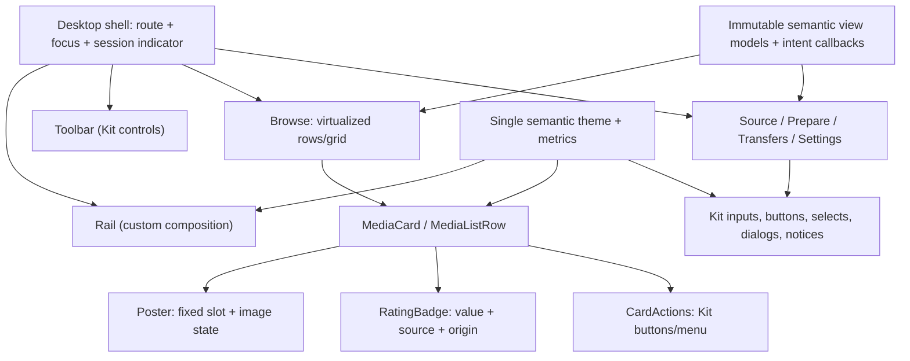

> **Historical v2 evidence — superseded.** Use [desktop v3](desktop-v3.md)
> and the [native lab](ui-probe.md). Kit APIs and old probe commands below are
> retained only as historical evidence; they are no longer supported.
> The 2026-10-20 v3 revision replaces historical flat/blue styling with warm
> amber/coral, 4/6/8/12 px radii, raised-layer shadows, artwork-derived secondary
> tint and cinematic backdrops. Repeated old visual rules below are archival,
> not constraints on the current implementation.

# Graphite desktop design system v1

**Status: user-approved Graphite direction; native increment implemented, acceptance incomplete.**
This document is the visual/state contract, not a claim that every control,
accessibility behavior or performance target is implemented. See
[native implementation](native-implementation.md) for actual component boundaries,
artwork constants, commands, evidence status and remaining gaps. The frozen HTML
[wireframe](desktop-wireframes.html) remains a design-only reference, not a runtime
framework. Approval to implement native Graphite is no longer an outstanding gate.

The user's navigation decision is final: **a permanent left icon-only rail**.
Expanded navigation, top navigation, layout switches, and automatic rail expansion
are not alternatives. Explicitly labelled proposals and acceptance targets below
remain distinct from implemented behavior. This spec supersedes the old navigation-
variant and warm-accent direction, not the
[approved MVP or provider/session contracts](../architecture.md).

## 1. Design intent and hierarchy

Graphite is a compact, professional desktop workspace, not a streaming-service
landing page. Neutral surfaces provide structure; restrained blue identifies the
primary action, selection, and focus. IMDb yellow belongs only to the IMDb label,
never to navigation, generic ratings, buttons, loading indicators, or global theme.

- Content first: readable title, year/type, and attributable rating at rest.
- Use alignment, spacing, type weight, and subtle surface boundaries before color.
  Reserve stronger outlines for interactive boundaries and keyboard focus.
- One primary action per task region; secondary and destructive actions stay
  explicit. No oversized hero, pill-heavy controls, glass, glow, poster lift,
  decorative chrome gradients, floating web-dashboard cards, or ornamental
  animation. Artwork may contain lighting/gradients; artwork scrims are allowed
  only with contrast-safe opaque backing for any overlay text. Never depend on
  the underlying image or a translucent scrim alone for text contrast.
- Familiar controls and consistent states beat bespoke interaction. Density must
  not remove labels, keyboard access, or error explanations.
- A catalog item is not a library item. No watch-progress bars, watched badges,
  resume claims, favorites/library actions, or inferred playback state.

## 2. Window and navigation

All dimensions below are **logical pixels**, not physical display pixels.

| Region | Contract |
| --- | --- |
| Native frame | Use the OS window frame and platform conventions; no imitation window buttons. HTML's frame is an illustration only. |
| Rail | Fixed 56 px, full workspace height; 36 × 36 px targets, 18 px glyphs. Browse, Transfers, Settings, About; no expanded labels or top-nav substitute. |
| Rail labels | Accessible names always; tooltips on hover and keyboard focus show destination and applicable shortcut. Active item has a persistent selection marker and accessible selected state, not just a color change. |
| Session indicator | Remains visible across routes, with text/accessible count. A small Transfers count badge may supplement it but is not the only indication of active sessions. |
| Toolbar | 44 px; back/title/search/context controls align consistently. Search is a real labelled input, not a giant hero field. |
| Workspace | 16 px padding, 12 px content gaps; width grows with the window, without scaling up all controls or enforcing a narrow marketing-page column. |
| Status | Short, truthful provider/refresh/task state; detailed failures use an inline notice rather than permanent toast spam. |
| Source inspector | Inline panel when space permits; proposed overlay below 1100 px. Preserve source selection and restore focus when dismissed. |

Proposed minimum usable window: **900 × 600** logical px. Below this, preserve
minimum control widths and scroll content rather than hide navigation/actions or
shrink text; the final native minimum-size API and OS behavior need verification.
At 900 px, wrap secondary toolbar controls into a second compact row if needed;
never overlap the rail, search, session indicator, or primary action. The 44 px
height is per toolbar row, not permission to clip a wrapped row.

Browse remains one destination for movies/series. Transfers describes downloads
and serving sessions, not watch history. Retain the native **Open local file…**
entry point in the playback/task area (and an accessible command/menu path): it
uses the same loopback server and external player, without requiring catalog or
debrid credentials. This does not add a new rail destination.

## 3. Semantic theme tokens

The table is the shared Graphite base contract. Names describe roles, not RGB
values. All components, including overlays and states, consume these tokens;
individual screens must not add ad-hoc colors. Values are opaque unless noted.

| Base token | Dark | Light | Use |
| --- | --- | --- | --- |
| `canvas` | `#17191D` | `#F3F4F6` | Window/workspace background |
| `surface` | `#202227` | `#FFFFFF` | Controls, panels, menus |
| `raised` | `#292C33` | `#E9ECF1` | Neutral inset groups/status panels |
| `surface.hover` | `#31353D` | `#DEE3EA` | Elevated neutral hover/active-rail surface |
| `border` | `#353942` | `#CDD3DD` | Decorative separators/panel edges only |
| `text` | `#ECEFF4` | `#1F232B` | Titles, body, labels |
| `text.secondary` | `#AFB5C0` | `#565F70` | Supporting readable text |
| `text.muted` | `#9CA5B4` | `#5F6879` | Metadata, placeholder, disabled explanation |
| `primary` | `#3C66BA` | `#315EB4` | Primary action and selected fill |
| `on-primary` | `#FFFFFF` | `#FFFFFF` | Text/icons on primary fill |
| `focus` | `#85AFF5` | `#315EB4` | Keyboard focus ring |

State aliases below are normative role mappings, not a second independent palette.
The lead-coordinated v2 palette includes explicit control/primary states, light
muted text, strong control borders and restrained semantic status inks. The IMDb
label color remains an **additional proposed token**. A visible control boundary cannot use the subtle base border
alone when its outline is needed to identify the control.

| Semantic token | Dark mapping/value | Light mapping/value | Contract |
| --- | --- | --- | --- |
| `border.control` | `#6E7788` | `#7B8495` | Coordinated strong boundary; ≥3:1 on `surface`/`raised` |
| `border.hover` | `text.secondary` | `text.secondary` | Pointer emphasis for interactive outline |
| `border.pressed` | `text` | `text` | Pressed outline; no geometric jump |
| `border.invalid` | `status.error.ink` | `status.error.ink` | Error outline plus error icon and inline explanation; focus ring remains separate |
| `control.default` | `#292C33` | `#FFFFFF` | Neutral control background |
| `control.hover` | `#31353D` | `#EEF1F5` | Neutral hover fill; use `border.hover` for identifiable boundary |
| `control.pressed` | `#3A3F49` | `#E2E6EC` | Neutral pressed fill; use `border.pressed` |
| `control.disabled` | `raised` | `raised` | Disabled fill for **all variants**, including primary/danger; no residual blue/red fill, opacity reduction or hover response |
| `text.disabled` | `text.muted` | `text.muted` | No whole-control opacity reduction |
| `primary.hover` | `#4673CC` | `#2A52A0` | Explicit primary hover background/outline; `on-primary` label |
| `primary.pressed` | `#335AA6` | `#234689` | Explicit primary pressed background/outline; no movement |
| `selection.solid.background` | `primary` | `primary` | Solid selection for applicable segmented/choice controls, not every selected component |
| `selection.solid.foreground` | `on-primary` | `on-primary` | Label/icon on solid selection |
| `selection.subtle.background` | `rgba(133,175,245,.16)` | `rgba(49,94,180,.12)` | Restrained blue tint over a neutral surface for selected rows/regions; pair with marker |
| `selection.subtle.foreground` | `text` | `text` | Normal text on tinted neutral selection |
| `selection.rail.background` | `surface.hover` | `surface.hover` | Active rail destination remains neutral, not solid blue |
| `selection.rail.foreground` | `text` | `text` | Active rail glyph |
| `selection.marker` | `focus` | `focus` | Persistent rail/row marker; selected state also exposed semantically |
| `selection.border` | `focus` | `focus` | Card selection outline/marker on neutral card |
| `focus.ring` | `focus` | `focus` | 2 px outer ring, 2 px surface-colored gap |
| `status.info.background` | `raised` | `raised` | Information panel |
| `status.success.background` | `raised` | `raised` | Success panel |
| `status.warning.background` | `raised` | `raised` | Warning panel |
| `status.error.background` | `raised` | `raised` | Failure panel |
| `status.info.ink` | `focus` (`#85AFF5`) | `primary` (`#315EB4`) | Information icon/short status label on neutral panel |
| `status.success.ink` | `#8CC9A8` | `#256441` | Success icon/short status label on neutral panel |
| `status.warning.ink` | `#E8BC72` | `#77520D` | Warning icon/short status label; not brand or selection amber |
| `status.error.ink` | `#EF9A9A` | `#A93232` | Error icon/label, invalid outline, outlined destructive action |
| `status.foreground` | `text` | `text` | Explanation/body text; semantic icon + explicit words always required |
| `status.border` | `border` | `border` | Decorative notice outline; icon/words identify status, contained interactive controls keep their own strong boundaries |
| `danger.foreground` | `status.error.ink` | `status.error.ink` | Outlined destructive button label/icon; neutral background |
| `danger.border` | `status.error.ink` | `status.error.ink` | Persistent destructive outline, including hover/pressed |
| `danger.fill` | `#A93232` | `#A93232` | Optional filled danger variant, reserved for explicit confirmation |
| `danger.on-fill` | `#FFFFFF` | `#FFFFFF` | Label/icon on filled danger |
| `danger.hover` | `#B83A3A` | `#B83A3A` | Filled danger hover background; white label and persistent error outline |
| `danger.filled-border` | `status.error.ink` | `status.error.ink` | Required visible outline, especially against dark surfaces |
| `link` | `focus` | `primary` | Underline where inline; named action, not bare URL |
| `poster.placeholder` | `raised` | `raised` | Stable image slot before load/on failure |
| `poster.foreground` | `text.secondary` | `text.secondary` | Placeholder icon and failure label |
| `overlay.background` | `rgba(8,9,11,.60)` | `rgba(20,26,34,.40)` | Modal scrim only; all text stays on the opaque dialog surface |
| `imdb.label.background` | `#F5C518` | `#F5C518` | Proposed IMDb-only label, not an IMDb data/API endorsement |
| `imdb.label.foreground` | `#1F232B` | `#1F232B` | Text within yellow label |
| `rating.value` | `text` | `text` | Numeric value on neutral card surface, not on artwork |

Use semantic inks sparingly for status icons, short labels and necessary invalid/
destructive outlines, on neutral raised panels. Do not turn every fact into a
colored badge or fill entire panels with status colors. Warning amber is a local
semantic cue, never a global brand, selection or navigation accent; `#F5C518`
remains exclusive to the IMDb label. Icons, explicit words, explanation and relevant
action are still required: color alone never distinguishes severity. Missing
credentials, service errors, invalid input and successful empty results remain
distinct states and messages.

Invalid controls retain their error outline/message while focused; the separate
outer focus ring still identifies keyboard position. Destructive controls must not
look like ordinary neutral actions: use the outlined error-ink variant by default.
An optional filled confirmation uses `danger.fill` with white text; in dark mode
its fill alone is only 2.12:1 against `raised`, so retain the visible error-ink
outline (3.06:1 against the fill and 6.50:1 against `raised`). Hover/pressed may
change neutral fill or add an inset stroke, but must preserve the error identity
and label contrast. Filled-danger hover uses the shared `danger.hover` token,
not a screen-local red. Do not replace a warning with an unlabeled red icon.

Disabled styling has priority over every variant and interaction state: primary,
danger and secondary use neutral `control.disabled` plus `text.disabled`; ghost
keeps its transparent background on the neutral host with the same readable text.
All variants suppress opacity reduction and hover/pressed response. Disabled
outlines may use decorative `border` because these are not actionable controls. In particular,
never leave a primary-blue fill behind a muted disabled label. Gallery forced-state
classes must resolve through the same shared state aliases and priority as actual
`:hover`, `:active`, `:focus-visible` and `:disabled` behavior, rather than showing
an attractive specimen that the interactive control cannot produce.

Focus and selection may coexist. The ring is outside the control with a gap
matching the surrounding surface, so it is measured against that surface, **not**
against blue selected fill. Do not put a focus-colored stroke directly on primary
blue: the supplied dark pair is only 2.49:1. Reserve ring space in clipping and
virtualized containers. If a ring crosses artwork, provide an opaque neutral
backing; do not assume arbitrary posters provide contrast.

### Frozen HTML v2 semantic aliases

Checked against the 1,201-line review artifact with SHA-256
`c686a3f290c40faad42ebbc1402dcea95c295c553dd1d22ff93846e80b875dd7`.
This table is the exact CSS-to-semantic mapping for that artifact, not a second
palette or a promise that CSS properties translate directly into native Kit fields.
Dark/light values are defined above unless explicitly listed here.

| HTML CSS variable | Shared semantic role / exact value |
| --- | --- |
| `--bg0` | `canvas` |
| `--bg1` | `surface` |
| `--bg2` | `raised`; also `control.disabled`, status backgrounds, poster placeholder |
| `--bg3` | `surface.hover`; also active `selection.rail.background` |
| `--line` | Decorative `border`; also notice/disabled outlines |
| `--ctl-b` | `border.control` |
| `--tx` | `text`; also neutral/subtle selection foreground |
| `--tx2` | `text.secondary`; also `border.hover` |
| `--tx3` | `text.muted`; also `text.disabled` |
| `--pri` | `primary`; `selection.solid.background` where used |
| `--pri-h` | `primary.hover` |
| `--pri-a` | `primary.pressed` |
| `--pri-ink` | `on-primary`; also white `danger.on-fill` / pressed inset stroke |
| `--pri-soft` | `selection.subtle.background`; segmented choices use tint + marker, not solid blue |
| `--ac` | `selection.marker` / `selection.border` and link/accent ink: dark `#85AFF5`, light `#315EB4` |
| `--focus` | `focus.ring` (same values as `--ac`, distinct role) |
| `--ctl-bg` | `control.default` |
| `--ctl-h` | `control.hover` |
| `--ctl-a` | `control.pressed` |
| `--hover` | `interaction.hover-overlay`: dark `rgba(255,255,255,.06)`, light `rgba(0,0,0,.05)`; transparent ghost/outlined-danger/rail feedback only |
| `--press` | `interaction.pressed-overlay`: dark `rgba(255,255,255,.11)`, light `rgba(0,0,0,.09)`; same transparent-control scope |
| `--ok` | `status.success.ink` |
| `--warn` | `status.warning.ink` |
| `--err` | `status.error.ink`, `border.invalid`, danger foreground/outline |
| `--info` | `status.info.ink` |
| `--err-fill` | `danger.fill` |
| `--err-fill-h` | `danger.hover` |
| `--scrim` | `overlay.background`; no text directly on scrim |
| `--shadow` | `shadow.overlay`: dark `0 8px 24px rgba(0,0,0,.45)`, light `0 8px 24px rgba(20,30,50,.2)`; menu/dialog elevation, not card lift/glow |
| `--art-edge` | `poster.edge`: dark `rgba(255,255,255,.1)`, light `rgba(0,0,0,.14)`; decorative inset artwork boundary only |
| `--imdb` | `imdb.label.background` |
| `--imdb-ink` | `imdb.label.foreground` |
| `--s2`, `--s4`, `--s6`, `--s8`, `--s12`, `--s16`, `--s20`, `--s24`, `--s32` | Corresponding spacing-scale values in px |
| `--rail`, `--hit`, `--glyph`, `--toolbar` | Rail 56, target 36, glyph 18, toolbar 44 px |
| `--ctl`, `--ctl-sm` | Control 28 / compact 24 px; `.btn.lg` is the 32 px prominent CTA role |
| `--gap`, `--pad` | Workspace gap 12 / padding 16 px |
| `--r`, `--rp` | Control radius 4 / panel radius 6 px |
| `--card-meta` | Shared fixed card footer 76 px; normal grid/performance rows also use 16 px row and 12 px column gaps |
| `--rowh` | Comfortable 32 / compact 28 px data-row minimum |
| `--fs-body`, `--fs-label`, `--fs-meta`, `--fs-head`, `--fs-title` | Body/default button 13, field/compact-button 12, metadata/group-caption 11, heading 18, detail title 20 px |
| `--font` | Exact CSS order: `system-ui,-apple-system,"Segoe UI Variable Text","Segoe UI","Noto Sans",Roboto,"Helvetica Neue",Arial,sans-serif`; OS system font takes precedence |
| `--mono` | `ui-monospace,SFMono-Regular,Menlo,Consolas,"DejaVu Sans Mono",monospace` |
| `--d-fast`, `--d-med`, `--d-slow` | 100 / 140 / 180 ms; reduced-motion preview uses effectively instant `0.01ms` |
| `--ease` | `cubic-bezier(.2,0,0,1)` |

Neutral hover/pressed outlines resolve to `--tx2` / `--tx`; primary uses its
explicit state fill/outline; danger preserves the error outline. At rest the rail
uses neutral selected fill plus marker, and cards use an outline rather than a
solid blue body. Selection roles must not be indiscriminately interchanged.
The opaque card disclosure uses `--bg1` / `--tx`, unmodified shared button styles,
a two-line synopsis and a fixed footer; the main-card focus ring is outside its
art frame at 2 px with 2 px offset, above the disclosure.

**Review-artifact variance / native verification:** HTML allows a 110–230 px
poster-size slider; the 132–180 px native starting range below remains a proposal.
HTML pins a whole focused grid row (up to `C` extra cards); the future-native bound
below targets at most one retained focused item and must be implemented/measured
rather than inferred from that demo. HTML's segmented group uses an inset ring;
verify adequate native focus contrast/geometry rather than copying CSS literally.
HTML skeletons pulse and busy buttons spin unless reduced motion is active; the
native target prefers static skeletons and minimal busy feedback. Artwork/kind-tag
lighting and colors are fixture art, not permission for new chrome palette values
or text on variable artwork without safe backing. These differences are disclosed,
not production implementation or complete accessibility acceptance.

### Contrast evidence and constraints

WCAG relative-luminance calculations (sRGB, opaque pairs, rounded to two decimals):

| Pair | Dark | Light |
| --- | --- | --- |
| Muted text / raised | 5.63:1 | 4.74:1 |
| White / primary | 5.52:1 | 6.19:1 |
| White / primary hover | 4.58:1 | 7.47:1 |
| White / primary pressed | 6.66:1 | 9.10:1 |
| Strong control border / raised | 3.10:1 | 3.18:1 |
| Focus / raised | 6.29:1 | 5.23:1 |
| IMDb label text / yellow | 9.66:1 | 9.66:1 |
| Success ink / raised | 7.35:1 | 5.95:1 |
| Warning ink / raised | 7.90:1 | 5.92:1 |
| Error ink / raised | 6.50:1 | 5.56:1 |
| Information ink / raised | 6.29:1 | 5.23:1 |
| White / filled danger | 6.58:1 | 6.58:1 |
| White / filled danger hover | 5.67:1 | 5.67:1 |

These checks do not establish full UI conformance. Normal text must reach 4.5:1;
essential UI boundaries, icons, selection markers, and focus rings reach 3:1
against their adjacent colors. Test every actual state/composite in both themes,
including hover, disabled explanations, menus, primary/danger outlines, invalid
inputs, status inks and focused-error combinations. Decorative separators need not reach 3:1; never rely on them as the sole
control affordance. No text directly over variable artwork.

## 4. Spacing, type, density, and scale

| Token/role | Value |
| --- | --- |
| Spacing scale | 2 / 4 / 6 / 8 / 12 / 16 / 20 / 24 / 32 px (4 px base with optical 2/6 steps) |
| Body | 13 px, regular, 18 px line height |
| Button label | 13 px default/prominent, 12 px compact; medium, 16 px line height |
| Standalone field label | 12 px, medium, 16 px line height |
| Group caption | 11 px, semibold, 16 px line height; concise grouping label, not body prose |
| Metadata | 11 px, regular, 16 px line height; never use this for paragraphs |
| Section/window heading | 18 px, semibold, 24 px line height |
| Detail title | 20 px, semibold, 25 px line height; distinct from section/card headings |
| Subheading/card title | 13 px, semibold, 18 px line height |
| Control radius | 4 px |
| Panel/dialog radius | 6 px |
| Control height | 28 px default, 24 px compact; optional 32 px prominent task CTA, not the default button size |
| Card footer | Fixed 76 px: two-line title slot 36 + metadata 16 + rating 16 + padding 6 + margin 2; grows only when required by text scaling |
| Card grid gaps | 12 px between columns, 16 px between rows |
| Data row | 32 px minimum default; multiline content grows rather than clips |
| Focus | 2 px ring with 2 px gap; outside layout box |

Font stack intent: Windows `Segoe UI Variable`, then `Segoe UI`; macOS the system
UI font (SF Pro where supplied by the OS); Linux `Noto Sans`, then the configured
system sans-serif. HTML may express this through `system-ui` and platform
fallbacks. Native code must resolve **one available font family after Kit/platform
initialization**, then pass that family to the native font API; a CSS comma-separated
stack is not a valid substitute for a family in GPUI's `SharedString` font property.
Verify family availability and metrics on each desktop; do not assume the first
preferred family exists. No downloadable font, bundled font asset, availability,
or redistribution license is promised.
Use tabular digits where supported for sizes, ratings, and transfers. Do not
simulate bold by duplicating text or depend on a particular font's width.

Default density is the compact professional baseline above. An optional compact
setting reduces controls to 24 px and row padding, not font sizes or the rail's
36 px targets. It must retain ≥28 px data rows and adequate focus space. User/OS
text scaling overrides fixed minima: controls and rows grow for the text metrics.
At 125%, 150%, and 200% display scale, use logical dimensions, crisp aligned
strokes, and suitably sized artwork; never double-apply the device scale. If text
scaling causes overflow, reflow/scroll, not text reduction. Truncated titles get a
full accessible name and hover/focus tooltip, not an inaccessible ellipsis only.

## 5. Primitive control contracts

Use the pinned Kit primitive first, themed/styled through a thin application
wrapper only when repeated policy warrants it. Do not reimplement inputs,
selection controls, menus, focus traversal, or dialogs as clickable rectangles.
Geometry is a design target; confirm the Kit's size/theme hooks before choosing
an override. Wrappers must preserve native/Kit keyboard and accessibility behavior.

| Primitive | Geometry and content | States/behavior |
| --- | --- | --- |
| Button | 28 px high (compact 24; occasional prominent task CTA 32); 8 px horizontal padding; 6 px icon gap; 14–16 px glyph; 4 px radius | Default, hover, pressed, focused, busy, disabled. Busy keeps width, label and cancellation semantics; blocks duplicate invocation, never silently spins forever. |
| Icon button | 28 px square, rail 36 px; 16/18 px glyph | Accessible action name and focus tooltip; never a lone unexplained icon. No hidden destructive action. |
| Text/search input | 28 px minimum; 8 px inset; persistent associated label | Focus ring, clear action with name, placeholder not label, inline invalid explanation. Preserve editing selection/IME; Enter commits search where specified. |
| Select | Same field height and outline; text + chevron | Show selected value; keyboard open/move/commit/cancel; options scroll within viewport. Do not fake it with a text input. |
| Checkbox/switch | Kit primitive, aligned to 28 px labelled row | Checkboxes for independent choices; switch only for immediate boolean state. Label target toggles; mixed/disabled states explicit where relevant. |
| Radio/segmented choice | 28 px group; separate keyboard semantics for mutually exclusive choices | Visible selected marker, roving/group focus; use actual radio/tab semantics appropriate to behavior, not generic buttons with inconsistent state. |
| Tab | Compact 28 px strip with selected marker | For peer content panels; arrows move within group; tab stop enters/leaves group. Not another primary navigation layout. |
| Data row | ≥32 px; 8 px horizontal inset; 6–8 px content gaps | Hover uses raised fill; selection is persistent; focus separate. Align numeric columns and stable action slots. |
| Tooltip | Small neutral surface, readable label; anchored without covering target | Hover and keyboard focus; dismiss on leave/blur/Esc. Not the only place for essential errors/instructions. Delay avoids flicker; no animation required. |
| Menu | Surface, control outline, 4 px item radius; ≥28 px items | Keyboard traversal, disabled reasons where relevant, Esc/outside dismissal, return focus to trigger; no offscreen clipping. |
| Dialog | Surface + 6 px radius; 16 px inset; bounded width/height, scroll body | Labelled heading; focus contained and restored; cancel focused for destructive/session-stop confirmation. Explicit default action; Esc only when safe. |
| Progress | Small labelled bar with amount/unit, or indeterminate label when unknown | Download/cache/prepare progress only. No watch-progress interpretation. Reduced motion removes interpolation/looping decoration. |
| Notice/empty state | Compact inline region with icon, heading, explanation and relevant action | Distinguish loading, empty, missing credential, offline/cached, quota full and service failure. No huge centered marketing illustration. |

Hover changes fill/outline; pressed adds a clear outline/inset state. Selection
persists after the pointer leaves. Keyboard focus is never replaced by hover and
must remain visible on selected controls. Disabled controls do not invoke actions;
explanations stay discoverable through associated text or a nearby focusable help
control, rather than assuming disabled elements can receive focus. Read-only fields
remain selectable/copyable and look different from disabled fields.

## 6. Composed MediaCard and progressive disclosure

A card is a neutral, stable layout, not a large nested button full of unrelated
actions. Proposed poster widths are 132–180 px at default density, in equal grid
columns; the artwork slot is always **2:3**. A user poster-size preference may
change column count, not typography. Card footer has a two-line title slot plus
metadata/rating rows within the shared **76 px footer** (36 px title + 16 px
metadata + 16 px rating + 6 px padding + 2 px margin). Grid gaps are 12 px between
columns and 16 px between rows; the performance preview and native row sizing
must consume the same footer/gap metrics, not a separate stale height constant.
List mode reuses the same semantic row
model with a smaller fixed-aspect poster and aligned facts.

Hover and focus-within reveal **actual bounded details, not only buttons**: an
opaque themed-neutral bottom panel contained entirely within the existing 2:3 poster slot
shows runtime (movie) **or** reported season count (series), up to two genres,
up to two synopsis lines, and compact Details/source actions. Use `surface` or
`raised` with matching text tokens and shared themed primitive controls; no
hardcoded light-text/control overrides or text on exposed artwork/translucent
scrim. Draw the outer card focus ring above/outside this panel so the disclosure
cannot hide the focused main action's indicator. Facts are optional: omit unknown runtime/count/genres/synopsis rather than
inventing values, inferring a season count, or fetching on interaction. Projection
precomputes bounded display text before render. The disclosure never enlarges the
card/grid row, shifts adjacent content, lifts/zooms the poster, or covers the
at-rest title/year/IMDb footer. If space is insufficient, shorten synopsis first
and preserve the actions and full-detail entry point.

**At rest:** title, year/type, and **`IMDb 8.1/10`** are visible when an attributable
IMDb rating is known. The yellow portion labels `IMDb`; the number remains neutral
text. TMDB scores are never relabelled IMDb. Rating source identity and provenance
must be available to the projection even if the short card shows only the label.
For example, an IMDb score supplied through Cinemeta is labelled as an IMDb score,
with “Provided by Cinemeta” in the details/provenance disclosure. An IMDb identifier
alone does not prove a rating exists. **IMDb 0.0/10 is a legitimate known value**:
use explicit optional/known-state checks, never a truthiness test that turns zero
into `—`. Do not convert other scores or synthesize a zero for missing data.
Rating availability and source-lookup eligibility are independent: a valid IMDb
mapping with an unknown rating still permits source lookup.

A rating-sort control must name its metric/source (for example, **IMDb rating**),
use that attributable IMDb value, and place unknowns last in either direction.
Never silently sort by a TMDB score under an IMDb or ambiguous “Rating” label;
known zero remains a numeric value, not an unknown.

| State | Card presentation | Interaction/announcement |
| --- | --- | --- |
| Known IMDb rating | `IMDb 8.1/10` at rest, including while not hovered | Accessible reading: title, year/type, IMDb rating 8.1 out of 10; details attribute contributing providers in the footer. |
| Missing IMDb rating | Stable rating row: `IMDb —` with “IMDb rating unavailable” accessible text | Do not substitute TMDB/another rating, infer 0, or collapse the layout. A valid IMDb mapping still enables sources. Other known ratings belong in labelled details. |
| Poster pending | Fixed 2:3 placeholder, neutral static skeleton | Bounded image work; title remains available. No layout shift or shimmer requirement. |
| Poster failed/missing | Same slot, quiet poster icon and `No artwork` | Title/details remain usable; bounded retry/backoff, not repeated render-triggered requests. |
| Hover | Strengthened outline and bounded opaque-neutral details disclosure inside the 2:3 poster footprint | Runtime or reported season count, up to two genres, up to two synopsis lines, plus `Details` and `Find sources` (movie) / `Choose episode` (series). No fetch, auto-play, lift, zoom, layout shift or hidden footer/rating. |
| Keyboard focus / focus within | Identical details and actions disclosure plus outer focus ring | Enter opens primary Details; keyboard reaches the same facts/actions without pointer. Keep disclosure open while focus is within it. Escape closes a transient action menu and returns to its trigger. |
| Selected | Persistent selection marker + outline on neutral card | Remains selected outside hover/focus; selected ID is not the recycled cell index. |
| Loading metadata | Fixed skeleton geometry; no invented rating or stale title under a different identity | Initial fetch differs from refresh: keep existing content on refresh and indicate refreshing separately. Coalesce live announcements. |
| Disabled action | Card details remain usable; unavailable action visually disabled with nearby reason | Disable only the invalid action, not all catalog exploration. Never make a silent dead card. |
| Missing IMDb mapping | Rating independent of mapping; show `Source lookup unavailable — no IMDb mapping` | `Find sources` disabled with explanation; no title/year guess or numeric-ID substitution; enrichment may obtain an explicit mapping. |
| Cached + refresh failed | Keep known title/art/rating and freshness/source notice | Inline retry on explicit request; never replace usable content with successful-empty copy. |

Do not put controls inside a semantic button. Use a focusable card/selection region
and sibling action buttons with an intentional keyboard model (arrow navigation
among cards, explicit entry to card actions). Details must be reachable at rest
by Enter or a labelled action; pointer double-click is not the only route. Keep
focus disclosure open while focus is inside its actions. Screen readers receive
names/state, not a repeated announcement of every decorative poster and icon.

Secondary metadata, external identifiers, rating sources, release/file facts and
refresh timestamps belong in Details or the source inspector. Details attribute
only actual contributors in a footer: “Data from TMDB and Cinemeta” (or “Data from
Cinemeta”); per-field provenance stays in the catalog, not the UI. TMDB's required
About attribution notice stays.
Safe progressive disclosure must not hide warnings, credentials needed for the
current step, file-choice ambiguity, quota failure, or what the next action does.
No source lookup, provider switch, preparation, deletion, or player launch on hover.
Hover/focus also must not trigger network, SQL or metadata fetches: use the current
semantic projection, with missing facts left absent. Opening Details is a separate
explicit intent: show the primary result, then fully enrich asynchronously from
all enabled, active enrichment providers, with quiet non-fatal failures. The
approved priority/enrichment revision is in progress, not live-provider verification.

Keep the source sequence explicit: chosen indexer → chosen release → prepare
through chosen debrid service → explicit file choice → download/serve → external
player launch when readiness policy allows. A design fixture's readiness percentage
is not a universal policy. Do not silently choose the largest file. Keep manual
inactive-only cleanup and in-use-file protection; never delete original local files.

Settings retain provider/account status, an ordered metadata-provider priority
list (default Cinemeta, TMDB), selected indexer/debrid,
external player/executable, media quota, and appearance. Tokens belong in OS secure
storage, never ordinary settings/logs/HTML fixtures; presence is not connectivity
validation. Replace/reset the old single metadata setting without migration.
The first enabled, active provider handles search/browse; others enrich. Missing
required credentials show inactive/skipped providers, not errors.
**Launch requested**, **Serving**, download bytes, and session count
are truthful; “Playing”, “Watched”, and “Resume” are not established by launch or
HTTP traffic. Navigation does not stop sessions. Quit/window-close confirmation
explains that Kinema's server stops and the external player stays open; no daemon.
No embedded player, library/history, new providers, or LAN scope is introduced.

## 7. Composition and native boundaries

Suggested modules below are **future organization**, not permission to move files
now or build an unused framework. Add a small module only when used. Names of
Kinema components/props are design vocabulary, not claimed Kit API symbols.

| Suggested boundary in `kinema-desktop` | Owns | Must not own |
| --- | --- | --- |
| `ui/theme` | Semantic colors, metrics, theme-mode adapter into pinned Kit | Per-screen palettes or new theme engine |
| `ui/controls` | Minimal shared styling/wrappers of Kit primitives; naming, sizes, shared loading/error policy | Replacement text editing, focus manager, generic widget framework |
| `ui/components/rail` | Fixed destinations, labels, active state/count | Navigation business rules or expanded/top variants |
| `ui/components/media_card` | Card/list composition, focus/action disclosure | Provider requests, SQL, image decoding |
| `ui/components/poster`, `rating_badge` | Stable image-state rendering; attributable score presentation | Cache workers, identity matching, rating inference |
| Existing screen modules | Route state, semantic view-model projection, selection/focus IDs, intents | Raw provider JSON embedded in render logic |
| Existing application/adapters | Owned background requests, catalog reads, artwork tasks/cache, secure store and player/session operations | UI layout decisions or GPUI types leaking into core |
| `kinema-core` | Pure identities, rating origins, validated values and domain policies where applicable | Colors, GPUI handles, controls, SQL/network/process effects |

Concrete proposed input/intent contracts (not copy-paste Rust):

- `MediaCardProps`: stable canonical media key, kind, title, nullable year,
  optional genres/runtime/reported season count/synopsis with precomputed bounded
  disclosure text (at most two genres and two synopsis lines), poster request key
  and current image state, nullable attributed IMDb rating
  (value/scale, rating-source ID, supplying-provider/origin), source-lookup
  availability/reason, selected/focused/busy flags, accessible labels.
- `CardIntent`: open details, select item, find sources for a mapped movie,
  choose episode for a series; carry media key and route generation. No URL,
  token, DB connection, or launcher command inside a presentational callback.
- `PosterProps`: request key (art identity + target size + scale), image handle
  or explicit pending/missing/failed state, aspect ratio, accessible decoration
  policy. Request scheduling lives outside render.
- `RatingBadgeProps`: rating-source identity, optional validated value/scale,
  supplying origin, unavailable reason. Do not pass a bare float and guess label.
- `RailProps`: active destination, destination intents, labelled session/task
  count; no layout-mode prop.
- `SourceRowModel`: stable source/release key, selected indexer, title, size,
  quality/cache facts with unknowns preserved, availability/reason, selection;
  source selection/prepare intents go to the existing coordinator.

One projection from canonical/domain data builds these semantic models. No repeated
provider-specific branching in each card. Stable content keys, not visible row
indices or poster URLs, bind selection, focus, errors and actions to identities.
Separate a grid *row's* virtualization key from each card's stable media key when
column count changes. When approved identity reconciliation remaps a canonical ID,
apply that explicit old→surviving-ID mapping atomically to collection selection,
focus/return targets, row models and pending intents; never infer a remap from a
title or index. Re-resolve modal return targets against the current mapping and
mounted collection. Reject callbacks/results from obsolete route generations.

### Pinned Kit API evidence and remaining verification

Research references: official [GPUI Kit documentation](https://gpui-kit.com/docs/),
[Button](https://gpui-kit.com/component/button/),
[theme](https://gpui-kit.com/component/theme/),
[virtual list](https://gpui-kit.com/component/virtual-list/), and
[image](https://gpui-kit.com/component/image/) pages. The theme/virtual-list/image
pages returned HTTP 200 during research, but web docs can advance independently
of the pin. The cached **`gpui-kit =0.7.3` source and lock-resolved component 0.7.3**
are the authority. The researcher verified the mappings below against that source;
this is API evidence, not a tested native implementation of Graphite.

| Concern | Verified pinned surface | Design consequence |
| --- | --- | --- |
| Facade/bootstrap | Kit `src/lib.rs`: `gpui_kit::*`, `component`, `assets`, `init`, `open_window` | Use official reexports only. `open_window` supplies a Base Root; do not add another Root. |
| Buttons | Facade example: `gpui_kit::component::button::{Button, ButtonVariants as _}`; `Button::new(...).primary().label(...)` | Style Kit buttons rather than rebuild click/focus behavior. |
| Built-in theme selection | Component `theme/registry.rs`: `ThemeRegistry::global(&App) -> &Self`; `default_light_theme` / `default_dark_theme` return `&Rc<ThemeConfig>` | Clone the selected `Rc` before taking a mutable application-context borrow. |
| Theme application | `theme/mod.rs`: `Theme::update<R>(&mut App, impl FnOnce(&mut Theme) -> R) -> R`; `theme/schema.rs`: `Theme::apply_config(&mut self, &Rc<ThemeConfig>)` | Apply the selected built-in configuration and then Graphite overrides in the same update closure. |
| Theme metrics | `Theme` has `colors: ThemeColor`, `font_family` / `mono_font_family: SharedString`, `font_size` / `mono_font_size: Pixels`, `radius` / `radius_lg: Pixels`, `shadow` / `focus_ring: bool` | Select a verified available single font family, or retain built-in default. A boolean focus-ring field does not establish a configurable 2 px ring geometry. |
| Theme colors | `theme/theme_color.rs`: `ThemeColor` uses `Hsla` fields including `background`, `border`, `accent`, `accent_foreground`, `input`; explicit `button_{primary,secondary,danger,success,warning,info}` groups each have base, `_active`, `_foreground`, `_hover` fields | Convert semantic colors centrally; map relevant explicit button groups/states as well as accent. Changing `accent` alone does **not** recolor all components. `input` is documented as “Border color for inputs such as Input, Select, etc.”: map `Theme.colors.input` to `border.control`, while keeping global `Theme.colors.border` decorative. Do not invent `input_border`. |
| Input outline styling | Component `src/input/input.rs`: Input implements `Styled` (around line 529); render uses `cx.theme().input` for its border, then `.refine_style(&self.style)` (around lines 797–803), then focus-ring styling | Base Input/Select outlines use typed `Theme.colors.input = border.control`. A thin application style builder may use `Input.border_color(...)` for local exceptions/invalid states, preserving Kit `InputState`, editing, IME and focus. Verify final focus-state ordering and overrides in runtime tests. |
| Fixed-height virtualization | Root-reexported `gpui_kit::uniform_list`, implemented in `gpui-pre 0.3.9` `elements/uniform_list.rs` | Virtualize fixed-height **grid rows** inside a bounded viewport; no standalone tile virtualizer was verified. Rebuild row grouping on column-count change while retaining card identities. |
| Variable rows | `gpui_kit::component::{v_virtual_list, h_virtual_list}` reexport base implementations using `Rc<Vec<Size<Pixels>>>`; `gpui-base 0.7.3` `virtual_list.rs` | Alternative for measured variable rows; row sizing, focus restoration and exact overscan remain application responsibilities to verify. |
| Poster rendering | Root `img(source)` with stable ID/fixed bounds and `with_loading` / `with_fallback`; `gpui-pre 0.3.9` `elements/img.rs` | Compose fixed-aspect Poster states over the image primitive; this does not establish request cancellation or cache limits. |
| Image retention | `elements/image_cache.rs` supplies `RetainAllImageCache` | It is **not bounded/LRU by default**. Prove framework/image-handle retention works with the owned byte-budgeted policy before claiming bounded memory. |

Bootstrap order: **Kit init → select built-in theme and clone its configuration
`Rc` → `Theme::update` (apply configuration, then all semantic/metric overrides in
that same closure) → Kit `open_window`**. This uses in-memory built-ins and an
application-owned token adapter, not `watch_dir`, theme plugins, or disk-loaded
themes. On subsequent theme changes, use the same complete mapping rather than
partially updating accent and leaving stale control colors. Use typed
`Theme.colors.input = border.control` for the shared Input/Select boundary policy;
keep `Theme.colors.border` decorative. Apply relevant Styled overrides only for
local exceptions/state needs, rather than inventing theme fields or making every
global separator strong. The desired focus ring/gap remains a native
runtime acceptance target: HTML CSS does not establish its GPUI rendering or the
interaction between Styled overrides and Kit's later focus-ring styling.

Use only the official facade and component/assets integration. No separate GPUI
dependency, gpui-fast, HTML renderer, CSS runtime, or JS framework is proposed.
The HTML theme tokens are a review notation, not directly portable native code.

**Runtime/implementation verification still required:** exact input/select/switch/
tab/dialog/menu styling hooks used by the final design; complete semantic-to-theme
field mapping; control state contrast and ring geometry; keyboard/accessibility
behavior; row measurement/overscan, modal focus return and reconciliation remaps;
image task cancellation, bounded caching and framework/GPU retention. No unverified
constructor is prescribed here. Prefer adapting Kit primitives; custom Rail,
MediaCard, Poster and RatingBadge are application compositions where needed.

## 8. Native loading and performance contract

These are **acceptance targets/proposals**, not measurements of current GPUI or
claims that existing workers already satisfy every cancellation requirement.

1. **Virtualize rendered content.** Mount visible grid rows plus **two overscan
   rows on each side**, clipped to available data; list mode uses the same rule.
   For `V` visible rows and `C` columns, rendered cards are bounded by
   `(V + 4) × C`, apart from at most one explicitly retained focused item. Do not
   render every fetched item and merely hide it. Recompute row grouping on resize
   without changing semantic item IDs or selection.
2. **Preserve focus through recycling.** The collection owns keyboard focus and
   focused/selected canonical identity; a disposable card widget is not the focus
   owner. Keep a stable collection focus target while cells unmount. Keyboard
   navigation brings the target row into view before revealing/focusing its mounted
   card/action; preserve the focused card when appropriate or restore it after
   virtualization without transferring focus to a recycled identity. Recycled
   cells cannot inherit another item's state/callback. Modal return resolves the
   saved identity (including explicit reconciliation remaps), scrolls it into view,
   mounts it and restores its action/collection focus. If filtering/removal makes
   it unavailable, focus a predictable surviving neighbor or results heading and
   announce the change; never drop focus to the window or a destroyed widget.
3. **Demand-driven paging.** Read local primary-provider query/page membership,
   then request missing pages only near the viewport/end. One page request in
   flight per current query is the proposed UI limit; coalesce equivalent demand,
   bound retained pages and queue length, stop at known end. Exact retained-page
   cap needs measurement; existing backend response/row caps are not expanded by
   this design. Do not requeue failed pages every frame: explicit retry with reason.
4. **Bounded provider enrichment.** Enrich only visible cards, only missing
   poster, year, rating, runtime, or genres; skip titles already enriched in the
   catalog. Bound concurrency, cancel on scroll/query changes, and reject stale
   generations. Details enrich fully after showing the primary result. Keep
   usable content during quiet, non-fatal enrichment failures. This is not a
   catalog crawler or automatic TTL. Unknown scores/IDs stay unknown unless
   explicitly supplied; TMDB scores are never labelled IMDb.
5. **No blocking render work.** SQL, network/file waits, poster decoding, image
   transforms, and secure-store/player work run outside UI rendering. Render uses
   prepared row models and ready/pending image handles. Do not decode the same
   image on each render or initiate per-frame requests.
6. **Own and bound artwork work.** One application-owned bounded artwork pool owns
   active jobs; route/view owners hold cancellable request subscriptions. Deduplicate
   by art identity, target dimensions and scale. Drop obsolete queued work and
   cancel obsolete subscriptions on route/query/size changes. An already running
   blocking decode may not cancel: it retains its global active slot until it
   actually completes, even after its old view disappears. **Never reset the active
   count or create a fresh per-route pool on navigation.** Bound concurrency across
   all generations, with bounded waits/response sizes where supported. On completion,
   release the global slot and apply to a view only when request key and generation
   still match; cancellation does not replace stale-result checks. Teardown drops
   subscriptions, not accounting for jobs still running; application shutdown owns
   pool cancellation/drain policy.
7. **Prioritize visible content.** Visible posters first, then two-row overscan;
   no unbounded scroll-ahead, entire-catalog image fetch, or preloading both themes'
   routes. Download/seek and user actions outrank artwork prefetch. A proposed
   starting limit is **4 active artwork fetch/decode jobs total across all routes
   and generations**, including obsolete non-cancellable work, with queued requests
   bounded by the current visible-plus-overscan set. The increment implements a
   global four-job cap and a 128-job queue; profile their actual behavior.
8. **Byte-budgeted image cache.** Track decoded bytes, not just image count, and
   account for compressed responses and GPU texture residency separately. Prefer
   thumbnails appropriate to logical size × device scale. Enforce encoded-byte
   limits while reading; preflight image headers and bound declared dimensions,
   total decoded pixels and animated-frame counts **before large allocations or
   decoding**, using checked size arithmetic. Enforce the same limits during
   decoding for malformed/misleading headers; rejecting only after a full decode
   is insufficient. The increment now implements numeric guards and LRU quotas;
   see [actual constants](native-implementation.md#artwork-bounds-are-implemented-constants-not-ram-measurements).
   These are not measured process/GPU memory guarantees or user settings. Evict least-recently-used unpinned
   artwork; retain visible/focused references only while needed. If pinned images
   exceed the budget, reduce requested resolution or defer overscan, not silently
   grow memory. Release GPU/image handles when evicted.
9. **Budget is not the media quota.** A **64 MiB decoded-artwork resident budget**
   is now implemented as 48 MiB poster + 16 MiB backdrop LRU accounting,
   **not a hard total-process cap, user setting, or slice of the 20 GiB media quota**. Compressed
   in-flight buffers, temporary decode allocations and GPU copies need separate
   bounded accounting; exact combined cap/disk-artwork policy remains open. The
   design does not authorize new user settings, automatic media eviction or any
   new data TTL. Acceptance of its runtime memory behavior requires native profiling; it
   is not a measured memory guarantee. Local artwork-cache memory accounting is
   separate from the managed-media quota.
10. **Stable loading/failure.** Fixed 2:3 placeholders reserve layout. Distinguish
    missing URL, pending request, decode failure and service failure. Proposed
    transient artwork retry policy: at most two retries with backoff (1 s then
    4 s), cancellable and only while relevant; permanent/invalid-image failures
    wait for explicit retry or changed request identity. Never restart failure
    retries on every hover, rerender, recycled cell mount, or scroll oscillation.
11. **Avoid repaint churn.** Change only affected rows, not the whole catalog, for
    image completion or hover. Use 100–180 ms opacity/fill/outline feedback;
    avoid continuous offscreen animations, repeated text shaping or full-size
    poster decoding. Batch completion notifications without delaying input.

### What the HTML can and cannot demonstrate

The review artifact can instrument mounted DOM cards/rows, queued/active simulated
image jobs, application-cache accounting, generation rejection, placeholder layout
stability, keyboard order, reduced-motion behavior and resize/scroll bounds.
DOM/job/application-cache counters do **not** measure browser resource retention,
GPU allocation, process RSS or total image memory. If it keeps all fixture cards in
the DOM, it must not claim native virtualization or bounded full-catalog rendering.
Inline fixture artwork cannot validate real network/decode/cache behavior. Browser
frame timing and screenshots cannot prove GPUI GPU memory, native focus semantics,
OS font metrics, worker cancellation, or production frame latency.

Future native profiling targets: sustained 60 Hz scrolling on an agreed reference
machine (16.7 ms frame budget), no blocking UI work, no viewport-wide layout jumps,
bounded active jobs/queues/resident image bytes, and prompt keyboard/focus feedback
while loading. Record hardware, OS/backend, DPI, data size, image dimensions, cold/
warm cache, p50/p95 frame time and worst stalls. Target p95 frame time ≤16.7 ms and
input feedback ≤100 ms; these are **not measured results or cross-platform support
claims**. Test slow/erroring providers, rapid resize/query changes, 10,000 semantic
fixtures, and repeated route changes for stale writes, leaks and task accumulation.

## 9. Motion, themes, and acceptance gate

Purposeful feedback only: **100–180 ms** color/opacity changes for hover, selection,
action reveal and panel appearance. No poster translation/scale, sliding navigation,
large drawer travel, pulsing session dots, skeleton shimmer, or animated gradients.
Reduced motion (OS preference plus explicit preview) makes all transitions instant
and removes looping effects; progress values and state messages still update.
Prefer no animation when the pinned API cannot provide inexpensive safe feedback.

Dark and light are complete themes, not inversion filters. Resolve theme once into
semantic tokens; switching must preserve route, filters, focus, selection, sessions
and ongoing tasks. Theme changes alone must not refetch provider data or artwork.
OS/system-theme integration is a future implementation detail to verify, not a
claim made by the HTML toggle.

### Review and later native acceptance checklist

- [x] User approved native Graphite implementation and the fixed icon-only rail;
  this approval does not complete the remaining native acceptance checks.
- [ ] Review 900, 1280, and 1600 px window widths in both themes; include 900 × 600,
  busy toolbars, long/localized titles, missing values, source inspector and dialogs.
  No horizontal overlap, clipped actions, or hidden active-session warning.
- [ ] Test 100%, 125%, 150%, and 200% display scale plus enlarged text on Windows,
  macOS, and Linux font fallbacks. Check crisp boundaries, title clipping, and
  reflow; browser emulation is not native OS evidence.
- [ ] Confirm ≥4.5:1 normal text and ≥3:1 essential UI/rings in every actual state;
  include hover, selected+focused, disabled explanations and light-theme IMDb label.
- [ ] Keyboard-only: rail tooltips/names, search editing, grid/list navigation and
  action entry, details, episode/source/file choice, menus/dialogs, escape/back,
  safe confirmation defaults and collection-owned focus return. No hover-only
  action or focus loss when rows recycle, column count changes, or approved
  reconciliation remaps a canonical ID; modal return resolves the surviving ID.
- [ ] Rating visible at rest; known zero, missing/other-source score, valid IMDb ID
  with unknown rating, missing IMDb mapping, poster pending/failure, metadata
  loading, selected, disabled and cached-error fixtures preserve meaning, spacing
  and correct action availability. IMDb-labelled sorting uses IMDb values with
  unknowns last in either direction, without substituting a non-IMDb score.
  Hover and focus-within show identical bounded facts plus actions inside the poster
  footprint, with missing facts omitted, no interaction-triggered I/O, no grid
  growth/layout shift, and title/year/IMDb footer always visible; Enter opens Details.
- [ ] Reduced motion removes all transitions/loops; no state information depends
  on motion, color alone, or a tooltip.
- [ ] Instrument DOM/job bounds honestly in HTML; separately profile native row
  bounds, queue/concurrency across navigation generations, stale completions, memory
  plateau/framework image retention and focus under load. Old non-cancellable
  decodes still occupy global slots until completion.
- [ ] Retain local-file playback, explicit file choice, manual inactive cleanup,
  secure credential storage, external-player and quit/session lifetime contracts.
  No new library/history/progress/provider/LAN scope appears.
- [ ] Verify pinned Kit APIs and styling/accessibility before coding; use official
  reexports/components/assets/init/open_window without a replacement UI framework.

**Remaining implementation/acceptance decisions:** minimum window and poster-size
controls; native font metrics/Kit hooks; measured artwork memory, concurrency,
retry policy and bounded page retention. The IMDb label/control palette belongs
to the approved Graphite direction. Implemented constants are documented
[separately](native-implementation.md); proposals here do not change application
settings, backend behavior or media quota policy. No user-approval-to-implement
gate remains; native workflow, accessibility and performance acceptance does.
