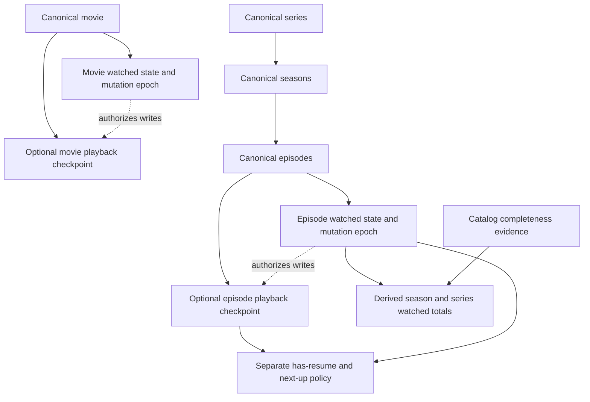
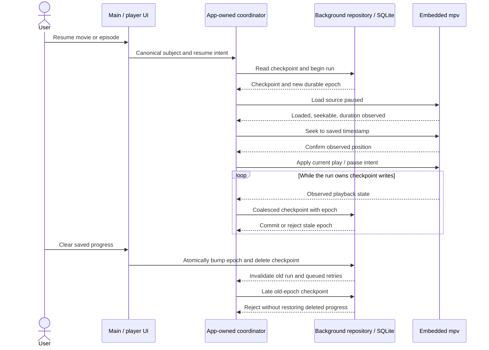
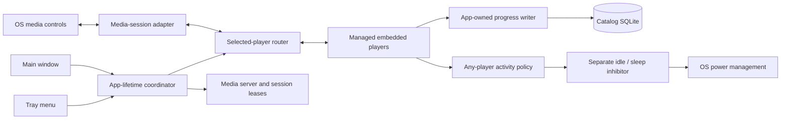
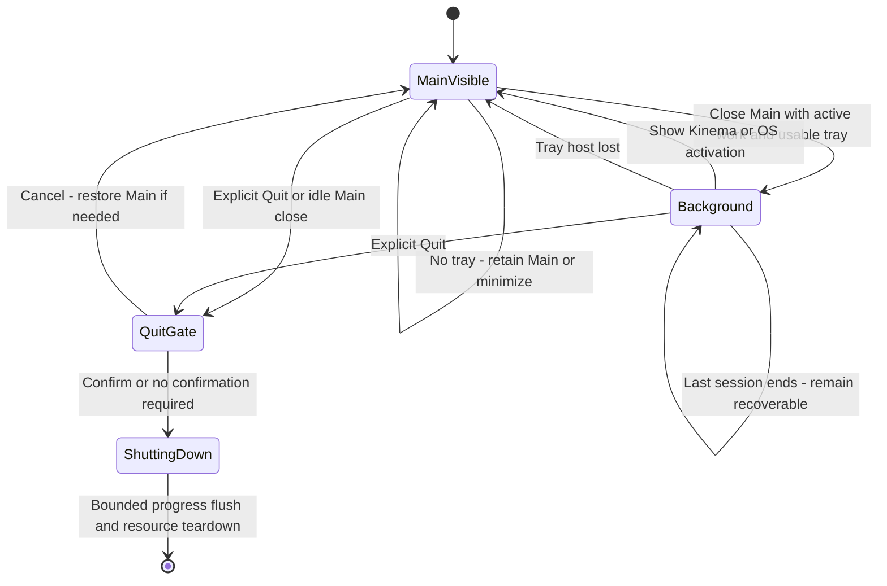

# Playback progress and desktop integration

**Status: user-approved, source implemented with scoped validation, 2026-10-28.**
The user approved proceeding after reviewing the in-context HTML revisions.
Root checks, native UI fixture review and isolated Linux media-session protocol
validation passed. See [the evidence record](../validation/playback-progress-desktop.md);
this is not native cross-platform qualification.

Extends the sole GPUI v3 UI and independent embedded-mpv player. This document
proposes changes to the manual-only tracking and main-close/quit rules in
[library.md](library.md), [player.md](player.md), and [desktop-v3.md](desktop-v3.md).
The agreed watch/progress policy below supersedes the earlier manual-only scope.
UI placement was reviewed using the
[in-context HTML wireframes](playback-progress-in-context.html). These map
changes onto the user's current series, episode grid, Streams and movie screenshots.
The earlier [component/state wireframes](playback-progress-wireframes.html) remain
supporting policy illustrations, not authoritative placement references. The HTML is an offline
review artifact, not shipped UI or native acceptance evidence.

External mpv/VLC behavior is unchanged. No legacy configuration/database/keyring
migration, cloud sync, viewing-history timeline, or new UI framework is proposed.

## 1. Current implementation

| Area | Inspected implementation | Consequence |
| --- | --- | --- |
| Storage | `crates/kinema-desktop/src/catalog_schema.rs`, `migrate_library`: v7 `movie_watch_state(title_id, title_kind, watched, updated_at)` and `episode_watch_state(episode_id, watched, updated_at)` | Binary state only; no saved position or duration |
| Mutations | `catalog_library.rs`: canonical episode resolution, transactional movie/episode/season watch mutations | Extend this repository boundary; do not create a second catalog |
| Aggregation | `catalog_library_query.rs`: watched episode counts plus catalog-completeness checks | Season/series are derived summaries, not independent completion flags |
| Domain | `crates/kinema-core/src/watch_progress.rs`: `EpisodeMark`, `next_up`, `default_season`, `season_tally` | Unknown metadata is not unwatched; next-up currently uses binary episode marks |
| Playback | `crates/kinema-mpv/src/state.rs` and `mpv/player.rs`: observed `time-pos`, duration, ended/loading state, absolute seek | Transport primitives exist, but are not connected to durable personal progress |
| Window ownership | `screens/player_window.rs`: global registry by session ID, generations, independent player window and lease release | Several players can coexist; progress and OS controls need explicit ownership |
| App close | `screens/quit.rs`: main close routes to quit; main-window removal calls `cx.quit()` | Adding a tray alone will not preserve playback |
| Bootstrap | `src/main.rs` and `screens/coordinator.rs` | No existing tray/media-session/inhibition integration |

Paths without a crate prefix above are relative to `crates/kinema-desktop/src`.

## 2. Product behavior

### Resume is independent of completion

Keep watched/unwatched as the completion flag; add a separate resume checkpoint.
A watched movie can be partially replayed without losing its watched mark. Library
membership remains independent of both. Saving progress never adds a title to the
Library, and removing membership never removes progress.

- For **unwatched** resumable movies/episodes, show **Resume · 24:18** and
  **Play from beginning**, plus a subtle progress bar and accessible elapsed/total
  text. Unknown duration shows elapsed time without a fabricated percent.
- For **watched** movies/episodes, hide catalog/detail progress bars, percentages,
  and resume timestamps; show the watched mark and ordinary Play action. Retain
  checkpoints internally. Proposed launch UX: offer Resume / Play from beginning
  inside the player when a usable checkpoint exists, rather than cluttering cards.
  The player's seek bar and OS transport position remain accurate regardless of
  watched status; hiding catalog progress must not hide playback controls.
- Resume still goes through source selection/preparation. A checkpoint is not a
  reusable stream URL. Carry the chosen resume/start-over intent to the player.
- For a series, prefer the most recently resumed, incomplete regular episode;
  otherwise retain current next-up policy. Watched replays and specials remain
  individually resumable but do not displace the show's next-up episode.
- Season/show watched totals still count only watched flags and preserve unknown
  completeness. Add a separate `has_resume` summary; partial playback is not a
  fractionally watched episode. Library's In progress filter can include movies
  with unwatched checkpoints and shows with unwatched checkpoints or partial
  watched totals. Watched replay checkpoints do not make an item In progress. Update
  counts/filter queries before pagination, not just visible cards.
- Resume for catalog movies/episodes is in scope. Unmatched local files may play
  and use desktop controls, but do not persist progress in the first increment.
  Do not use filename guesses or file paths as catalog identity.

### Placement in the current UI

The screenshot-based review preserves the current layout rather than introducing
new movie cards or episode rows:

- **Series detail:** extend the existing Continue action for the resumable next-up
  episode; retain the watched tally and Library controls. Season tile bars remain
  episode-completion summaries, not elapsed-time bars.
- **Episode grid:** put a thin elapsed-progress bar at the bottom edge of the
  unwatched episode's artwork, with compact resume text in that same card. Preserve
  the Next up badge and top-right watched toggle. Watched cards have neither the
  elapsed-progress bar nor resume text.
- **Movie detail:** use the existing Play action's location for Resume with the
  exact timestamp and keep adjacent watched/Library controls. No extra elapsed
  bar or elapsed/total text below the action row: the user requested the same
  compact presentation as the series hero.
- **Streams:** retain the source list and filters, but revise the cluttered
  selected-source drawer for review: release identity, compact technical details,
  distinct debrid account-presence status, and a separate playback section.
  Put provider selection above one primary Resume action, with Play from beginning
  as a quieter secondary action. Avoid repeating full release/file names by default;
  expose file detail on demand. Account presence is not readiness or availability.
- **Clear saved progress:** title/episode context actions, not the application-wide
  toolbar menu. Wireframes explicitly show how to reach the relevant menu. Watched
  titles still offer Clear without exposing the saved timestamp in catalog UI.

The user accepted the series hero and episode grid placement, and requested
removal of the movie progress bar. The revised Streams drawer was accepted for implementation, with native font sizes
and spacing to use the existing application tokens rather than screenshot-overlay
measurements.
The screenshot progress values are hypothetical fixtures, not recorded user data.

### Agreed watch/progress policy

The user approved independent watched status and progress, backward-position
updates, and automatic marking at **90%**. These product decisions supersede the
earlier EOF-and-clear proposal; source implementation follows these decisions.

| Action | Watched status | Saved progress |
| --- | --- | --- |
| Manual Mark watched | Set watched | Preserve |
| Manual Mark unwatched | Set unwatched | Preserve; suppress auto-marking for the current playback run |
| Clear saved progress | Unchanged | Delete checkpoint |
| Play from beginning | Unchanged | Clear when new playback is ready, then save new positions |
| Seek backward | Unchanged | Save the newly observed position, even if smaller |
| Confirmed position reaches 90% | Set watched unless this run is suppressed | Preserve/update checkpoint |

The same manual rules apply to season/show bulk actions through episode mutations;
there are no season/show watched booleans. Marking unwatched makes preserved
progress visible again. Automatic marking is one-way: seeking backward, replaying,
or changing sources never automatically marks an item unwatched.

Evaluate the threshold using valid, confirmed position and finite positive media
duration (`position / duration >= 0.90`), including after a confirmed seek or
resume. This measures current position, not cumulative time actually viewed:
seeking beyond 90% qualifies. Loading defaults, speculative seek targets, failed
loads, and unknown/live durations do not qualify. EOF is not a separate completion
requirement. Commit the watched update and checkpoint atomically, and do not
repeatedly rewrite an already-watched flag on every sample.

Manual Mark unwatched overrides automatic marking for the remainder of that
playback run, including subsequent seeks. A new explicit playback run may qualify
again. Carry this suppression through epoch handshakes and retries; a late
pre-toggle completion event must not undo the user's choice.

Clear saved progress is an explicit context action, independent of watched state.
It invalidates pending writes but does not stop playback; continuing playback may
create a new checkpoint after a fresh writer handshake. Explain this behavior in
the action help. Play from beginning resets only when the new playback is ready;
cancelled or failed preparation preserves the old checkpoint.

## 3. Persistence and identity

The following is the proposed data relationship, not a new independent season or
series watched flag. A movie and episode each have at most one checkpoint.



Add the next catalog schema migration (choose the version from the implementation
state at that time), only for the current normalized catalog. Retain existing
watch tables and introduce parallel **movie_playback_progress** and
**episode_playback_progress** tables rather than a polymorphic ID without foreign
keys. Movie keys use the existing movie-kind foreign-key constraint; episode keys
reference canonical episodes. Deletion uses the catalog's existing personal-data
retention/RESTRICT policy.

Each progress row contains:

| Column | Contract |
| --- | --- |
| `title_id` / `episode_id` | Primary key and canonical FK |
| `position_ms` | INTEGER NOT NULL, >= 0; last confirmed mpv position, not furthest position |
| `duration_ms` | Nullable INTEGER, > 0 when known |
| `updated_at` | INTEGER using existing catalog timestamp convention; presentation/sort only |
| `revision` | Monotonically increasing per-item write revision, not a wall-clock conflict rule |

Index recency for continue/next-up queries. A missing row means no checkpoint;
zero is a legitimate observed position, although Resume is offered only above
zero. Store integer milliseconds after rejecting negative/nonfinite/overflowing
mpv values. Do not persist ephemeral localhost ports, URLs, tokens, magnets, or
credentials. Optional future edition/source matching requires a separate privacy
and identity design, not a URL column.

Use a durable per-item revision in the existing watch-state rows (new column with
default zero) as the authoritative mutation epoch, including when no progress row
exists. Progress writes carry the expected revision; reset/manual mutations bump
it atomically. Only explicit clear/start-over deletes checkpoints; manual watched
changes preserve checkpoints and retag them to the new epoch. The progress row's revision records
its epoch. `BeginPlaybackRun` atomically increments and returns this durable epoch
in a SQLite write transaction; every save compares its expected epoch in the
same transaction as its upsert. Thus a later run in another application process
also revokes an earlier writer. Within a run, the sole writer serializes sequence
numbers. This tombstone-like behavior prevents deleted progress from being
resurrected by queued writes. Repository reads return watch state, revision, and
checkpoint together. Migration must not fabricate checkpoints for old watched
rows. Existing rows retain their exact watched values.

Add typed repository operations: `ReadPlaybackProgress`, `BeginPlaybackRun`,
`SavePlaybackCheckpoint`, `ClearPlaybackProgress`, and `CompletePlaybackRun`.
Names are illustrative. Serialize writes on the existing background data boundary;
commit watch/progress changes together, then publish shared-state invalidations.
Never block rendering on SQLite. Busy/full/corrupt databases are errors, not empty
progress; allow playback with a visible, nonfatal “Progress could not be saved”
notice and bounded retry: coalesce one latest pending sample per subject, retry
at 1/2/4 seconds, then wait for a new valid checkpoint or explicit retry. Reset or
epoch change discards the old sample and retries. Shutdown retries share its
single deadline; discard unsaved samples on exit, never replay them next startup.
Failed resume reads offer Retry or Play from beginning, not a silent zero seek.
The latter may play untracked, but cannot save until a successful repository
read/new-run handshake authorizes replacement of the unknown checkpoint.

## 4. Playback protocol and races

This sequence illustrates successful Resume and the stale-write boundary. Error
and explicit fallback behavior are specified in the steps below.



1. Carry a typed canonical `PlaybackSubject::Movie | Episode | Untracked` through
   launch/preparation to the managed player. Display titles and session IDs alone
   are not identities. Resolve identity off-thread before enabling persistence.
2. Allocate a playback run generation and per-subject writer ownership. Starting
   another run for the same item invalidates the old writer; older windows may
   continue playing but cannot overwrite its checkpoint. This is deterministic
   latest-run ownership, not whichever callback arrives last. Warn on duplicate
   playback; do not silently merge positions using `max`.
3. Read progress asynchronously. For Resume, initialize/load paused, wait for
   file-loaded and seekability, issue an absolute precise seek, await observed
   confirmation, then apply the user's current pause/play intent. Guard every
   result with run/session/media generation. Loading-zero snapshots must never
   overwrite a checkpoint. Start over must not clear progress until launch is
   ready and the reset transaction succeeds.
4. If a different source's duration differs by more than max(30 seconds, 2% of
   the stored duration), ask Resume anyway / Start over. Do not proportionally
   remap time. Out-of-range points and unseekable/live sources offer explicit
   fallback; seek failure preserves the old checkpoint. A streaming source's
   duration may be unknown: preserve elapsed time without assuming completion.
5. Coalesce valid observed checkpoints at most every **5 seconds**. Flush on
   confirmed pause, completed seek, player close, source replacement, completion,
   and graceful quit. Snapshot the outgoing media before teardown resets mpv's
   state. Save backward seeks too. A seek target is not a confirmed position.
6. Use an application-owned persistence task, not a player-view drop callback,
   for final writes. Track `(subject, epoch, run, sequence)` and reject obsolete
   or out-of-order samples. Manual reset revokes the old run's write authority;
   subsequent playback requires a new epoch/run handshake before saving again.
7. Graceful shutdown drains final writes with a bounded deadline (proposed 2 s)
   before releasing workers. Surface a failure when interactive; never hang OS
   logout. Crash/power loss can lose the last interval or pending failed writes.

“Exact resume” means the last successfully saved observed media timestamp,
subject to source seek precision. It cannot mean guaranteed frame-exact recovery
across crashes, stream edits, or different cuts of a film.

Pure identity/value validation, checkpoint eligibility, completion, and next-up
policies belong in `kinema-core`. SQLite and desktop coordination stay in desktop;
mpv remains a transport backend, unaware of Library or SQL.

## 5. Desktop libraries and qualification

Documentation checked on 2026-10-28; versions are candidates, **not dependencies
added by this design**. Cross-platform claims in crate documentation are not
native Kinema qualification or a maintenance/SLA guarantee.

| Capability | Recommended candidate | Evidence and integration gate |
| --- | --- | --- |
| OS media session | [`souvlaki 0.9.3`](https://docs.rs/souvlaki/0.9.3/souvlaki/) | MPRIS on Linux, native macOS and Windows controls. Windows requires a live HWND; macOS requires AppDelegate/event-loop integration. Test with GPUI's existing loop, never start winit alongside it. Published API preferred over its unfinished 1.0 rewrite. |
| Idle/display/sleep inhibition | [`keepawake 0.6.1`](https://docs.rs/keepawake/0.6.1/keepawake/) | RAII handle and distinct display/idle/sleep options. Verify actual backend coverage and release behavior on every target before adoption; portal/session behavior may differ on Linux. |
| Tray/menu | [`tray-icon 0.26.1`](https://docs.rs/tray-icon/0.26.1/tray_icon/) | Windows/macOS native integration; Linux AppIndicator or KSNI. Select KSNI, disable default GTK/AppIndicator features on Linux, and audit the resolved feature graph. KSNI runs D-Bus on a worker; Windows requires a running event loop, macOS creation/event loop on the main thread. |

These are established purpose-built candidates, not proof that one library solves
all three needs. `tray-icon`'s documented KSNI option avoids introducing GTK/
AppIndicator system requirements; no KDE library dependency is needed. Linux tray
hosts can still be absent, notably on GNOME without a suitable extension. A
StatusNotifier protocol implementation is not a KDE runtime dependency.

Before pinning versions, inspect release/repository activity, licenses, security
advisories and exact feature/API compatibility; the documentation review alone
does not establish long-term maintenance. Keep intentional versions in root
workspace dependencies and commit lockfile changes. If a candidate fails its
native spike, report the gap rather than introducing an untested fallback stack.

### One routed media session

The app owns the integrations independently of Main. Media control routing and
power inhibition use different policies: one selected player versus all players.



An application-owned desktop integration coordinator owns one OS media session
and selects one embedded player: explicit user selection/focus wins, otherwise
most recently started live player. A focused paused player remains the target;
do not steal control merely because another player reports progress. When it
closes, choose the most recently active remaining player. OS session metadata,
position and commands must all refer to the same selected generation.

Publish movie/episode title, series/episode description, finite duration, position,
play/pause state, and safe optional artwork. Do not publish provider URLs, tokens,
local paths or account details. Decode/fetch artwork outside the UI thread and
keep temporary artwork alive until the OS no longer references it.

The [event API](https://docs.rs/souvlaki/0.9.3/souvlaki/enum.MediaControlEvent.html)
includes Play, Pause, Toggle, Stop, seek/position and SetVolume. Implement transport
through the same commands used by Cinema Dock, not a second mpv controller.
Clamp finite volume to the app-supported range, normalize OS volume units, and
reject invalid values. Observe mpv before publishing the resulting state. System
volume keys commonly change **system volume**, not player volume; macOS/Windows
shells need not expose app volume or seek despite the crate enum. Advertise only
supported actions; Next/Previous stay disabled until a real queue exists. Ignore
untrusted OpenUri requests; never turn desktop messages into arbitrary launches.

Callbacks enqueue bounded, typed, generation-tagged commands onto GPUI's owned
coordination task. They do not access GPUI entities from foreign threads or do
blocking I/O on the UI thread. Own event subscriptions and detach on shutdown.
The Windows session's HWND must remain valid while registered: use a retained
host window or explicitly recreate registration on host changes, verified in the
spike. Do not retain a destroyed main-window handle after close-to-tray.

### Inhibition is separate from media registration

Media registration does **not** reliably prevent screen locking or sleep. Acquire
one process-wide inhibitor while any embedded video is actively playing; retain
it through short buffering (proposed 30 s grace), and release on pause, stop,
EOF, failure, long stalled buffering, or shutdown. One paused/closed player must
not release another player's inhibitor. External players manage their own policy.

Request display/idle and automatic sleep inhibition, not a permanent power-plan
change. Never override explicit user lock, suspend, lid-close or logout. Managed
enterprise lock policies and desktop consent may win. Treat denied/unavailable
inhibition as a nonfatal capability failure, not successful protection; explain
once in player status. Acquisition/release must respect backend thread affinity.

## 6. Tray and application lifetime

Create a small application-lifetime owner of coordinator, player registry, media
server/leases, progress writer, tray handle, OS session and inhibitor. Main is a
view, not the process owner. This is ownership refactoring, not a new framework.

Recommended defaults:

| Action | Behavior |
| --- | --- |
| Close Main with active managed playback/serving or pending launch | Hide Main, retain players and session work; show a one-time “Kinema is still running” notice with restore/Quit guidance |
| Close Main while idle | Quit normally; optional explicit “Keep in tray when idle” preference, default off |
| Close player | Stop that player, flush progress and release its lease; do not hide the video invisibly |
| Close Settings | Close Settings only |
| Tray Show / OS app activation | Restore the existing main view or recreate it against the same app coordinator; never duplicate workers |
| Quit / native app Quit | Existing active-session confirmation, then bounded flush and deterministic teardown; never merely hide |
| Last active session ends while Main hidden | Remain recoverable in tray until explicit Quit; do not disappear unexpectedly |

If no usable tray host exists or registration fails, **do not hide Main**: retain
it and offer Minimize / Quit / Cancel with a clear explanation. Re-evaluate host
loss while hidden and restore Main if needed. On macOS, Dock activation also
restores Main, but do not rely on an undocumented GPUI last-window behavior.
Keeping an actual video player visible after Main closes is the primary use case;
this proposal does not invent audio-only playback after closing that player.

The lifecycle below distinguishes Main visibility from process and player
lifetime. Closing an individual player is not a transition to hidden playback.



The tray menu contains exactly three items:

- **Show** when Main is hidden; **Hide** when Main is visible
- **Settings**
- **Quit**

Hide uses the same fresh tray-health, native restorer and Main-only hider safety
checks as close-to-background. A failed/unsupported explicit Hide leaves Main
visible and never quits an idle application or hides independent players.
Settings reuses the independent Settings window; Quit uses existing confirmation.
No players submenu, playback controls, status item or Transfers entry is present.
OS media controls remain separate. Single activation restores Main where
supported; the visibility menu action follows observed Main state, not player
visibility. Session callbacks reference
stable IDs/generations, never stale window pointers. Retain existing external
serving/quit warnings; do not infer that an external process stopped from a lack
of network traffic.

## 7. Delivery and acceptance gates

1. **Progress foundation:** pure policies, migration/repository tests, canonical
   launch identity, periodic checkpoints and resume UI. Manual watch flags only.
2. **Completion integration:** implement the agreed 90%/manual-override policy,
   shared invalidation, and updated Library/series next-up queries.
3. **Native integration spike:** pin and test media controls, inhibitors, tray and
   GPUI event-loop/handle lifetime on Windows, macOS, Linux X11 and Wayland. No UI
   feature is declared portable solely because a dependency compiles.
4. **Lifecycle integration:** app-owned coordinator/writer, close versus quit,
   no-host fallback, restore and session routing; then packaging documentation.

Required deterministic tests:

- Migration preserves watched/library data; FK and numeric constraints; transaction
  rollback; no checkpoint versus zero; DB busy/failure is not successful empty.
- Resume after restart; observed backward seek; unknown duration; NaN/overflow;
  incompatible source duration; unseekable source; seek failure and late load.
- Stale run, reordered writes, manual/bulk reset while playing, two players of
  one item, crash recovery, close during init, final flush timeout.
- Below/at/above 90%; confirmed forward/backward seeks; unknown duration; manual
  unwatched suppression and stale completion; watched progress hidden in catalog
  but retained for resume; clear progress during playback; catalog
  completeness unchanged; new episodes invalidate whole-show completeness.
- Fake OS adapters: selected-player routing, volume validation, unsupported
  events, shared inhibitor ownership, callback after teardown, tray-host loss.
- Main close keeps playback and HTTP leases alive; player close releases only
  its lease; restore works repeatedly; Quit drains and tears down once.

Native evidence must record OS/desktop/session versions, candidate versions,
packaged dependencies, commands/scenario and observed results. Test real media
keys, shell play/pause/seek/volume availability, paused metadata, lock timeout
while playing versus paused, explicit lock, tray unavailable/restarting, and
Windows HWND/macOS main-thread behavior. Include multiple players and main-window
close while video remains visible. Native Windows/macOS playback and HDR remain
unqualified until independently tested; this proposal changes none of those claims.

Implementation validation from the repository root remains:

```sh
cargo fmt --all -- --check
cargo clippy --workspace --all-targets --locked -- -D warnings
cargo test --workspace --locked
```

Implementation evidence and remaining limitations must be recorded separately
from the design. HTML review and compiling adapters do not establish real provider
playback or native desktop qualification.
