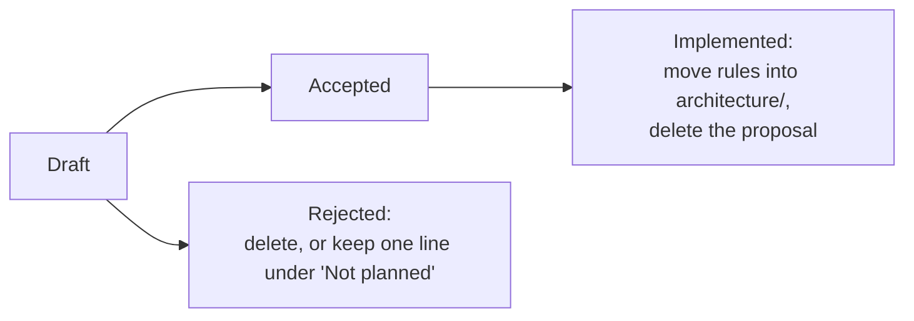

# Proposals

A proposal is a draft of an idea or design that has **not been decided or
built**. Proposals are where new directions get discussed before they change
the [architecture](../architecture/README.md).

## Lifecycle



- **Draft:** the idea is open for discussion. Nothing in it is a commitment.
- **Accepted:** the direction is agreed and can be built. Note the decision and
  the reason in the proposal.
- **Implemented:** move the lasting rules into the relevant `architecture/`
  page and delete the proposal. Git history keeps the discussion.

Keep proposals short. Discuss one decision at a time. Do not put test logs or
run evidence here.

## Layout

Most proposals fit in one file, `docs/proposals/<feature>.md`. When a proposal
is too complex for that, for example when it has several screens, flows or
alternatives to compare, give it its own folder:

```
docs/proposals/<feature>/
├── README.md          entry point: the template below, plus links to the other files
├── <topic>.md         optional deeper notes (data model, protocol, migration…)
├── <screen>.html      optional UI/UX wireframes
└── assets/            optional images used by the pages above
```

- **The folder name** is the feature in kebab-case, like single-file names.
  The index links to `<feature>/README.md`.
- **`README.md` is the decision record.** It holds the status, problem, options
  and open questions. The other files support it. Readers should not have to
  open the HTML to understand what is being decided.
- **Converting:** when a single-file proposal grows, move it to
  `<feature>/README.md` and update the index.

### HTML wireframes

Use HTML to wireframe UI/UX: layouts, states, responsive breakpoints and
interaction flows. Use it to compare options side by side.

- **Self-contained:** one file with inline CSS and JS, no build step and no
  network fetches (no CDNs or remote fonts). Opening it locally in a browser
  must work offline.
- **Use design-system values.** Mirror the [token](../architecture/design-system.md)
  names and values with CSS variables (`--background`, `--primary`, `--radius-md`,
  …) and the spacing, type and size scales. If a wireframe needs a new token,
  call it out in the proposal; don't invent values silently.
- **Show every state** that matters: loading, empty, failure, stale, focus,
  disabled. Show Dark and Light where it matters, and narrow and wide
  breakpoints.
- **Label each section** with a short heading and an anchor, so that the
  README can link to them (`streams.html#narrow`). Label alternatives
  "Option A/B".
- **Synthetic content only.** Never use real credentials, account data, or URLs
  that carry tokens.
- **Wireframes are not the product.** Native GPUI is the only UI. HTML never
  ships, and there are no HTML players or runtime web views.

**Implementing a folder proposal:** move the resulting rules into
`architecture/` (for UI work, into [ui.md](../architecture/ui.md) and the
[design system](../architecture/design-system.md)), and add native design-lab
scenes. Then delete the whole folder, wireframes included. Git history keeps
them.

## Template

```markdown
# Title

**Status:** Draft · **Area:** playback | data | providers | media | runtime | UI | platform

## Problem
What is wrong or missing, and for whom.

## Current state
What exists today (link the architecture page), and the constraints that apply.

## Options
1. Option. Trade-offs.
2. …

## Recommendation (optional)

## Open questions
```

## Index

| Proposal | Area | Status |
| --- | --- | --- |
| [Refresh, freshness and retention](refresh-and-retention.md) | data | Draft |
| [Debrid availability and rollout](debrid-availability.md) | providers | Draft |
| [Metadata coverage: locales, providers and facts](metadata-coverage.md) | providers / UI | Draft |
| [Media storage options](media-storage-options.md) | media | Draft |
| [Direct torrent playback](torrent-engine.md) | media | Draft |
| [External player discovery and reconnects](external-players.md) | playback | Draft |
| [Player enhancements](player-enhancements.md) | playback | Draft |
| [HDR playback](hdr-playback.md) | playback | Draft |
| [Watch history and data portability](watch-history-and-portability.md) | data | Draft |
| [Browse loading and backdrop](browse-loading-and-backdrop.md) | UI | Draft |
| [UI refinements](ui-refinements.md) | UI | Draft |
| [Notifications](notifications.md) | UI / platform | Draft |
| [Welcome wizard](welcome-wizard.md) | UI | Draft |
| [Visual baselines](visual-baselines.md) | tooling | Draft |
| [Performance budgets](performance-budgets.md) | all | Draft |
| [Cross-platform qualification](cross-platform-qualification.md) | platform | Draft |
| [Desktop releases and distribution](desktop-releases.md) | platform | Draft |
| [Keyring service name](keyring-service-name.md) | providers (debt) | Draft |
| [Player process isolation](player-process-isolation.md) | playback (debt) | Draft |
| [Cancellable networking](cancellable-networking.md) | runtime (debt) | Draft |
| [Mobile platforms](mobile-platforms.md) | platform | Draft |

## Roadmap

Planned work, grouped by theme. Each item links to the proposal that holds its
design. Remove an item once it ships and its rules are in `architecture/`.

**Playback**

- [ ] Seek-bar thumbnail previews: [player enhancements](player-enhancements.md)
- [ ] Qualify the player shortcuts on Windows, macOS and non-US layouts, then
  add configurable bindings: [player enhancements](player-enhancements.md)
- [ ] External subtitles (OpenSubtitles): search, download and load them in the
  player: [player enhancements](player-enhancements.md)
- [ ] Validate 4K, high-bitrate and hardware-decoded playback:
  [player enhancements](player-enhancements.md)
- [ ] HDR playback with correct output and tone mapping: [HDR playback](hdr-playback.md)
- [ ] Direct torrent playback with `librqbit` (currently an isolated proof of
  concept): [torrent engine](torrent-engine.md)

**UI**

- [ ] Native desktop notifications: [notifications](notifications.md)
- [ ] Redesign Streams and Settings, and polish the player chrome:
  [UI refinements](ui-refinements.md)
- [ ] Guided welcome wizard (tokens, debrid, cache): [welcome wizard](welcome-wizard.md)
- [ ] Smooth scrolling, next-page skeletons and a title backdrop:
  [browse loading and backdrop](browse-loading-and-backdrop.md)

**Data**

- [ ] Import and export of the Library and watch history, with safe merging,
  no credentials, and optional sync across devices:
  [watch history and portability](watch-history-and-portability.md)

**Engineering debt** (see the Known debt notes in architecture)

- [ ] Rename the keyring service from `kinema-next`: [keyring service name](keyring-service-name.md)
- [ ] Isolate native playback crashes from the app: [player process isolation](player-process-isolation.md)
- [ ] Make network requests interruptible: [cancellable networking](cancellable-networking.md)
- [ ] Back up or export personal records: [watch history and portability](watch-history-and-portability.md)
- [ ] Make settings writes durable on Windows and macOS: [cross-platform qualification](cross-platform-qualification.md)

**Platform and releases**

- [ ] Hands-on testing on Windows and macOS (embedded playback,
  notifications, keyring, packaging):
  [cross-platform qualification](cross-platform-qualification.md)
- [ ] Windows installer, macOS distribution, Linux AppImage, and a release
  pipeline triggered by tags: [desktop releases](desktop-releases.md)
- [ ] Investigate Android and iOS (UI framework, embedded playback, touch
  layouts). This is investigation only, with no support claim until it is
  validated on real devices: [mobile platforms](mobile-platforms.md)

## Not planned

These items are out of scope unless a new proposal makes the case for them:

- **LAN sharing:** the media server's security model is loopback-only with
  opaque routes.
- **Transcoding:** players decode; the server only delivers bytes.
- **A background daemon:** Kinema is one process, and quitting stops serving.
- **Runtime plugins:** adapters are compiled in behind small boundaries.
- **Federated indexer search:** one explicitly selected indexer keeps results
  attributable and bounded.
- **Explicit retained downloads, or rolling caches** beyond what the
  [media storage proposal](media-storage-options.md) covers: the cache is not
  offline storage.
- **Migration from the legacy C++ app:** clean breaks over compatibility shims.
