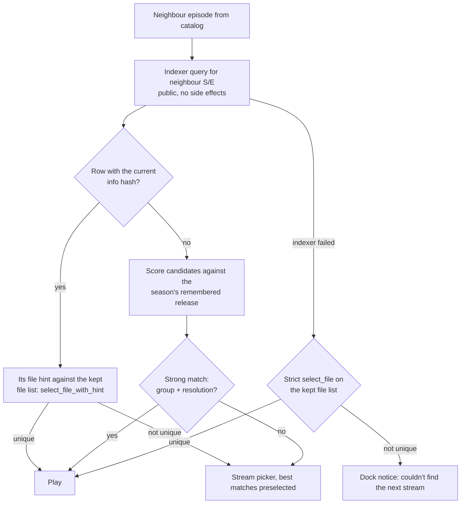

# Episode continuity

**Status:** Accepted · **Area:** playback / data / providers

Accepted 2026-11-07, revised 2026-11-08 after a proof of concept (below).
Reason: series playback needs no trip back to Detail, and file choice stays
explicit (same pack via indexer hints, strong release matches, otherwise the
picker).

## Problem

Watching a series means going back to Detail after every episode, picking the
next episode, then picking a stream again. The embedded player has no
Next/Previous controls, and Kinema forgets which release the user chose, so
Resume also makes the user pick a stream again.

## Current state

- Episode order comes from canonical season/episode rows;
  `kinema-core::watch_progress::next_up` already orders across seasons and
  skips specials ([playback](../architecture/playback.md#progress-and-resume)).
- A debrid preparation lists **every file** in the torrent
  (`PreparedTorrent.files`). The strict `kinema-core::sources::select_file`
  accepts only one standalone `SxxExx`/`NxNN` marker and rejects combined
  episodes. The session drops the preparation once playback starts.
- Torrentio episode results often contain season packs, with an episode
  `file_index`/`filename` hint and the pack's info hash.
- mpv supports `loadfile … replace` (`Player::load`), but the desktop calls it
  only once per window. **Nothing flushes progress on a source change today**;
  flushes happen on pause, seek, close and quit. The player is one window per
  lease, keyed by session ID and generation in the player registry.
- The player window holds the session's `PlaybackTarget`, which online
  subtitle search uses.
- OS media controls deliberately disable Next/Previous.
- Constraints: file choice must be unambiguous
  ([providers](../architecture/providers.md#debrid)); identity never comes from
  file names; indexer quality/size/seeders are unverified hints.

## Decisions so far

1. **Controls:** Next/Previous in the Cinema Dock, plus an **Up next** card
   shown when the episode ends, with a cancellable **5 s** countdown. Previous
   always goes to the previous episode (no "restart if past N seconds" rule;
   seeking to 0 already covers that). No "Are you still watching?" stop.
   Embedded player only; never for external players or untracked local files.
2. **Auto-pick:** play without asking when the stream comes from the same
   torrent, or is a **strong similar match** (same release group and same
   resolution). Otherwise open the episode's stream picker with the best
   matches preselected.
3. **Prefetch:** resolve the next episode early **only** when it is in the
   same pack (already in the debrid account, so no new side effects). Resolve
   only; download no bytes before the user commits.
4. **Persistence:** remember the last played release **per season** across
   restarts, and use it for Resume as well as Next/Previous. The stream list
   stays available as it is today: picking a stream there is the override, and
   becomes the new remembered choice. There is no separate "forget" action.
5. **Indexer file hints are trusted** as explicit identity, per indexer:
   - **Torrentio** hints (file name and index) are trusted under the existing
     `select_file_with_hint` guards.
   - **Peerflix** sends an index only, with no file name, so the index is
     trusted **only when the file's own `SxxExx`/`NxNN` marker equals the
     target episode**. Otherwise the picker opens. This applies to any
     index-only hint, whichever indexer sends it.
6. **Episode-marker reader fixes** ship first, as their own commit in the same
   PR, because they also improve today's stream picking (see below).
7. **The POC code is throwaway.** The implementation is rewritten from this
   proposal; the POC branch stays only as a reference.

## Design sketch

### Neighbour resolution (pure policy in `kinema-core`)

- **The indexer query comes first.** It is cheap and has no account side
  effects, and its per-episode hint covers packs whose files have no episode
  markers (`01.mkv`). The same-pack path then reuses the kept preparation, so
  it adds nothing new to the debrid account. Resolving early therefore means an
  indexer query, plus a file unlock only when the hash matches.
- **Hints are trusted, within the existing guards:** an exact basename match,
  Real-Debrid file indices only (AllDebrid IDs are synthetic), and a hint is
  rejected when the file name carries a contradicting or combined episode
  marker. An index-only hint also needs a matching full marker (decision 5).
  A missing or rejected hint falls back to the strict marker rule.
- **An indexer failure is not an empty result.** Fall back to the strict
  marker rule on the kept file list, and otherwise show a notice instead of a
  picker built from no results.

- Release traits are parsed from the release name into a `ReleaseTraits`
  (group, resolution, source, codec, HDR/DV, audio). Scoring is ordered:
  group, resolution, source, codec, HDR flags, audio, size ratio, then seeders
  as the last tiebreak. A missing trait never counts as a match.
- Choosing a torrent by score is new behavior. The file inside it is still
  chosen only by the existing unambiguous rules, so `Ambiguous`/`NotFound` falls
  back to the picker, never to a guess.
- The UI says why a stream was chosen ("Same pack", "Same release group ·
  1080p WEB-DL").

### Episode-marker reader fixes (`kinema-core::sources`)

The POC found these false refusals of correct hints (about 280 of 725
refusals in the sample):

- `WxH` resolutions read as `NxNN`: `1448x1080`, `966x720`. A side of 3 or more
  digits on the season, or 4 on the episode, is not a marker.
- `s<digit>` embedded inside a word (`FS88`) treated as a malformed marker.
  Only a token that starts with `s` counts.
- Revision suffixes rejected: `S01E05v2` is S01E05.

Keep refusing combined episodes (`S01E01E02`, `S01E01-02`, `1x16 - 1x17`) and
contradicting markers. Pin each case with fixture tests.

### Player transition

- The window stays and the source is swapped. The sequence is:
  1. **Flush** the old run's progress explicitly (`flush_progress`); the save
     must be acknowledged, not dropped.
  2. Register the new lease; the old one is still held, so two leases exist
     briefly (well under `MAX_SESSIONS`; two leases in one pack share an
     asset).
  3. Re-key the window in the player registry under the new session ID with a
     **new generation**, and tombstone the old session ID so late events from
     it can't reopen or update a window.
  4. Start a new run for the new `Episode` subject, and update the window's
     `PlaybackTarget`, title and OS media session. *Why:* subtitle search and
     progress both read the target; a stale one searches or saves against the
     old episode.
  5. `Player::load` (`loadfile replace`), with the paused-load and resume
     sequence reapplied.
  6. Release the old lease **exactly once**, after the new episode is ready.
     If the swap fails, release the new lease and keep the old episode.

  Late samples from the old run are rejected by generation and subject. This
  refines "one window per lease" into "one lease per window at a time".
- The kept debrid preparation (the file list) belongs to the window, not the
  stream sheet. It is cancelled when the window closes, when the swap leaves the
  pack, and when the account changes.
- Audio/subtitle choices carry over by language and flags, never by track ID.
- Next/Previous are disabled when there is no neighbour, and show a busy state
  while resolving. A failure shows a dock notice and leaves the current episode
  playing.
- Progress rules do not change: skipping early never marks watched; a
  neighbour with saved progress resumes through the normal resume sequence.
- OS media controls advertise Next/Previous only when the dock does, and route
  them as the same commands.
- The Up next countdown is owned by the player window on the UI executor, is
  cancelled by any user input or close, and animates only through
  `ui::motion` presets.

### Persisted release preference (High risk: schema)

- A new personal record per season `(series, season)`: the last played info
  hash and its `ReleaseTraits`. Per episode, the last played `MediaIdentity`
  (hash, provider file path, size). Every play overwrites both, whether the
  stream was picked by hand or chosen automatically.
- Resume tries the remembered episode stream first, then the season's
  release; a duration mismatch still asks the user.
- **Crossing into a new season:** that season has no remembered release yet,
  so score against the previous season's traits. The same-hash path still
  covers complete-series packs.
- It is independent of watched state and progress: **Clear saved progress**
  and Library removal leave it alone.
- It is a personal record: excluded from cache, media, artwork and refresh
  cleanup, never logged (hashes are not on the logging allowlist), and never
  holds URLs or debrid file IDs.

## Proof of concept findings (2026-11-08)

Branch `poc/episode-continuity` (reference only). 640 requests over 8 series
and 160 episodes (sitcom packs, drama, unnumbered anime, miniseries), with
loopback fixtures anonymized from the captures.

| | Torrentio | Peerflix |
| --- | --- | --- |
| Rows with a file name | 99.9% | 0% |
| Rows with a file index | 99.9% | ~87% |
| Wrong file chosen from a hint | 0 | 1 wrong index seen |

- Against rebuilt pack file lists, Torrentio hints chose the right file 8,202
  times and were refused 725 times (all safe; most are reader bugs above).
- Starting from a pack, 146 of 148 next-episode steps stayed in the same pack.
  Starting from a single-episode release, 44 of 145 were strong matches
  (checked by hand: same release family, similar size), and the rest went to
  the picker.
- Trait coverage: resolution 80%, source 78%, codec 63%, group 57%, audio 28%,
  HDR 5%. Groups are weakest on non-English titles, which costs pickers, never
  wrong picks.

## Build order

1. **Marker reader fixes** with fixture tests (decision 6).
2. Pure policies in `kinema-core`: neighbour order, `ReleaseTraits` parsing
   and scoring, the index-only hint rule, the resolution flow.
3. The per-season release record and its migration (High risk).
4. Player: source swap in the same window, Next/Previous, Up next, track
   carry-over, OS media controls.

## Later

- Up next appears at end of file, so the credits play out first; the user can
  press Next at any time. Showing it earlier (a credits chapter, or the last N
  seconds) can follow if needed.
